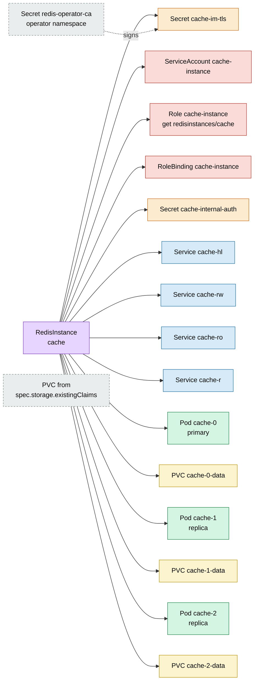
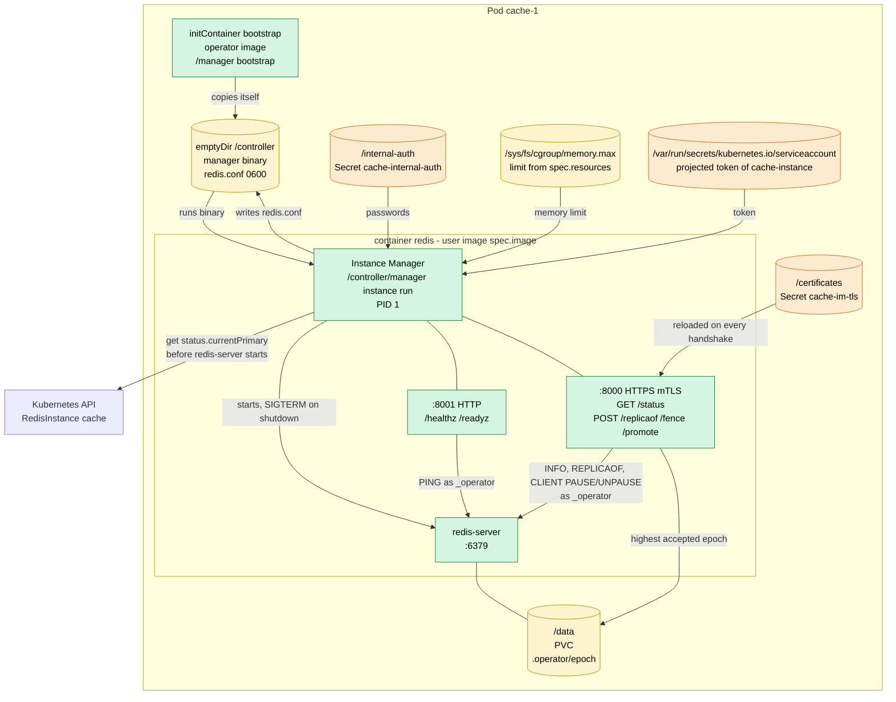
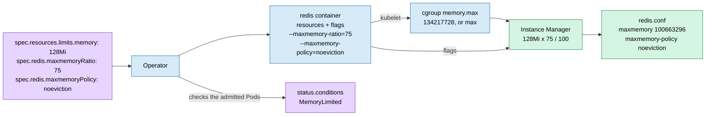
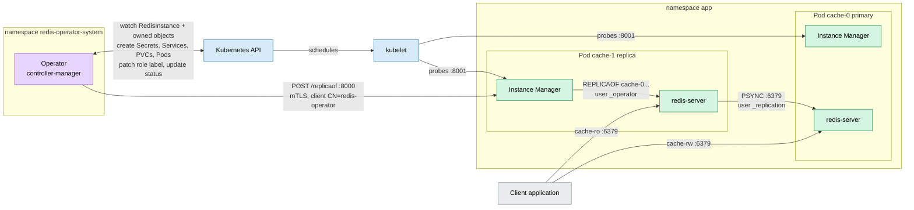

# Architecture

How the operator, the Instance Manager and the Kubernetes objects of a
`RedisInstance` work together. The diagrams use the example instance
`cache` with `instances: 3` in namespace `app`.

## Resource tree (ownership)

Like the Argo CD resource tree: every arrow is an `ownerReference`
(`controller: true`), so deleting the `RedisInstance` garbage-collects
everything under it. Grey dashed boxes are not owned by the instance.



How the objects use each other:

| Object                      | Content                                         | Used by                                                  |
|-----------------------------|-------------------------------------------------|----------------------------------------------------------|
| Secret `redis-operator-ca`  | CA cert and key                                 | operator: signs `cache-im-tls` and its own client certs  |
| ServiceAccount `cache-instance` | token of the Instance Managers           | every Pod (`serviceAccountName`), redis container only   |
| Role / RoleBinding `cache-instance` | `get` on `redisinstances/cache` only  | the Instance Manager reads `status.currentPrimary`       |
| Secret `cache-im-tls`       | `tls.crt`, `tls.key`, `ca.crt`                  | every Pod, mounted at `/certificates`                    |
| Secret `cache-internal-auth`| `operator-password`, `replication-password`     | every Pod at `/internal-auth`; operator for `REPLICAOF`  |
| Service `cache-hl`          | headless                                        | stable DNS `cache-N.cache-hl.app.svc` for every Pod      |
| Service `cache-rw`          | selects `redis.operator.com/role=primary`       | clients that write                                       |
| Service `cache-ro`          | selects `redis.operator.com/role=replica`       | clients that only read                                   |
| Service `cache-r`           | selects every Pod                               | clients that read from any instance                      |
| PVC `cache-N-data`          | Redis data                                      | Pod `cache-N`, mounted at `/data`                        |

A PVC from `spec.storage.existingClaims` takes the place of the generated
`cache-N-data`; the operator never owns or deletes it (see [Volumes](#volumes)).
On scale-down the operator deletes the extra Pods and their generated PVCs,
but never the primary: if the primary is above the new `spec.instances`, it stays and the
operator emits a `Warning` Event `ScaleDownBlocked` until you
[switch over](#switchover) to a remaining instance.

There is no ConfigMap: the Instance Manager builds `redis.conf` inside the
Pod from the mounted Secrets.

## Inside a Pod



The init container copies the operator binary into a shared `emptyDir`, so
the redis container can run the Instance Manager with any Redis image.

## Safe start

Before it starts `redis-server`, the Instance Manager reads
`status.currentPrimary` of its own `RedisInstance` (waiting until the operator
has set it):

- **This Pod is the primary:** `redis.conf` has no `replicaof`.
- **Another Pod is:** `redis.conf` gets `replicaof <primary>.cache-hl.app.svc 6379`,
  so a restarted replica never runs as a primary, not even for a moment, and
  takes no writes on a stale dataset.

The Pod keeps `automountServiceAccountToken: false`. The operator mounts a
projected token of `cache-instance` into the redis container only, at the path
client-go expects, so the init container gets no token. The Role allows `get`
on this one `RedisInstance` and nothing else.

`redis.conf` turns off the passwordless `default` user (unless
`spec.acl.defaultUser: enabled`) and defines two internal users:

| User           | Rights                         | Used by                                      |
|----------------|--------------------------------|----------------------------------------------|
| `_operator`    | `+@all`                        | Instance Manager                              |
| `_replication` | `+psync +replconf +ping`       | replicas syncing from the primary            |

## Memory

Redis keeps the whole dataset in RAM, so `maxmemory` must fit the container
memory limit. Without it Redis grows until the kernel OOMKills it, instead of
rejecting writes or evicting keys.



- **`maxmemory = memory limit × maxmemoryRatio / 100`.** The ratio defaults
  to 75 and may be 10–95. The rest is left for fork copy-on-write (BGSAVE,
  AOF rewrite), replication and client buffers, and fragmentation.
- **The limit comes from cgroup v2**, not the Downward API: without a limit
  `resourceFieldRef: limits.memory` gives the node memory, while
  `memory.max` gives `max`. The cgroup also shows a default limit set by a
  LimitRange. Nodes with cgroup v1 are not supported.
- **`maxmemoryPolicy`** defaults to `noeviction`: Redis rejects writes
  instead of silently deleting keys. Pick `allkeys-lru` or `allkeys-lfu` for a
  cache.
- **No memory limit:** `maxmemory 0` (no limit). The instance still starts,
  for development, but the condition `MemoryLimited` turns `False` and the
  operator emits one `Warning` Event `MemoryLimitMissing`.
- **Changes** reach only new Pods for now: the Instance Manager writes the
  settings to `redis.conf` at start. Applying them live with `CONFIG SET`
  comes with the rolling update (step 3).

## Runtime cooperation



## Epoch

`status.primaryEpoch` grows with every change of the primary: today with every
[switchover](#switchover), from step 4 also with every failover. Every command
of the operator to an Instance Manager (`/replicaof`, `/fence`, `/promote`)
carries it:

- The Instance Manager stores the highest epoch it has accepted on the PVC
  (`/data/.operator/epoch`, written atomically with fsync and rename), so it
  survives restarts of the Pod.
- A command with a lower epoch gets `409 Conflict` and is not run. This stops
  a late request of a former operator leader from undoing a failover.
- Commands run one at a time, so one of an older epoch never runs after a
  newer one.

The operator no longer connects to Redis itself: `REPLICAOF` goes through
`POST /replicaof`, which is idempotent and does nothing when the replica
already follows the requested primary.

## Volumes

You choose the volumes when you create the `RedisInstance`; after that the
operator alone manages them. `spec.storage.existingClaims` cannot be changed
(the API server rejects it), so no edit can put a running instance on another
volume by mistake.

```yaml
spec:
  storage:
    volumeClaimTemplate: {size: 5Gi}
    existingClaims:
      - {instanceOrdinal: 0, claimName: cache-restored}   # e.g. restored from a snapshot
      - {instanceOrdinal: 3, claimName: cache-spare}      # reserved: used when scaling up to 4
status:
  volumes:
    - {ordinal: 0, claimName: cache-restored, uid: 7f3a…, external: true, state: Ready}
    - {ordinal: 1, claimName: cache-1-data,   uid: 91bc…, state: Ready}
    - {ordinal: 2, claimName: cache-2-data,   uid: c0de…, state: Ready}
```

`status.volumes` is the memory of the operator. An instance is bound to a
volume once, when it first needs one: the claim from `existingClaims`, or
else a PVC generated from `volumeClaimTemplate`. The UID of the PVC is
recorded before any Pod mounts it, and a Pod is only created on a volume that
is `Ready`.

| `state` | Meaning |
|---|---|
| `Ready` | The PVC exists, has the recorded UID and is not being deleted. |
| `Terminating` | The PVC is being deleted, but the Pod still uses it (`pvc-protection`). The Pod keeps running. |
| `Missing` | The PVC does not exist, or a PVC with its name has another UID: it was deleted and created again and holds other data. The instance gets no Pod. |
| `Lost` | The PVC lost its PersistentVolume. |
| `Detached` | An external PVC of an instance removed by a scale-down. It is mounted again on the next scale-up. |

The condition `StorageReady` is `False` while any instance's volume is not
`Ready` (`Detached` does not count), and lists them in its message. Entering
such a state emits a `Warning` Event `VolumeUnavailable`.

What the operator does on its own:

- **Scale-down:** a generated PVC is deleted with its binding (the data of a
  replica can be synced again); an external PVC stays, bound and `Detached`.
- **Scale-up:** an instance with a binding gets the same PVC back (same UID
  only); otherwise the claim from `existingClaims`, or a new generated PVC.
- **A generated PVC of a replica is gone and the Pod with it:** a new empty PVC
  is generated (Event `VolumeRecreated`) and the replica does a full sync.
- **A generated name is taken by a PVC the operator did not create:** never
  adopted, the instance stays `Missing` until you delete or rename that PVC.
- **The volume of the primary is gone:** never replaced on its own, because an
  empty primary would make every replica drop its data in a full resync. The
  primary keeps running while its PVC is `Terminating`: [switch over](#switchover)
  to a replica, then delete the old primary's Pod, and it comes back as a
  replica on a new volume. Once the Pod is gone too, only failover (step 4)
  can move the primary.

The only way to change the volume of an instance is to recreate a replica:

```sh
kubectl annotate redisinstance cache redis.operator.com/recreate=cache-2
```

The operator deletes the Pod and its generated PVC (an external PVC is only
let go, never deleted), binds the instance to a new generated PVC and starts
it there; the replica syncs from the primary. It rejects the request (Event
`RecreateRejected`) for the primary, during a switchover, and without a
`volumeClaimTemplate`.

Known limits:

- **`status.volumes` does not survive every restore.** A `RedisInstance`
  re-created from git or Velero starts with an empty status. The operator
  rebuilds the bindings from the spec, with the same result, except that an
  instance moved by `recreate` goes back to its external PVC, and a PVC
  replaced meanwhile is not detected (its UID is recorded anew).
- **Foreign data at creation is not detected.** The operator cannot tell
  whether an external PVC belonged to this database. A replica overwrites it
  in its full sync, so data on a PVC of another database given by mistake is
  lost. A wrong primary is caught only by the safe start of step 4.
- **One PVC in two `RedisInstance`s** is not detected yet.
- An external PVC of an instance in the middle cannot be replaced without a
  `volumeClaimTemplate`.

## Switchover

A switchover moves the primary to a replica while both are healthy, with no
lost writes. Use it before maintenance of the primary's node; the rolling
update (step 3) and failover (step 4) build on it.

```sh
kubectl annotate redisinstance cache redis.operator.com/promote=cache-1
kubectl get redisinstance cache -o jsonpath='{.status.currentPrimary}'   # cache-1 once done
```

The operator removes the annotation when the switchover has completed or
failed; the outcome is in the condition `Switchover` and in the Events.

```mermaid
sequenceDiagram
    autonumber
    participant U as User
    participant OP as Operator
    participant API as Kubernetes API
    participant OLD as IM cache-0 (primary)
    participant NEW as IM cache-1 (target)

    U->>API: annotate promote=cache-1
    OP->>OP: validate: a primary exists, target is not it,<br/>target is a Ready Pod of the instance
    OP->>API: status: targetPrimary=cache-1, primaryEpoch 1→2,<br/>Switchover=True (before any command)
    loop every second until caught up
        OP->>NEW: GET /status
        OP->>OLD: POST /fence {epoch 2}
        Note over OLD: CLIENT PAUSE WRITE:<br/>writes wait, reads and replication go on
        OP->>OLD: GET /status
        Note over OP: caught up: same replID,<br/>target offset ≥ primary offset
    end
    OP->>NEW: POST /promote {epoch 2}
    Note over NEW: REPLICAOF NO ONE, CLIENT UNPAUSE
    OP->>API: status: currentPrimary=cache-1, targetPrimary="",<br/>Switchover=False/Completed; remove annotation
    OP->>OLD: POST /replicaof {epoch 2, cache-1}
    Note over OLD: REPLICAOF cache-1, CLIENT UNPAUSE:<br/>waiting writes get READONLY
    OP->>API: next reconcile: move role labels,<br/>so cache-rw selects cache-1
```

Why the steps are in this order:

- **Fence first.** Replication is asynchronous, so the replica is always a
  little behind. While the primary is fenced its offset stops growing, so
  "the target has the same offset" means "the target has every write".
- **Writes wait instead of failing.** Clients see a pause, usually well under
  a second, not errors. After the demotion the waiting writes get
  `READONLY`, so none of them land on the old primary.
- **The epoch is stored before the first command.** No Instance Manager ever
  sees an epoch the status does not hold, and the status update fails on a
  stale `resourceVersion`, so two operator leaders cannot both start a
  switchover.
- **Every step can be repeated.** After a crash of the operator, the next
  reconcile continues from `status.targetPrimary`. A target that already
  reports `role:master` was promoted by an earlier pass, so the operator only
  finishes.

The operator rejects the request (Event `SwitchoverRejected`, annotation
removed, nothing changed) when the instance has no primary yet, the target is
already the primary, is not a Pod of this instance, or is not Ready.

If the target does not catch up within a minute (e.g. its link to the primary
is down), the switchover fails: the operator lifts the fence, so the primary
takes writes again, sets `Switchover=False` with reason `Failed` and emits a
`Warning` Event `SwitchoverFailed`.

Known limits:

- A restart of the old primary during a switchover loses the fence, which
  lives in the `redis-server` process. Safe start of a primary comes with
  failover (step 4).
- The fence lasts at most an hour if the operator never follows up; the
  timeouts are fixed in code.
- `cache-rw` follows the role label, which the next reconcile moves. Until
  then it points at the old primary, which answers `READONLY`.

## Reconcile loop

One pass of `RedisInstanceReconciler.Reconcile`. The operator re-runs it on
every change of the `RedisInstance` or an owned object, and requeues after
5 s while replication is not set up (every second during a switchover).
The primary is the Pod in `status.currentPrimary` (`cache-0` for a new
instance).

```mermaid
sequenceDiagram
    autonumber
    participant OP as Operator
    participant API as Kubernetes API
    participant IM as Instance Manager (replica)
    participant RS as redis-server (replica)

    Note over OP: On start: EnsureCA loads or creates<br/>Secret redis-operator-ca
    OP->>API: Get RedisInstance
    OP->>API: CreateOrUpdate Secret cache-im-tls<br/>(new cert when missing or past 2/3 of lifetime)
    OP->>API: CreateOrUpdate Secret cache-internal-auth<br/>(generate only missing passwords)
    OP->>API: CreateOrUpdate ServiceAccount, Role, RoleBinding cache-instance
    OP->>API: Ensure Services hl, rw, ro, r
    opt recreate annotation
        OP->>API: Delete Pod and generated PVC, bind to a new generated PVC
    end
    loop each ordinal
        OP->>API: Bind a volume (status.volumes), create a generated PVC if needed,<br/>observe the PVC (UID, deletion, Lost)
    end
    OP->>API: Update status if the bindings changed
    loop each ordinal
        OP->>API: Create Pod (only on a Ready volume), or patch its role label
    end
    OP->>API: Delete Pods and generated PVCs above spec.instances (never the primary)
    opt promote annotation or status.targetPrimary set
        OP->>OP: one step of the switchover (see Switchover)
    end
    loop each Running replica (Ready or not: a replica becomes Ready only after its first sync)
        OP->>IM: POST /replicaof {epoch, primaryHost} (mTLS)
        alt epoch lower than the one IM accepted
            IM-->>OP: 409 Conflict
        else
            IM->>IM: store epoch in /data/.operator/epoch
            IM->>RS: INFO replication
            opt not replicating from the primary
                IM->>RS: REPLICAOF <primary>.cache-hl.app.svc 6379
            end
            IM->>RS: CLIENT UNPAUSE (lifts the fence of a demoted primary)
            IM-->>OP: {changed}
        end
    end
    OP->>API: Update status if changed (readyInstances, phase, currentPrimary,<br/>primaryEpoch, MemoryLimited, StorageReady and Switchover conditions)
    opt a Pod has no memory limit (first time)
        OP->>API: Warning Event MemoryLimitMissing
    end
```


