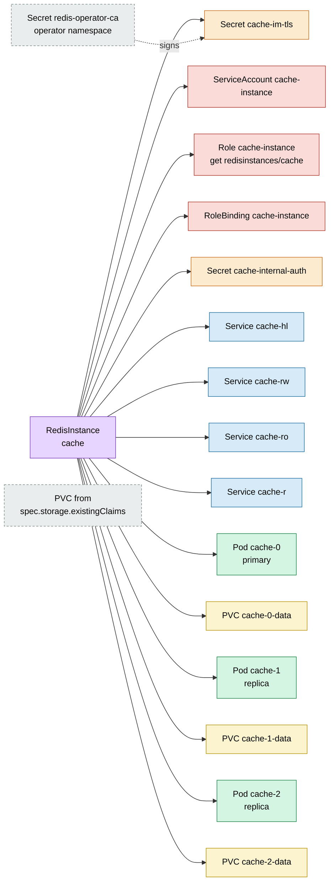
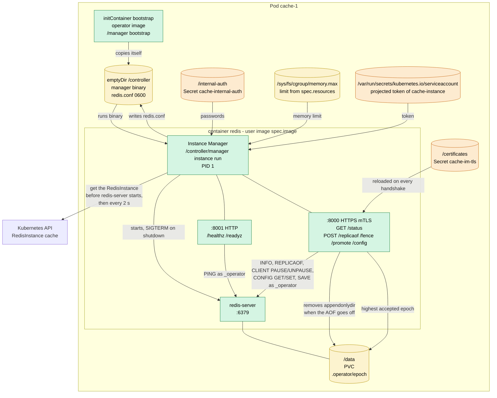
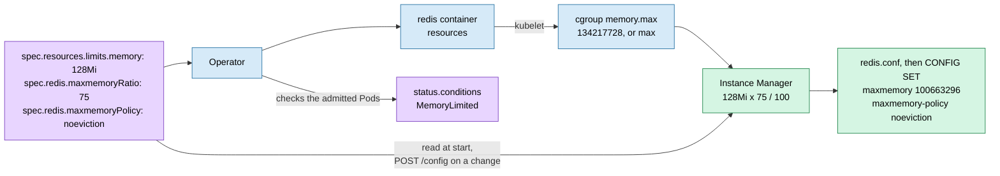
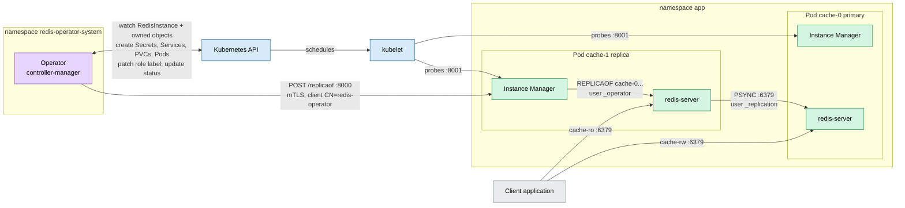
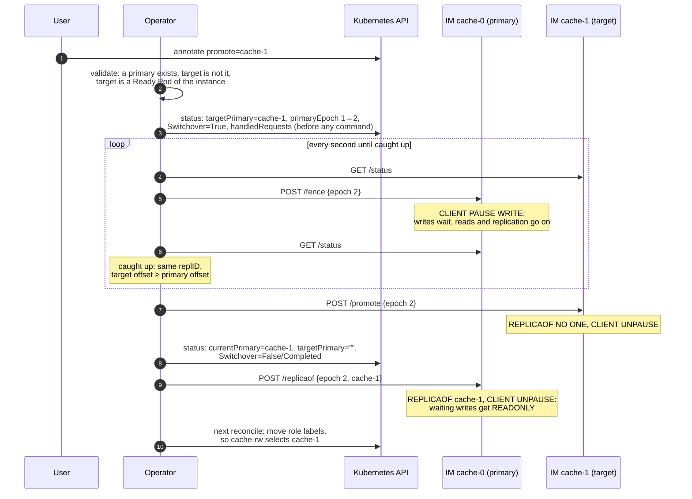
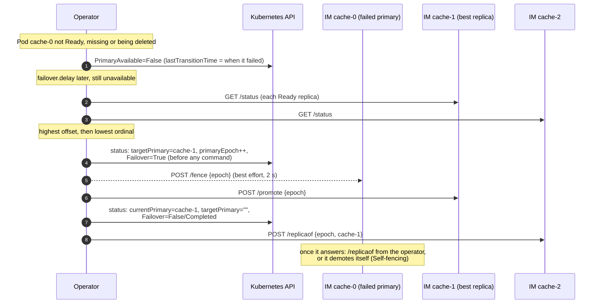
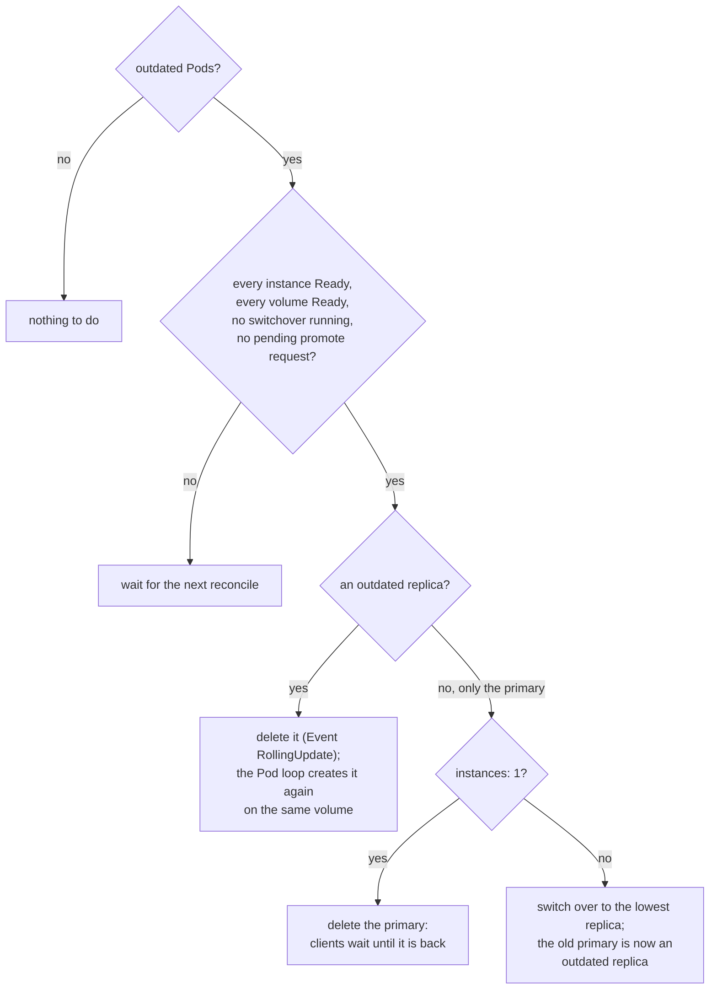
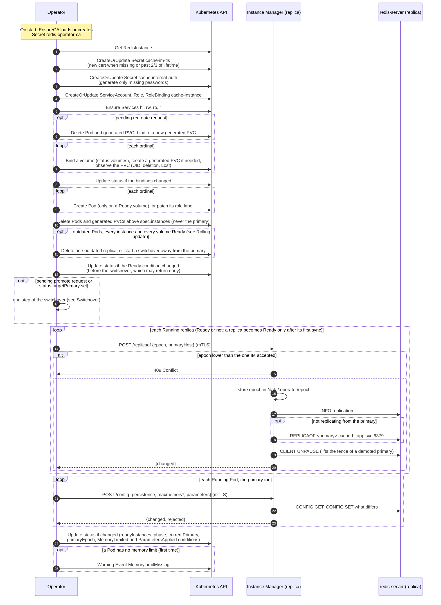

# Architecture

How the operator, the Instance Manager and the Kubernetes objects of a
`RedisInstance` work together. The diagrams use the example instance
`cache` with `instances: 3` in namespace `app`.

## Resource tree (ownership)

Like the Argo CD resource tree: every arrow is an `ownerReference`
(`controller: true`), so deleting the `RedisInstance` garbage-collects
everything under it. Grey dashed boxes are not owned by the instance.



How the objects use each other:

| Object                      | Content                                         | Used by                                                  |
|-----------------------------|-------------------------------------------------|----------------------------------------------------------|
| Secret `redis-operator-ca`  | CA cert and key                                 | operator: signs `cache-im-tls` and its own client certs  |
| ServiceAccount `cache-instance` | token of the Instance Managers           | every Pod (`serviceAccountName`), redis container only   |
| Role / RoleBinding `cache-instance` | `get` on `redisinstances/cache` only  | the Instance Manager reads its `RedisInstance` at start  |
| Secret `cache-im-tls`       | `tls.crt`, `tls.key`, `ca.crt`                  | every Pod, mounted at `/certificates`                    |
| Secret `cache-internal-auth`| `operator-password`, `replication-password`     | every Pod at `/internal-auth`; operator for `REPLICAOF`  |
| Service `cache-hl`          | headless                                        | stable DNS `cache-N.cache-hl.app.svc` for every Pod      |
| Service `cache-rw`          | selects `redis.operator.com/role=primary`       | clients that write                                       |
| Service `cache-ro`          | selects `redis.operator.com/role=replica`       | clients that only read                                   |
| Service `cache-r`           | selects every Pod                               | clients that read from any instance                      |
| PVC `cache-N-data`          | Redis data                                      | Pod `cache-N`, mounted at `/data`                        |

Every Pod carries the labels `app.kubernetes.io/name=redis`,
`redis.operator.com/instance=cache` and `redis.operator.com/role`
(`primary`/`replica`); the Services select by the last two. They are stable,
so NetworkPolicies may use them. The operator does not set
`app.kubernetes.io/instance`, which Argo CD uses for its own tracking.

A PVC from `spec.storage.existingClaims` takes the place of the generated
`cache-N-data`; the operator never owns or deletes it (see [Volumes](#volumes)).
On scale-down the operator deletes the extra Pods and their generated PVCs,
but never the primary: if the primary is above the new `spec.instances`, it stays and the
operator emits a `Warning` Event `ScaleDownBlocked` until you
[switch over](#switchover) to a remaining instance.

There is no ConfigMap: the Instance Manager builds `redis.conf` inside the
Pod from the mounted Secrets.

## Inside a Pod



The init container copies the operator binary into a shared `emptyDir`, so
the redis container can run the Instance Manager with any Redis image.

## Safe start

Before it starts `redis-server`, the Instance Manager reads its own
`RedisInstance`, waiting until the operator has set `status.currentPrimary`:

- **This Pod is the primary:** `redis.conf` has no `replicaof`.
- **Another Pod is:** `redis.conf` gets `replicaof <primary>.cache-hl.app.svc 6379`,
  so a restarted replica never runs as a primary, not even for a moment, and
  takes no writes on a stale dataset.
- **`spec.redis`:** `redis.conf` gets `maxmemory*`, `spec.redis.startup` and
  `appendonly` (yes only when an AOF is on the volume). After the start, the
  Instance Manager applies the whole configuration with `CONFIG SET` (see
  [Configuration](#configuration-and-persistence-step-35)); `/readyz` answers
  only then, so no client sees the defaults of Redis.

### A restarted primary waits for approval

A primary that comes back with an empty or old dataset is the classic way
Redis loses data: its replicas connect, find a history they do not know, do
a full resync and drop everything they hold. So a Pod that starts as the
primary lets no replica sync: `redis.conf` turns the `_replication` user
off, and `/readyz` fails until the operator decides.

The operator compares the primary (`GET /status`: replication ID, offset,
number of keys) with the Ready replicas:

| Situation | Decision |
|---|---|
| no Ready replica | approve: nothing better to promote |
| same replication ID, offset not behind any replica | approve: a partial resync |
| every replica is empty | approve: nothing to lose |
| the primary is empty, a replica is not | **failover** to the best replica |
| `persistence: aof` and the primary loaded keys | approve: its AOF is at most ~1 s behind the crash, like a replica |
| `persistence: rdb` or `none` | **failover**: a snapshot may be minutes older than the replicas |

Approving is `POST /promote`: it turns the `_replication` user on, and the
Pod becomes Ready. Whether a primary waits for approval is a state of the
Instance Manager process, set when it starts as the primary, not read from
the ACL: a user who turns `_replication` off by hand is not overruled. A failover goes as in [Failover](#failover), with the
reason in the condition `Failover`; the old primary then syncs from the new
one.

Why not compare offsets alone: Redis 7.2 starts with a new replication ID and
an offset from 0 after every restart, a clean shutdown as well as a crash,
when it loads an AOF. The offsets of the replicas then tell nothing, so the
size of the dataset and how it was kept decide.

Known limits: an AOF that Redis loads only in part (`aof-load-truncated`)
still has keys and is approved; while the operator is down, a restarted
primary stays not Ready.

The Pod keeps `automountServiceAccountToken: false`. The operator mounts a
projected token of `cache-instance` into the redis container only, at the path
client-go expects, so the init container gets no token. The Role allows `get`
on this one `RedisInstance` and nothing else.

`redis.conf` turns off the passwordless `default` user (unless
`spec.acl.defaultUser: enabled`) and defines two internal users:

| User           | Rights                         | Used by                                      |
|----------------|--------------------------------|----------------------------------------------|
| `_operator`    | `+@all`                        | Instance Manager                              |
| `_replication` | `+psync +replconf +ping`       | replicas syncing from the primary            |

## Memory

Redis keeps the whole dataset in RAM, so `maxmemory` must fit the container
memory limit. Without it Redis grows until the kernel OOMKills it, instead of
rejecting writes or evicting keys.



- **`maxmemory = memory limit × maxmemoryRatio / 100`.** The ratio defaults
  to 75 and may be 10–95. The rest is left for fork copy-on-write (BGSAVE,
  AOF rewrite), replication and client buffers, and fragmentation.
- **The limit comes from cgroup v2**, not the Downward API: without a limit
  `resourceFieldRef: limits.memory` gives the node memory, while
  `memory.max` gives `max`. The cgroup also shows a default limit set by a
  LimitRange. Nodes with cgroup v1 are not supported.
- **`maxmemoryPolicy`** defaults to `noeviction`: Redis rejects writes
  instead of silently deleting keys. Pick `allkeys-lru` or `allkeys-lfu` for a
  cache.
- **No memory limit:** `maxmemory 0` (no limit). The instance still starts,
  for development, but the condition `MemoryLimited` turns `False` and the
  operator emits one `Warning` Event `MemoryLimitMissing`.
- **Changes** of `maxmemoryRatio` or `maxmemoryPolicy` apply live with
  `CONFIG SET`. A change of `resources` changes the Pod, so it goes through
  the [rolling update](#rolling-update).

### Configuration and persistence (step 3.5)

```yaml
spec:
  redis:
    persistence: aof            # aof (default) | rdb | none
    startup:                    # read only at start: a change replaces the Pods
      databases: 16
      ioThreads: 1
    parameters:                 # further options of redis.conf
      hz: "20"
      notify-keyspace-events: Ex
```

The Instance Manager applies this configuration with `CONFIG SET` when a Pod
starts, before it reports Ready, and the operator sends it to every running
Pod on each reconcile (`POST /config`), so a change reaches Redis without a
restart; only what differs is set. A wrong value is reported
in the condition `ParametersApplied`; it never stops `redis-server`, as a bad
line in `redis.conf` would.

`parameters` rejects the options the operator manages: ports and sockets,
`dir` and data files, replication, users and passwords, `maxmemory*` (own
fields), `appendonly` and `save` (`persistence`), `tls-*`, `cluster-*`,
`include`, `rename-command`, `loadmodule` and `enable-*-command`. Values are
one line.

Some options cannot change while Redis runs (Redis 7.2 answers
`can't set immutable config`). **Only two of them are supported today**, as
typed fields in `startup`: `databases` and `ioThreads`, with the defaults of
Redis. They go
into `redis.conf`, so changing one replaces every Pod in a
[rolling update](#rolling-update); `parameters` rejects them. The other
immutable options (`tcp-backlog`, `disable-thp`, `set-proc-title`,
`always-show-logo`, `syslog-*`) have no field and cannot be set: in
`parameters` they end up in `ParametersApplied=False`. A field is added when
someone needs one.

| `persistence` | Redis | Lost on a crash |
|---|---|---|
| `aof` | `appendonly yes`, `appendfsync everysec`, plus RDB snapshots | up to ~1 s of writes |
| `rdb` | RDB snapshots only | the writes since the last snapshot |
| `none` | `appendonly no`, `save ""` | everything (a cache) |

Switching modes is where Redis loses data, so the Instance Manager never
lets `redis.conf` decide:

- **Redis started with `appendonly yes` on a dataset kept only in RDB starts
  empty**: it reads only the AOF. So `redis.conf` turns AOF on only when an
  AOF exists on the volume; to enable it, the Instance Manager runs
  `CONFIG SET appendonly yes` after the start, and Redis writes the AOF from
  memory.
- **An AOF left on the volume after it was turned off** would be loaded on
  the next start and lose every write made since. So turning AOF off is
  `CONFIG SET appendonly no`, then `SAVE`, then removing `appendonlydir`.

With `none`, a `dump.rdb` already on the volume stays and a restart loads it.

## Runtime cooperation



## Epoch

`status.primaryEpoch` grows with every change of the primary: today with every
[switchover](#switchover), from step 4 also with every failover. Every command
of the operator to an Instance Manager (`/replicaof`, `/fence`, `/promote`)
carries it:

- The Instance Manager stores the highest epoch it has accepted on the PVC
  (`/data/.operator/epoch`, written atomically with fsync and rename), so it
  survives restarts of the Pod.
- A command with a lower epoch gets `409 Conflict` and is not run. This stops
  a late request of a former operator leader from undoing a failover.
- Commands run one at a time, so one of an older epoch never runs after a
  newer one.

The operator no longer connects to Redis itself: `REPLICAOF` goes through
`POST /replicaof`, which is idempotent and does nothing when the replica
already follows the requested primary.

## Self-fencing

The operator may not reach a primary, e.g. during a network partition, so
every Instance Manager also watches its own role: it reads its
`RedisInstance` every 2 seconds, which also tells it whether the API server
is reachable.

```yaml
spec:
  failover:
    delay: 30s            # default; at least 4s
    fenceOnAPILoss: true  # default
```

| Redis | The read of the `RedisInstance` | The Instance Manager |
|---|---|---|
| replica | any | does nothing: the operator manages replicas |
| primary | `status.currentPrimary` names another Pod, and no switchover or failover runs | **demotes itself**: `REPLICAOF` the new primary, under the epoch guard of the API |
| primary | failing for more than `delay/2` | **fences itself** (`CLIENT PAUSE WRITE`, renewed while it lasts) |
| primary | works again, after it fenced itself | lifts its own fence, unless a switchover runs (that fence is the operator's) |

- **Half the delay.** The operator promotes a replica only after `delay`
  (see [Failover](#failover)), so a primary cut off from the API server has stopped
  taking writes by then: no two primaries take writes at once.
- **`fenceOnAPILoss: false`** keeps writes going while the API server is
  down, at the risk of two primaries taking writes during a partition. It is
  a choice per instance; the default favours the data.
- **Not while the primary moves.** A Pod the operator has just promoted still
  reads the old `currentPrimary` until the operator records the new one; with
  `status.targetPrimary` set, the Instance Manager leaves its role alone.
- **Any failed read counts,** a timeout as well as a `403`: the Instance
  Manager cannot tell an API server that is down from one it cannot reach.
- **A restart of the operator, or of the API server for less than
  `delay/2`, changes nothing.**

Known limit: a failure of the control plane longer than `delay/2` stops the
writes of every primary in the cluster (reads go on). Turn `fenceOnAPILoss`
off where that matters more than a split brain.

## Requests

Two annotations on the `RedisInstance` ask the operator for a one-off
action: `redis.operator.com/promote=<pod>` ([switchover](#switchover)) and
`redis.operator.com/recreate=<pod>` ([recreate](#volumes)). The operator never
removes them. It records the value it handled in `status.handledRequests`,
in the same status update as the change the request made, and acts only on
a value it has not handled:

```sh
kubectl annotate redisinstance cache redis.operator.com/recreate=cache-2
kubectl get redisinstance cache -o jsonpath='{.status.handledRequests}'
# {"redis.operator.com/recreate":"cache-2"}
kubectl annotate redisinstance cache redis.operator.com/recreate=cache-2@2 --overwrite   # again, same Pod
```

- **The same value twice does nothing**, so the annotation may stay, also in
  git with a tool that heals drift.
- **Anything after an `@`** only makes the value new: `cache-2@2` asks again
  for `cache-2`. Any token works, e.g. a date.
- **Removing the annotation** drops its record, so setting the same value
  later is a new request. A rejected request (Events `SwitchoverRejected`,
  `RecreateRejected`) counts as handled too.
- **A crash cannot repeat or lose a request:** the record and its effect are
  written together.

## Volumes

You choose the volumes when you create the `RedisInstance`; after that the
operator alone manages them. `spec.storage.existingClaims` cannot be changed
(the API server rejects it), so no edit can put a running instance on another
volume by mistake.

```yaml
spec:
  storage:
    volumeClaimTemplate: {size: 5Gi}
    existingClaims:
      - {instanceOrdinal: 0, claimName: cache-restored}   # e.g. restored from a snapshot
      - {instanceOrdinal: 3, claimName: cache-spare}      # reserved: used when scaling up to 4
status:
  volumes:
    - {ordinal: 0, claimName: cache-restored, uid: 7f3a…, external: true, state: Ready}
    - {ordinal: 1, claimName: cache-1-data,   uid: 91bc…, state: Ready}
    - {ordinal: 2, claimName: cache-2-data,   uid: c0de…, state: Ready}
```

`status.volumes` is the memory of the operator. An instance is bound to a
volume once, when it first needs one: the claim from `existingClaims`, or
else a PVC generated from `volumeClaimTemplate`. The UID of the PVC is
recorded before any Pod mounts it, and a Pod is only created on a volume that
is `Ready`.

| `state` | Meaning |
|---|---|
| `Ready` | The PVC exists, has the recorded UID and is not being deleted. |
| `Terminating` | The PVC is being deleted, but the Pod still uses it (`pvc-protection`). The Pod keeps running. |
| `Missing` | The PVC does not exist, or a PVC with its name has another UID: it was deleted and created again and holds other data. The instance gets no Pod. |
| `Lost` | The PVC lost its PersistentVolume. |
| `Detached` | An external PVC of an instance removed by a scale-down. It is mounted again on the next scale-up. |

The condition `StorageReady` is `False` while any instance's volume is not
`Ready` (`Detached` does not count), and lists them in its message. Entering
such a state emits a `Warning` Event `VolumeUnavailable`.

What the operator does on its own:

- **Scale-down:** a generated PVC is deleted with its binding (the data of a
  replica can be synced again); an external PVC stays, bound and `Detached`.
- **Scale-up:** an instance with a binding gets the same PVC back (same UID
  only); otherwise the claim from `existingClaims`, or a new generated PVC.
- **A generated PVC of a replica is gone and the Pod with it:** a new empty PVC
  is generated (Event `VolumeRecreated`) and the replica does a full sync.
- **A generated name is taken by a PVC the operator did not create:** never
  adopted, the instance stays `Missing` until you delete or rename that PVC.
- **The volume of the primary is gone:** never replaced on its own, because an
  empty primary would make every replica drop its data in a full resync. The
  primary keeps running while its PVC is `Terminating`: [switch over](#switchover)
  to a replica, then delete the old primary's Pod, and it comes back as a
  replica on a new volume. Once the Pod is gone too, only failover (step 4)
  can move the primary.

The only way to change the volume of an instance is to recreate a replica:

```sh
kubectl annotate redisinstance cache redis.operator.com/recreate=cache-2
```

The operator deletes the Pod and its generated PVC (an external PVC is only
let go, never deleted), binds the instance to a new generated PVC and starts
it there; the replica syncs from the primary. It rejects the request (Event
`RecreateRejected`) for the primary, during a switchover, and without a
`volumeClaimTemplate`. Every value is handled once (see [Requests](#requests)).

Known limits:

- **`status.volumes` does not survive every restore.** A `RedisInstance`
  re-created from git or Velero starts with an empty status. The operator
  rebuilds the bindings from the spec, with the same result, except that an
  instance moved by `recreate` goes back to its external PVC, and a PVC
  replaced meanwhile is not detected (its UID is recorded anew). With
  `status.handledRequests` gone too, a `promote` or `recreate` annotation kept
  in the restored object runs once more.
- **Foreign data at creation is not detected.** The operator cannot tell
  whether an external PVC belonged to this database. A replica overwrites it
  in its full sync, so data on a PVC of another database given by mistake is
  lost. A wrong primary is caught only by the safe start of step 4.
- **One PVC in two `RedisInstance`s** is not detected yet.
- An external PVC of an instance in the middle cannot be replaced without a
  `volumeClaimTemplate`.

## Switchover

A switchover moves the primary to a replica while both are healthy, with no
lost writes. Use it before maintenance of the primary's node. The
[rolling update](#rolling-update) uses it to replace the primary, and
failover (step 4) will build on it.

```sh
kubectl annotate redisinstance cache redis.operator.com/promote=cache-1
kubectl get redisinstance cache -o jsonpath='{.status.currentPrimary}'   # cache-1 once done
```

The operator handles every value once (see [Requests](#requests)); the
outcome is in the condition `Switchover` and in the Events.



Why the steps are in this order:

- **Fence first.** Replication is asynchronous, so the replica is always a
  little behind. While the primary is fenced its offset stops growing, so
  "the target has the same offset" means "the target has every write".
- **Writes wait instead of failing.** Clients see a pause, usually well under
  a second, not errors. After the demotion the waiting writes get
  `READONLY`, so none of them land on the old primary.
- **The epoch is stored before the first command.** No Instance Manager ever
  sees an epoch the status does not hold, and the status update fails on a
  stale `resourceVersion`, so two operator leaders cannot both start a
  switchover.
- **Every step can be repeated.** After a crash of the operator, the next
  reconcile continues from `status.targetPrimary`. A target that already
  reports `role:master` was promoted by an earlier pass, so the operator only
  finishes.

The operator rejects the request (Event `SwitchoverRejected`, recorded as
handled, nothing else changed) when the instance has no primary yet, the target is
already the primary, is not a Pod of this instance, or is not Ready.

If the target does not catch up within a minute (e.g. its link to the primary
is down), the switchover fails: the operator lifts the fence, so the primary
takes writes again, sets `Switchover=False` with reason `Failed` and emits a
`Warning` Event `SwitchoverFailed`.

Known limits:

- A restart of the old primary during a switchover loses the fence, which
  lives in the `redis-server` process. Safe start of a primary comes with
  failover (step 4).
- The fence lasts at most an hour if the operator never follows up; the
  timeouts are fixed in code.
- `cache-rw` follows the role label, which the next reconcile moves. Until
  then it points at the old primary, which answers `READONLY`.

## Failover

A failover promotes a replica when the primary has failed. Unlike a
switchover, it cannot wait for the replica to catch up: the writes the old
primary did not replicate yet are lost.



- **When:** the primary Pod is not Ready, does not exist or is being deleted
  for `spec.failover.delay` (default `30s`). The condition `PrimaryAvailable`
  turns `False` at once; its `lastTransitionTime` is when the primary
  failed, so a restart of the operator does not restart the delay. A primary
  that comes back in time keeps its role.
- **Which replica:** only Ready ones, which have finished their first sync;
  of those the one with the highest replication offset, which holds the most
  writes; a tie goes to the lowest ordinal.
- **Without a Ready replica** (e.g. `instances: 1`) nothing happens; the
  operator looks again every 5 seconds.
- **The old primary** is fenced if it still answers. When it cannot be
  reached it has fenced itself after `delay/2` (see
  [Self-fencing](#self-fencing)), so it took no writes when the replica was
  promoted. Once back, it becomes a replica of the new primary.
- **Every step can be repeated,** as in a switchover: the epoch and the
  target are written before the first command, and a crash of the operator
  continues from `status.targetPrimary`. A failover takes over from a
  switchover in progress (its condition turns `False` with reason
  `Interrupted`).
- Events: `FailoverStarted` (Warning) and `FailoverCompleted`. The condition
  `Ready` is `False` with reason `PrimaryUnavailable`, then `Failover`.

What makes a primary unavailable, and so leads to a failover once it lasts
for `failover.delay`:

| Cause | What the operator sees | Failover |
|---|---|---|
| The node of the primary fails | after ~40 s (`node-monitor-grace-period`) the Pod is no longer Ready | after ~40 s + `delay` |
| A network partition between the node and the control plane | the same; the old primary also fences itself (see [Self-fencing](#self-fencing)) | yes |
| Redis hangs or is overloaded: PING misses the 1 s probe timeout | `/readyz` fails | once it lasts `delay` |
| The Pod is deleted or evicted and does not come back (image, volume) | no Pod, or a Pod that is not Ready | once it lasts `delay` |
| `redis-server` crashes on every start | the Pod never becomes Ready | yes |
| One restart of the container | not Ready for a few seconds | no, it is back in time |
| Loading a large dataset after a restart (PING answers `LOADING`) | not Ready until the load ends | **yes, if loading takes longer than `delay`** |

**Choosing `delay`:** it must be longer than the time the primary needs to
load its dataset from the volume, or every restart of the primary ends in a
failover. Redis loads roughly a few hundred MB per second from an AOF or an
RDB, so a dataset of tens of GB needs a `delay` of minutes. A shorter
`delay` moves the primary sooner, with the risk of failovers for restarts
that would have healed; the self-fencing of the old primary comes after
`delay/2` either way.

Not covered by a failover: an operator that cannot reach a Ready primary (a
network problem of the operator alone must not move the primary); Redis that
answers PING but refuses writes, e.g. `MISCONF` on a full disk; the volume of
a running primary failing (step 4.4); planned changes, which use a
switchover.

## Rolling update

Every Pod carries the annotation `redis.operator.com/spec-hash`: a hash of
the PodSpec the operator built it from. When a change of the `RedisInstance`
(`image`, `resources`, `redis.startup`, `acl.defaultUser`) or a new operator image
gives another hash, the Pod is outdated and the operator replaces it.



- **One Pod at a time.** The operator acts only while every instance is
  Ready, and a Pod being deleted does not count as Ready (nor in
  `status.readyInstances`). A replica is Ready only after its first sync, so
  the next Pod goes only when the new one replicates again.
- **Never on a volume in trouble.** A Pod whose volume is not `Ready` (e.g.
  its PVC is `Terminating` or `Lost`) is never outdated: without a usable
  volume there is no desired Pod to compare with, and replacing it would
  leave the instance without a Pod. While any volume is not `Ready` the
  whole rolling update waits, so a second instance never goes down next to
  one that is about to lose its volume.
- **Why a hash and not a comparison of the Pods.** The API server fills in
  defaults (`dnsPolicy`, `terminationMessagePath`, ...), so the live PodSpec
  never equals the built one. The hash is computed from what the operator
  built and compared with what it stored. The role label is not part of the
  PodSpec, so a switchover restarts nothing.
- **The primary goes last,** through a planned switchover with no lost
  writes (see Switchover). With `instances: 1` there is no replica to take
  over, so the operator restarts the primary and clients see an outage.
- **The switchover is validated like a requested one** (see Switchover); if
  it would be rejected, e.g. no primary is recorded yet, the rolling update
  waits.
- **A failed switchover** does not repeat at once: the rolling update waits
  5 minutes before it fences the primary again.
- **A switchover the user asked for goes first:** the rolling update waits
  while a `promote` request is pending. A handled one that stays, e.g. in
  git, does not block it.

Known limits:

- **An operator upgrade restarts every Redis Pod.** The `bootstrap`
  initContainer runs the operator image, which copies the Instance Manager
  into the Pod, so it is part of the hash. A new operator version makes
  every Pod of every `RedisInstance` in the cluster outdated at once. Each
  instance still replaces one Pod at a time, but all instances roll in
  parallel: one switchover per instance (a short write pause and reconnects
  for its clients) and a burst of resyncs over the whole cluster. There is no
  way yet to delay or spread it (planned: a cluster-wide limit and a
  maintenance window, step 11), nor to keep `redis-server` running while
  the Instance Manager is replaced (planned: in-place upgrade, step 11).
- A replacement waits for Ready, which means the first sync is done, not
  for a zero replication lag. Only the primary waits for zero lag, through
  the switchover.
- The rolling update stalls, without an Event, while an instance is not
  Ready (e.g. its volume is not `Ready`, see Volumes).

### With GitOps (Argo CD, Flux)

Keep the `RedisInstance` in git; the Pods, Services and PVCs are the
operator's and never belong there. A change of `spec.image` in git is the
intended way to start a rolling update. Until the steps below are done:

- **`promote` and `recreate` may live in git.** The operator handles each
  value once and never removes the annotation, so self-heal has nothing to
  put back (see [Requests](#requests)). To repeat a request, commit a new
  value, e.g. `cache-2@2`. A restore without the status runs it once more.
- **Any resource tracking of Argo CD works.** Label tracking reads
  `app.kubernetes.io/instance`, which the operator never sets on its objects,
  so Argo CD does not take them for its own or prune them.
- **Add a health check**, so Argo CD shows a rolling update or a switchover
  as `Progressing` instead of `Healthy` (see [Ready condition](#ready-condition)).

## Ready condition

The condition `Ready` sums up the instance. When several things are wrong,
the first in this order is the reason:

| `status` | `reason` | When | Passes on its own |
|---|---|---|---|
| `False` | `StorageNotReady` | the condition `StorageReady` is not `True` | no: see [Volumes](#volumes) |
| `False` | `ParametersNotApplied` | Redis refused an option, see the condition `ParametersApplied` | no: fix `spec.redis` |
| `False` | `PrimaryUnavailable` | the primary is not Ready; a failover follows after `failover.delay` | yes |
| `False` | `Failover` | a replica takes over from the failed primary | yes |
| `False` | `Switchover` | a switchover runs or a `promote` request is pending | yes |
| `False` | `RollingUpdate` | some Pods run an outdated spec | yes |
| `False` | `InstancesNotReady` | fewer Ready instances than `spec.instances` | usually: Pods start, replicas sync |
| `True` | `Ready` | none of the above | |

Its `observedGeneration` is the `metadata.generation` it was computed for.
Right after a change of the spec the condition still holds the old answer,
so a tool must ignore it until both match.

```sh
kubectl get redisinstance
# NAME    READY   REASON          PRIMARY   AGE
# cache   False   RollingUpdate   cache-0   3d
kubectl wait redisinstance cache --for=condition=Ready --timeout=10m
```

Health check for Argo CD, in `argocd-cm` (or `configs.cm` of its Helm chart):

```yaml
resource.customizations.health.redis.operator.com_RedisInstance: |
  hs = {status = "Progressing", message = "Waiting for the operator"}
  if obj.status ~= nil and obj.status.conditions ~= nil then
    for _, c in ipairs(obj.status.conditions) do
      if c.type == "Ready" and c.observedGeneration == obj.metadata.generation then
        hs.message = c.message
        if c.status == "True" then
          hs.status = "Healthy"
        elseif c.reason == "StorageNotReady" or c.reason == "ParametersNotApplied" then
          hs.status = "Degraded"
        end
      end
    end
  end
  return hs
```

## Reconcile loop

One pass of `RedisInstanceReconciler.Reconcile`. The operator re-runs it on
every change of the `RedisInstance` or an owned object, and requeues after
5 s while replication is not set up, every second during a switchover, and
after the remaining delay when a rolling update waits after a failed
switchover.
The primary is the Pod in `status.currentPrimary` (`cache-0` for a new
instance).


