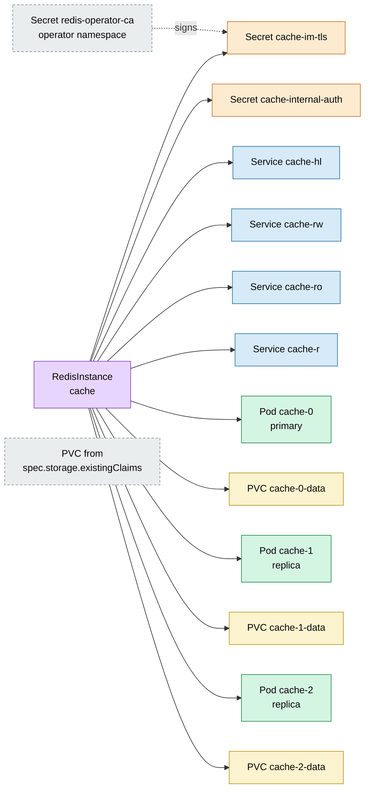
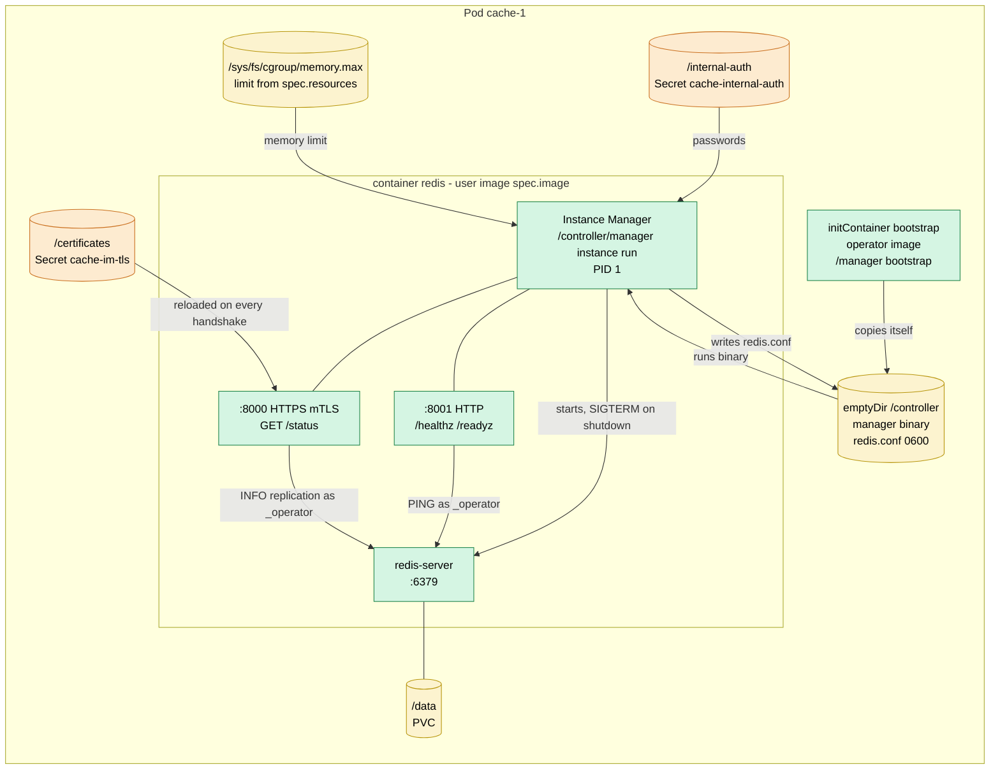
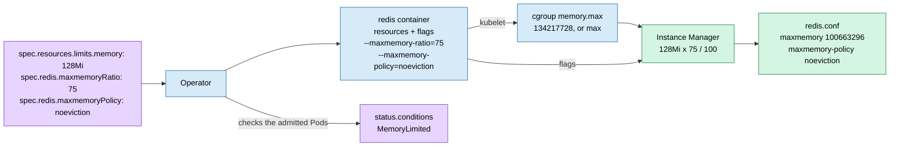
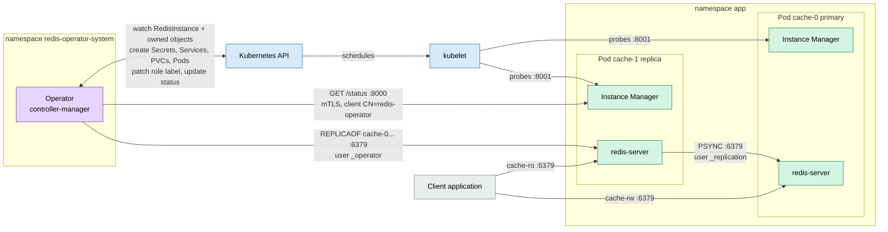
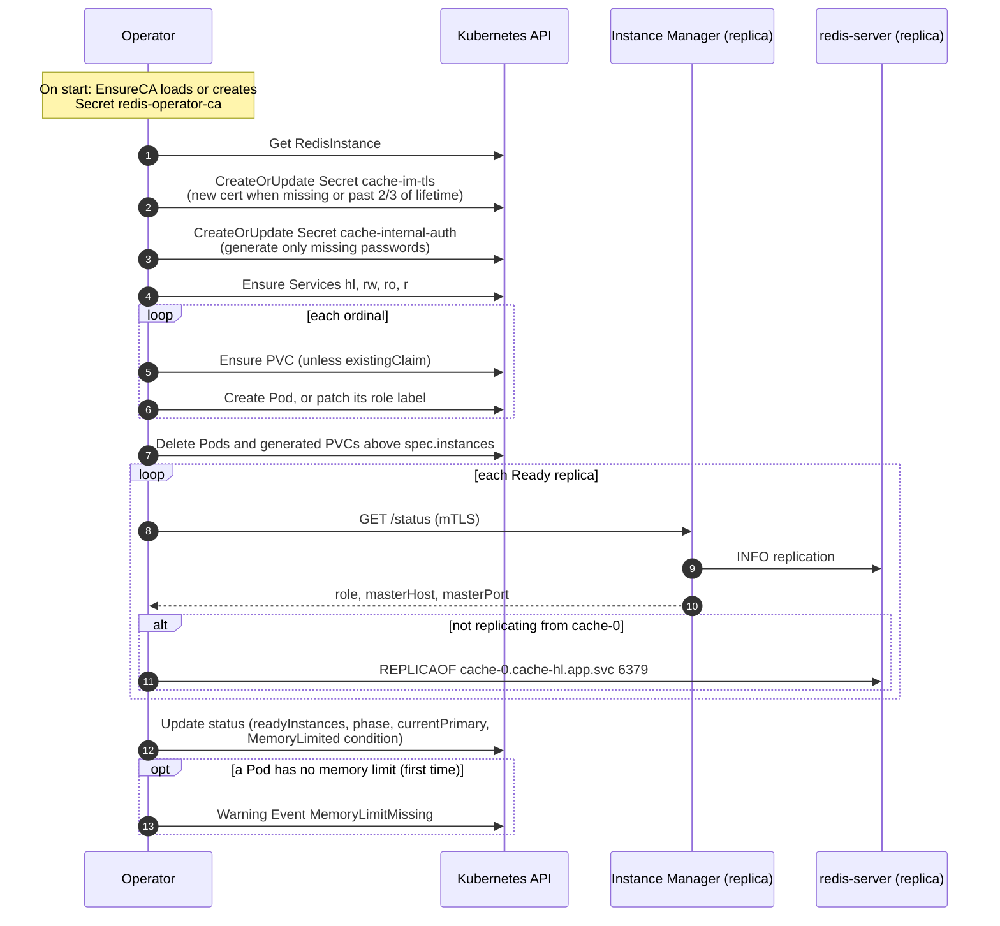

# Architecture

How the operator, the Instance Manager and the Kubernetes objects of a
`RedisInstance` work together. The diagrams use the example instance
`cache` with `instances: 3` in namespace `app`.

## Resource tree (ownership)

Like the Argo CD resource tree: every arrow is an `ownerReference`
(`controller: true`), so deleting the `RedisInstance` garbage-collects
everything under it. Grey dashed boxes are not owned by the instance.

How the objects use each other:

| Object                      | Content                                         | Used by                                                  |
|-----------------------------|-------------------------------------------------|----------------------------------------------------------|
| Secret `redis-operator-ca`  | CA cert and key                                 | operator: signs `cache-im-tls` and its own client certs  |
| Secret `cache-im-tls`       | `tls.crt`, `tls.key`, `ca.crt`                  | every Pod, mounted at `/certificates`                    |
| Secret `cache-internal-auth`| `operator-password`, `replication-password`     | every Pod at `/internal-auth`; operator for `REPLICAOF`  |
| Service `cache-hl`          | headless                                        | stable DNS `cache-N.cache-hl.app.svc` for every Pod      |
| Service `cache-rw`          | selects `redis.operator.com/role=primary`       | clients that write                                       |
| Service `cache-ro`          | selects `redis.operator.com/role=replica`       | clients that only read                                   |
| Service `cache-r`           | selects every Pod                               | clients that read from any instance                      |
| PVC `cache-N-data`          | Redis data                                      | Pod `cache-N`, mounted at `/data`                        |

A PVC from `spec.storage.existingClaims` takes the place of the generated
`cache-N-data`; the operator never owns or deletes it. On scale-down the
operator deletes the extra Pods and their generated PVCs.

There is no ConfigMap: the Instance Manager builds `redis.conf` inside the
Pod from the mounted Secrets.

## Inside a Pod

The init container copies the operator binary into a shared `emptyDir`, so
the redis container can run the Instance Manager with any Redis image.

`redis.conf` turns off the passwordless `default` user (unless
`spec.acl.defaultUser: enabled`) and defines two internal users:

| User           | Rights                         | Used by                                      |
|----------------|--------------------------------|----------------------------------------------|
| `_operator`    | `+@all`                        | operator (`REPLICAOF`), Instance Manager      |
| `_replication` | `+psync +replconf +ping`       | replicas syncing from the primary            |

## Memory

Redis keeps the whole dataset in RAM, so `maxmemory` must fit the container
memory limit. Without it Redis grows until the kernel OOMKills it, instead of
rejecting writes or evicting keys.

- **`maxmemory = memory limit × maxmemoryRatio / 100`.** The ratio defaults
  to 75 and may be 10–95. The rest is left for fork copy-on-write (BGSAVE,
  AOF rewrite), replication and client buffers, and fragmentation.
- **The limit comes from cgroup v2**, not the Downward API: without a limit
  `resourceFieldRef: limits.memory` gives the node memory, while
  `memory.max` gives `max`. The cgroup also shows a default limit set by a
  LimitRange. Nodes with cgroup v1 are not supported.
- **`maxmemoryPolicy`** defaults to `noeviction`: Redis rejects writes
  instead of silently deleting keys. Pick `allkeys-lru` or `allkeys-lfu` for a
  cache.
- **No memory limit:** `maxmemory 0` (no limit). The instance still starts,
  for development, but the condition `MemoryLimited` turns `False` and the
  operator emits one `Warning` Event `MemoryLimitMissing`.
- **Changes** reach only new Pods for now: the Instance Manager writes the
  settings to `redis.conf` at start. Applying them live with `CONFIG SET`
  comes with the rolling update (step 3).

## Runtime cooperation

## Reconcile loop

One pass of `RedisInstanceReconciler.Reconcile`. The operator re-runs it on
every change of the `RedisInstance` or an owned object, and requeues after
5 s while replication is not set up.

