# Architecture

How the operator, the Instance Manager and the Kubernetes objects of a
`RedisInstance` work together. The diagrams use the example instance
`cache` with `instances: 3` in namespace `app`.

## Resource tree (ownership)

Like the Argo CD resource tree: every arrow is an `ownerReference`
(`controller: true`), so deleting the `RedisInstance` garbage-collects
everything under it. Grey dashed boxes are not owned by the instance.

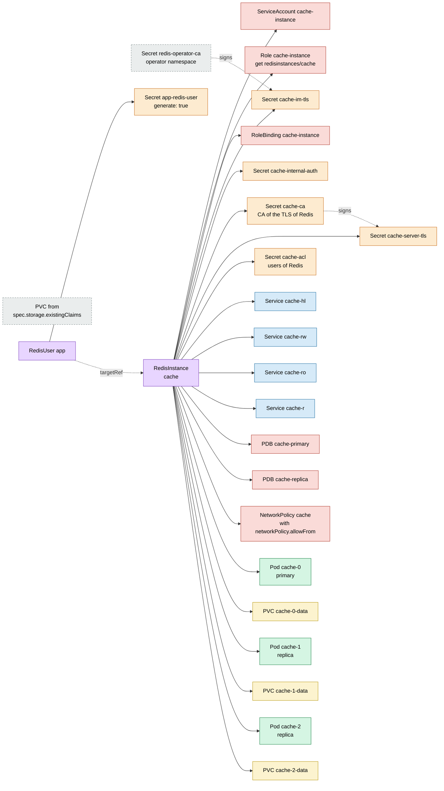

How the objects use each other:

| Object                      | Content                                         | Used by                                                  |
|-----------------------------|-------------------------------------------------|----------------------------------------------------------|
| Secret `redis-operator-ca`  | CA cert and key                                 | operator: signs `cache-im-tls`, its own client certs and the certs of its [webhook](#validation-webhook) |
| ServiceAccount `cache-instance` | token of the Instance Managers           | every Pod (`serviceAccountName`), redis container only   |
| Role / RoleBinding `cache-instance` | `get` on `redisinstances/cache` and `secrets/cache-acl` only | the Instance Manager reads its `RedisInstance` and users |
| Secret `cache-im-tls`       | `tls.crt`, `tls.key`, `ca.crt`                  | every Pod, mounted at `/certificates`                    |
| Secret `cache-internal-auth`| `operator-password`, `replication-password`     | every Pod at `/internal-auth`; operator for `REPLICAOF`  |
| Secret `cache-ca`           | `ca.crt`, `ca.key`: the CA of the TLS of Redis, 10 years | operator: signs `cache-server-tls`                  |
| Secret `cache-server-tls`   | `tls.crt`, `tls.key`, `ca.crt`                  | every Pod at `/tls`; clients take `ca.crt` from it       |
| Secret `cache-acl`          | `users.acl`: users with hashed passwords; `external.acl`: last good file | every Instance Manager, read from the API, see [Users](#users) |
| Secret `app-redis-user`     | `username`, `password`, owned by the `RedisUser` | the application of a `RedisUser` with `generate: true`  |
| Service `cache-hl`          | headless                                        | stable DNS `cache-N.cache-hl.app.svc` for every Pod      |
| Service `cache-rw`          | selects `redis.operator.com/role=primary`       | clients that write                                       |
| Service `cache-ro`          | selects `redis.operator.com/role=replica`       | clients that only read                                   |
| Service `cache-r`           | selects every Pod                               | clients that read from any instance                      |
| PVC `cache-N-data`          | Redis data                                      | Pod `cache-N`, mounted at `/data`                        |
| PDB `cache-primary`         | `minAvailable: 1`, the Pod with `role=primary`  | a drain: the primary leaves only after a switchover     |
| PDB `cache-replica`         | `minAvailable: <replicas - 1>`, the Pods with `role=replica` | a drain: one replica at a time              |
| NetworkPolicy `cache`       | lets in `allowFrom`, the instances, the operator and the probes | only with `spec.networkPolicy.allowFrom`, see [Network policies](#network-policies) |

Every Pod carries the labels `app.kubernetes.io/name=redis`,
`redis.operator.com/instance=cache` and `redis.operator.com/role`
(`primary`/`replica`); the Services select by the last two. They are stable,
so NetworkPolicies may use them (see [Network policies](#network-policies)). The operator does not set
`app.kubernetes.io/instance`, which Argo CD uses for its own tracking.

A PVC from `spec.storage.existingClaims` takes the place of the generated
`cache-N-data`; the operator never owns or deletes it (see [Volumes](#volumes)).
On scale-down the operator deletes the extra Pods and their generated PVCs,
but never the primary: if the primary is above the new `spec.instances`, it stays and the
operator emits a `Warning` Event `ScaleDownBlocked` until you
[switch over](#switchover) to a remaining instance. A shard of a
[RedisCluster](#rediscluster) moves its master on its own.

There is no ConfigMap: the Instance Manager builds `redis.conf` inside the
Pod from the mounted Secrets.

## Inside a Pod

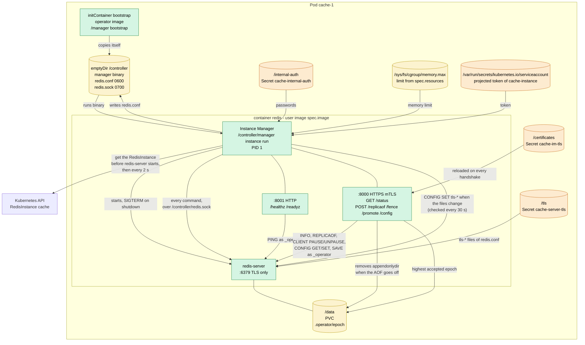

The init container copies the operator binary into a shared `emptyDir`, so
the redis container can run the Instance Manager with any Redis image.

## Safe start

Before it starts `redis-server`, the Instance Manager reads its own
`RedisInstance`, waiting until the operator has set `status.currentPrimary`:

- **This Pod is the primary:** `redis.conf` has no `replicaof`.
- **Another Pod is:** `redis.conf` gets `replicaof <primary>.cache-hl.app.svc 6379`,
  so a restarted replica never runs as a primary, not even for a moment, and
  takes no writes on a stale dataset.
- **`spec.redis`:** `redis.conf` gets `maxmemory*`, `spec.redis.startup` and
  `appendonly` (yes only when an AOF is on the volume). After the start, the
  Instance Manager applies the whole configuration with `CONFIG SET` (see
  [Configuration](#configuration-and-persistence-step-35)); `/readyz` answers
  only then, so no client sees the defaults of Redis.

### A restarted primary waits for approval

A primary that comes back with an empty or old dataset is the classic way
Redis loses data: its replicas connect, find a history they do not know, do
a full resync and drop everything they hold. So a Pod that starts as the
primary lets no replica sync: `redis.conf` turns the `_replication` user
off, and `/readyz` fails until the operator decides.

The operator compares the primary (`GET /status`: replication ID, offset,
number of keys) with the Ready replicas:

| Situation | Decision |
|---|---|
| no Ready replica | approve: nothing better to promote |
| same replication ID, offset not behind any replica | approve: a partial resync |
| every replica is empty | approve: nothing to lose |
| the primary is empty, a replica is not | **failover** to the best replica |
| `persistence: aof` and the primary loaded keys | approve: its AOF is at most ~1 s behind the crash, like a replica |
| `persistence: rdb` or `none` | **failover**: a snapshot may be minutes older than the replicas |

Approving is `POST /promote`: it turns the `_replication` user on, and the
Pod becomes Ready. Whether a primary waits for approval is a state of the
Instance Manager process, set when it starts as the primary, not read from
the ACL: a user who turns `_replication` off by hand is not overruled. A failover goes as in [Failover](#failover), with the
reason in the condition `Failover`; the old primary then syncs from the new
one.

Why not compare offsets alone: Redis 7.2 starts with a new replication ID and
an offset from 0 after every restart, a clean shutdown as well as a crash,
when it loads an AOF. The offsets of the replicas then tell nothing, so the
size of the dataset and how it was kept decide.

Known limits: an AOF that Redis loads only in part (`aof-load-truncated`)
still has keys and is approved; while the operator is down, a restarted
primary stays not Ready.

The Pod keeps `automountServiceAccountToken: false`. The operator mounts a
projected token of `cache-instance` into the redis container only, at the path
client-go expects, so the init container gets no token. The Role allows `get`
on this one `RedisInstance` and nothing else.

`redis.conf` turns off the passwordless `default` user (unless
`spec.acl.defaultUser: enabled`) and defines two internal users:

| User           | Rights                         | Used by                                      |
|----------------|--------------------------------|----------------------------------------------|
| `_operator`    | `+@all`                        | Instance Manager                              |
| `_replication` | `+psync +replconf +ping`       | replicas syncing from the primary            |

## Users

Applications get users from two sources: a `RedisUser` each, or an ACL
file in a Secret of your own (`spec.acl.externalSecretRef`, e.g. users
migrated from another Redis). `default`, `_operator` and `_replication` are
reserved; the username of a `RedisUser` must not start with `_`.

```yaml
apiVersion: redis.operator.com/v1
kind: RedisUser
metadata: {name: app, namespace: app}
spec:
  targetRef: {name: cache}
  authentication:
    generate: true          # or passwordSecretRef: {name: from-vault, key: password}
  acl:
    rules: ["~app:*", "+@read", "+@write", "-@dangerous"]
```

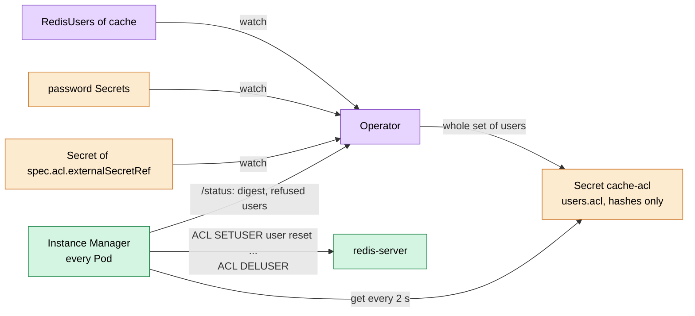

- The operator computes the whole set of users on every change and writes
  it to `cache-acl`. Redis and that Secret get only SHA-256 hashes: `>pw` and
  `<pw` of the file become `#hash` and `!hash`.
- The Instance Manager applies a changed user with `ACL SETUSER <user> reset
  ...`, deletes users that are gone, and every 30 s syncs all of them, so
  users changed by hand return to the Secret. Internal users are never
  touched. A starting Pod is not Ready before its first sync.
- Redis refuses bad rules of one user (e.g. an unknown command) as a whole
  and keeps the previous rules of that user; the others are applied. The
  `RedisUser` shows `Ready=False/Rejected` and a `Warning` Event
  `RulesRejected`.
- One bad line refuses the whole file: no `user <name>` line, a reserved
  name, a user defined twice or `nopass`. The instances keep the users of the
  last good file (`external.acl` of `cache-acl`), the condition `ACLReady`
  says the line and the reason, never its text, and a `Warning` Event
  `InvalidExternalACL` follows. A missing Secret or key keeps them too.
- A username claimed by two `RedisUser`s, or by a `RedisUser` and the file,
  is applied from neither: guessing could hand one application the data of
  another. The `RedisUser`s show `Ready=False/Conflict`. The
  [validating webhook](#validation-webhook) turns away such a `RedisUser`
  before it is stored, so it cannot lock out the user that came first.
- Deleting a `RedisUser` removes its user from Redis (finalizer
  `redis.operator.com/user`).

`Ready` of a `RedisUser`:

| `status` | `reason` | When |
|---|---|---|
| `False` | `TargetNotFound` | the `RedisInstance` of `targetRef` does not exist |
| `False` | `Conflict` | another `RedisUser` or the file has the same username |
| `False` | `PasswordMissing` | the Secret of `passwordSecretRef` or its key does not exist yet |
| `False` | `Rejected` | Redis refused the rules; it keeps the previous ones |
| `False` | `Pending` | some running instance has not applied the user yet |
| `True` | `Applied` | every running instance has the user |

The condition `ACLReady` of the `RedisInstance` sums up all users
(`InvalidExternalACL`, `Rejected`, `Pending`, `Applied`). It is not part of
`Ready`: a wrong user of one application must not mark the database down.

### Password rotation

Changing `password` in the Secret of `passwordSecretRef` swaps the password
at once: clients with the old one get `WRONGPASS` within seconds. To rotate
without that moment, keep the old one in the key `previousPassword` of the
same Secret while the applications move over:

1. `password: <new>`, `previousPassword: <old>`: Redis accepts both.
2. Move the applications to the new password.
3. Remove `previousPassword`: only the new one works.

A generated password (`generate: true`) does not rotate.

### Validation webhook

CEL rules of the CRD see one object. What needs other objects, the operator
checks in a validating webhook for `RedisUser`, before the API server
stores it:

| Check | Answer |
|---|---|
| the `RedisInstance` of `targetRef` does not exist | admitted with a warning: GitOps tools create objects in no fixed order |
| another `RedisUser` of the instance, or `spec.acl.externalSecretRef` of it, has the username | refused |

```console
$ kubectl apply -f second.yaml
The RedisUser "second" is invalid: spec.username: Forbidden: RedisUser first also claims the username app; neither would be applied
```

- An update is checked only when the username or `targetRef` changes, so a
  conflict that came later, e.g. with a changed ACL file, blocks no other fix.
- The webhook is only a faster answer. Two `apply`s at the same moment may
  both pass; the controller checks the same and shows `Conflict`. With
  `failurePolicy: Ignore`, a stopped operator blocks nothing: every
  `RedisUser` is admitted and only the controller checks it.
  `kubectl apply --dry-run=server` asks the webhook and stores nothing.
- No cert-manager: the webhook server presents a certificate from the CA
  `redis-operator-ca`, issued in memory for every handshake, and at its
  start the operator writes that CA to the `caBundle` of
  `redis-operator-validating-webhook-configuration`. The Pod of the operator
  is Ready only once the webhook server serves.
- Argo CD shows the injected `caBundle` as a difference; ignore it with
  `ignoreDifferences` on `/webhooks/0/clientConfig/caBundle` of that
  configuration.
- To install without it, comment out both `[WEBHOOK]` sections of
  `config/default/kustomization.yaml` and set `ENABLE_WEBHOOKS=false` on the
  manager.

## Network policies

A NetworkPolicy isolates a Pod for every port at once: the first one that
selects a Pod for `Ingress` drops all traffic to it but what the policies
that select it allow, added up. So either the operator isolates the
instances, with one policy that lets in all they need, or you do, with your
own:

```yaml
spec:
  networkPolicy:
    allowFrom:                      # unset (default): the operator creates no policy
      - namespaceSelector: {matchLabels: {team: backend}}
```

With `allowFrom`, the operator creates the NetworkPolicy `cache`, owned by
the instance, and deletes it when `allowFrom` is removed. It is the policy
below, with your clients in the last rule. Without `allowFrom`, write it
yourself: the first three rules are what the instance needs.

```yaml
apiVersion: networking.k8s.io/v1
kind: NetworkPolicy
metadata: {name: cache, namespace: app}
spec:
  podSelector: {matchLabels: {redis.operator.com/instance: cache}}
  policyTypes: [Ingress]
  ingress:
    # Required: the replication between the instances.
    - ports: [{port: 6379}]
      from: [{podSelector: {matchLabels: {redis.operator.com/instance: cache}}}]
    # Required: the operator calls the Instance Manager.
    - ports: [{port: 8000}]
      from:
        - namespaceSelector: {matchLabels: {kubernetes.io/metadata.name: redis-operator-system}}
          podSelector: {matchLabels: {control-plane: controller-manager, app.kubernetes.io/name: redis-operator}}
    # Required: the probes of the kubelet. They only report health.
    - ports: [{port: 8001}]
    # Yours: the clients of Redis.
    - ports: [{port: 6379}]
      from: [{namespaceSelector: {matchLabels: {team: backend}}}]
```

| Missing rule | What breaks |
|---|---|
| `6379` between the instances | replicas lose the replication; a failover has no candidate |
| `8000` from the operator | switchover, failover, `spec.redis` and users: errors end with "is a NetworkPolicy of the namespace blocking the operator?" |
| `8001` | every Pod is not Ready (`Readiness probe failed: ... i/o timeout`); needed where the CNI filters traffic from the node |

A policy drops packets instead of refusing them, so a blocked port shows as
a timeout. The operator adds the hint above to every timeout of the
Instance Manager API; it may also be a Pod that restarts or a node that is
gone.

**One owner.** With `allowFrom`, the operator cannot switch off a policy of
yours that selects the instances: the CNI applies every policy, and one can
only let more in. The operator does not delete or change it, which a GitOps
tool would undo, but sets `NetworkPolicyReady=False/ForeignPolicy` with its
name, and emits a `Warning` Event `ForeignNetworkPolicy`, until you remove
it. Only policies in the namespace of the instance count: a policy selects
Pods of its own namespace only, so one elsewhere cannot let anyone in to
Redis. It can keep its own Pods from reaching Redis with egress rules: a
client needs both its egress and the ingress of Redis.

Limits:

- Only ingress. The Instance Manager needs DNS, the API server, whose
  address depends on the cluster, and the primary; a wrong egress rule
  costs it the API, so it fences itself. Add egress in a policy of your own,
  without `allowFrom`.
- Cluster-wide policies (`AdminNetworkPolicy`, `BaselineAdminNetworkPolicy`,
  Calico `GlobalNetworkPolicy`, `CiliumClusterwideNetworkPolicy`) apply on
  top of `allowFrom`; the operator does not see them.
- The cluster bus of a `RedisCluster` (`16379`): see [Users and network policies](#users-and-network-policies).

## Memory

Redis keeps the whole dataset in RAM, so `maxmemory` must fit the container
memory limit. Without it Redis grows until the kernel OOMKills it, instead of
rejecting writes or evicting keys.

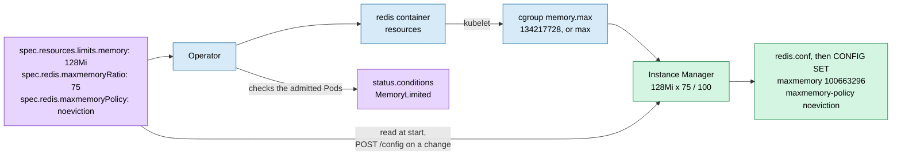

- **`maxmemory = memory limit × maxmemoryRatio / 100`.** The ratio defaults
  to 75 and may be 10–95. The rest is left for fork copy-on-write (BGSAVE,
  AOF rewrite), replication and client buffers, and fragmentation.
- **The limit comes from cgroup v2**, not the Downward API: without a limit
  `resourceFieldRef: limits.memory` gives the node memory, while
  `memory.max` gives `max`. The cgroup also shows a default limit set by a
  LimitRange. Nodes with cgroup v1 are not supported.
- **`maxmemoryPolicy`** defaults to `noeviction`: Redis rejects writes
  instead of silently deleting keys. Pick `allkeys-lru` or `allkeys-lfu` for a
  cache.
- **No memory limit:** `maxmemory 0` (no limit). The instance still starts,
  for development, but the condition `MemoryLimited` turns `False` and the
  operator emits one `Warning` Event `MemoryLimitMissing`.
- **Changes** of `maxmemoryRatio` or `maxmemoryPolicy` apply live with
  `CONFIG SET`. A change of `resources` changes the Pod, so it goes through
  the [rolling update](#rolling-update).

### Configuration and persistence (step 3.5)

```yaml
spec:
  redis:
    persistence: aof            # aof (default) | rdb | none
    startup:                    # read only at start: a change replaces the Pods
      databases: 16
      ioThreads: 1
    parameters:                 # further options of redis.conf
      hz: "20"
      notify-keyspace-events: Ex
```

The Instance Manager applies this configuration with `CONFIG SET` when a Pod
starts, before it reports Ready, and the operator sends it to every running
Pod on each reconcile (`POST /config`), so a change reaches Redis without a
restart; only what differs is set. A wrong value is reported
in the condition `ParametersApplied`; it never stops `redis-server`, as a bad
line in `redis.conf` would.

`parameters` rejects the options the operator manages: ports and sockets,
`dir` and data files, replication, users and passwords, `maxmemory*` (own
fields), `appendonly` and `save` (`persistence`), `tls-*`, `cluster-*`,
`include`, `rename-command`, `loadmodule` and `enable-*-command`. Values are
one line.

Some options cannot change while Redis runs (Redis 7.2 answers
`can't set immutable config`). **Only two of them are supported today**, as
typed fields in `startup`: `databases` and `ioThreads`, with the defaults of
Redis. They go
into `redis.conf`, so changing one replaces every Pod in a
[rolling update](#rolling-update); `parameters` rejects them. The other
immutable options (`tcp-backlog`, `disable-thp`, `set-proc-title`,
`always-show-logo`, `syslog-*`) have no field and cannot be set: in
`parameters` they end up in `ParametersApplied=False`. A field is added when
someone needs one.

| `persistence` | Redis | Lost on a crash |
|---|---|---|
| `aof` | `appendonly yes`, `appendfsync everysec`, plus RDB snapshots | up to ~1 s of writes |
| `rdb` | RDB snapshots only | the writes since the last snapshot |
| `none` | `appendonly no`, `save ""` | everything (a cache) |

Switching modes is where Redis loses data, so the Instance Manager never
lets `redis.conf` decide:

- **Redis started with `appendonly yes` on a dataset kept only in RDB starts
  empty**: it reads only the AOF. So `redis.conf` turns AOF on only when an
  AOF exists on the volume; to enable it, the Instance Manager runs
  `CONFIG SET appendonly yes` after the start, and Redis writes the AOF from
  memory.
- **An AOF left on the volume after it was turned off** would be loaded on
  the next start and lose every write made since. So turning AOF off is
  `CONFIG SET appendonly no`, then `SAVE`, then removing `appendonlydir`.

With `none`, a `dump.rdb` already on the volume stays and a restart loads it.

### TLS

TLS is on by default (`spec.tls.enabled`), and then Redis takes only TLS
connections, on 6379 (`port 0`, `tls-port 6379`); replicas connect to the
primary over TLS too (`tls-replication yes`). Connect with the CA from the
Secret:

```sh
kubectl get secret cache-server-tls -o jsonpath='{.data.ca\.crt}' | base64 -d > ca.crt
redis-cli --tls --cacert ca.crt -h cache-rw.app.svc --user <user> --pass <password>
```

`spec.tls.enabled` cannot change once the instance exists: in a rolling
update a replica in the new mode could not sync from the primary still in
the old one, so the rollout would never end.

**What the Pods mount.** Always `cache-server-tls`, which the operator
writes, never a Secret of the user directly, so a Pod never gets a
certificate the operator has not checked:

| File | Content |
|---|---|
| `tls.crt`, `tls.key` | the certificate Redis serves |
| `ca.crt` | its CA: clients and replicas verify Redis with it |
| `replication.crt`, `replication.key` | what a replica shows the primary (`tls-client-cert-file`), from `cache-ca` |
| `trusted.crt` | every CA Redis trusts (`tls-ca-cert-file`): of the server, of the instance and, with client certificates, of the clients |

**Your own certificate,** e.g. from cert-manager:

```yaml
spec:
  tls:
    serverSecretRef: {name: cache-tls}   # kubernetes.io/tls with tls.crt, tls.key and ca.crt
```

The operator checks every version of that Secret before Redis gets it: the
key belongs to the certificate, the certificate verifies against `ca.crt`,
and it covers `cache-rw.app.svc`, `cache-ro.app.svc`, `cache-r.app.svc` and
every Pod (`cache-0.cache-hl.app.svc`…, which a wildcard
`*.cache-hl.app.svc` covers). If not, the condition `TLSReady` is `False`
with what is wrong (e.g. the names it misses), `Ready` is `False` with
reason `TLSNotReady`, and Redis keeps the certificate it serves. The
operator watches the Secret, so a renewal by cert-manager reaches Redis on
its own.

**Client certificates:**

```yaml
spec:
  tls:
    clientAuth: required             # none (default) | optional | required
    clientCASecretRef: {name: clients-ca, key: ca.crt}
```

Redis then asks every client for a certificate signed by that CA
(`tls-auth-clients`). Replicas show `replication.crt`, signed by the CA of
the instance, so replication goes on. A client certificate replaces no
password: the ACL users still log in. A change of `clientAuth` is a flag of
the Instance Manager, so it rolls the Pods: the replicas first, which
already show a certificate when the primary starts to ask for one.

**Renewal without a restart.** Every 30 seconds the Instance Manager
compares the files in `/tls` with the ones Redis loaded. When the kubelet
has put a new version there (about a minute after the Secret changed), it
runs one `CONFIG SET` of every TLS file option with the same paths, which
makes Redis read them again: new connections get the new certificate, open
ones go on. Redis 7.2 serves the old certificate until then, even with the
files replaced.

Known limits:

- `spec.tls.enabled` is set when the instance is created; there is no
  migration between plaintext and TLS.
- The certificate of the CA of the instance covers `cluster.local` as the
  cluster domain.
- Replacing the CA of the instance is manual for now: `TLSReady` warns a
  year ahead (reason `CAExpiresSoon`); clients then need a new `ca.crt`.
- The cluster bus of RedisCluster (`tls-cluster`) comes with step 10. Each instance has a CA of its own, `cache-ca`, valid
for ten years, apart from the CA of the operator: a client trusts only its
own database. The operator issues the certificate of Redis, `cache-server-tls`,
for the client Services (`cache-rw`, `-ro`, `-r`, short and qualified) and
every Pod (`*.cache-hl.app.svc`, which replicas connect to), and renews it
after two thirds of its 90 days, with the same CA, so clients keep their
`ca.crt`. TLSReady warns a year before the CA expires; replacing the CA is
manual for now.

The Instance Manager reaches `redis-server` over a unix socket in the Pod
(`/controller/redis.sock`), so its commands and probes need no TLS.

## Runtime cooperation

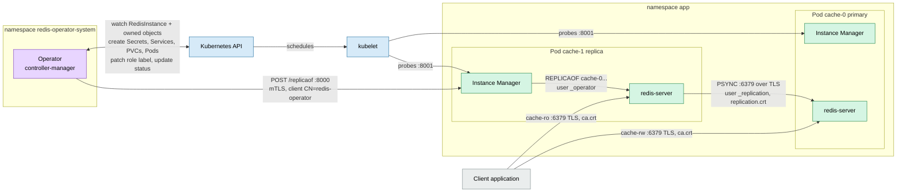

## Epoch

`status.primaryEpoch` grows with every change of the primary: today with every
[switchover](#switchover), from step 4 also with every failover. Every command
of the operator to an Instance Manager (`/replicaof`, `/fence`, `/promote`)
carries it:

- The Instance Manager stores the highest epoch it has accepted on the PVC
  (`/data/.operator/epoch`, written atomically with fsync and rename), so it
  survives restarts of the Pod. It stores the UID of the `RedisInstance` too:
  the epoch of another instance, e.g. on a PVC restored from a snapshot,
  counts as none, so the new instance, which counts from 1, is not stale.
  Until it has read its `RedisInstance`, the Instance Manager answers `503`.
- A command with a lower epoch gets `409 Conflict` and is not run. This stops
  a late request of a former operator leader from undoing a failover.
- Commands run one at a time, so one of an older epoch never runs after a
  newer one.

The operator no longer connects to Redis itself: `REPLICAOF` goes through
`POST /replicaof`, which is idempotent and does nothing when the replica
already follows the requested primary.

## Self-fencing

The operator may not reach a primary, e.g. during a network partition, so
every Instance Manager also watches its own role: it reads its
`RedisInstance` every 2 seconds, which also tells it whether the API server
is reachable.

```yaml
spec:
  failover:
    delay: 30s            # default; at least 4s
    fenceOnAPILoss: true  # default
```

| Redis | The read of the `RedisInstance` | The Instance Manager |
|---|---|---|
| replica | any | does nothing: the operator manages replicas |
| primary | `status.currentPrimary` names another Pod, and no switchover or failover runs | **demotes itself**: `REPLICAOF` the new primary, under the epoch guard of the API |
| primary | failing for more than `delay/2` | **fences itself** (`CLIENT PAUSE WRITE`, renewed while it lasts) |
| primary | works again, after it fenced itself | lifts its own fence, unless a switchover runs (that fence is the operator's) |

- **Half the delay.** The operator promotes a replica only after `delay`
  (see [Failover](#failover)), so a primary cut off from the API server has stopped
  taking writes by then: no two primaries take writes at once.
- **`fenceOnAPILoss: false`** keeps writes going while the API server is
  down, at the risk of two primaries taking writes during a partition. It is
  a choice per instance; the default favours the data.
- **Not while the primary moves.** A Pod the operator has just promoted still
  reads the old `currentPrimary` until the operator records the new one; with
  `status.targetPrimary` set, the Instance Manager leaves its role alone.
- **Any failed read counts,** a timeout as well as a `403`: the Instance
  Manager cannot tell an API server that is down from one it cannot reach.
- **A restart of the operator, or of the API server for less than
  `delay/2`, changes nothing.**

Known limit: a failure of the control plane longer than `delay/2` stops the
writes of every primary in the cluster (reads go on). Turn `fenceOnAPILoss`
off where that matters more than a split brain.

## Requests

Two annotations on the `RedisInstance` ask the operator for a one-off
action: `redis.operator.com/promote=<pod>` ([switchover](#switchover)) and
`redis.operator.com/recreate=<pod>` ([recreate](#volumes)). The operator never
removes them. It records the value it handled in `status.handledRequests`,
in the same status update as the change the request made, and acts only on
a value it has not handled:

```sh
kubectl annotate redisinstance cache redis.operator.com/recreate=cache-2
kubectl get redisinstance cache -o jsonpath='{.status.handledRequests}'
# {"redis.operator.com/recreate":"cache-2"}
kubectl annotate redisinstance cache redis.operator.com/recreate=cache-2@2 --overwrite   # again, same Pod
```

- **The same value twice does nothing**, so the annotation may stay, also in
  git with a tool that heals drift.
- **Anything after an `@`** only makes the value new: `cache-2@2` asks again
  for `cache-2`. Any token works, e.g. a date.
- **Removing the annotation** drops its record, so setting the same value
  later is a new request. A rejected request (Events `SwitchoverRejected`,
  `RecreateRejected`) counts as handled too.
- **A crash cannot repeat or lose a request:** the record and its effect are
  written together.

## Volumes

You choose the volumes when you create the `RedisInstance`; after that the
operator alone manages them. `spec.storage.existingClaims` cannot be changed
(the API server rejects it), so no edit can put a running instance on another
volume by mistake.

```yaml
spec:
  storage:
    volumeClaimTemplate: {size: 5Gi}
    existingClaims:
      - {instanceOrdinal: 0, claimName: cache-restored}   # e.g. restored from a snapshot
      - {instanceOrdinal: 3, claimName: cache-spare}      # reserved: used when scaling up to 4
status:
  volumes:
    - {ordinal: 0, claimName: cache-restored, uid: 7f3a…, external: true, state: Ready}
    - {ordinal: 1, claimName: cache-1-data,   uid: 91bc…, state: Ready}
    - {ordinal: 2, claimName: cache-2-data,   uid: c0de…, state: Ready}
```

`status.volumes` is the memory of the operator. An instance is bound to a
volume once, when it first needs one: the claim from `existingClaims`, or
else a PVC generated from `volumeClaimTemplate`. The UID of the PVC is
recorded before any Pod mounts it, and a Pod is only created on a volume that
is `Ready`.

| `state` | Meaning |
|---|---|
| `Ready` | The PVC exists, has the recorded UID and is not being deleted. |
| `Terminating` | The PVC is being deleted, but the Pod still uses it (`pvc-protection`). The Pod keeps running. |
| `Missing` | The PVC does not exist, or a PVC with its name has another UID: it was deleted and created again and holds other data. The instance gets no Pod. |
| `Lost` | The PVC lost its PersistentVolume. |
| `Detached` | An external PVC of an instance removed by a scale-down. It is mounted again on the next scale-up. |

The condition `StorageReady` is `False` while any instance's volume is not
`Ready` (`Detached` does not count), and lists them in its message. Entering
such a state emits a `Warning` Event `VolumeUnavailable`.

What the operator does on its own:

- **Scale-down:** a generated PVC is deleted with its binding (the data of a
  replica can be synced again); an external PVC stays, bound and `Detached`.
- **Scale-up:** an instance with a binding gets the same PVC back (same UID
  only); otherwise the claim from `existingClaims`, or a new generated PVC.
- **A generated PVC of a replica is gone and the Pod with it:** a new empty PVC
  is generated (Event `VolumeRecreated`) and the replica does a full sync.
- **A generated name is taken by a PVC the operator did not create:** never
  adopted, the instance stays `Missing` until you delete or rename that PVC.
- **The volume of the primary is gone:** never replaced while it is the
  primary, because an empty primary would make every replica drop its data in
  a full resync. The primary moves instead, see below.

When a volume fails under a running instance, the operator acts on one
instance at a time, the lowest ordinal first, and only while every other
instance is Ready and no switchover or failover runs:

| Volume | State | The operator |
|---|---|---|
| of the primary | `Terminating` or `Lost`, the primary is Ready | **switches over** to the best replica (Event `PrimaryVolumeFailing`), without losing writes; the old primary is then a replica, below |
| of the primary | the Pod is gone too (`Missing`) or not Ready | waits `failover.delay`, then **fails over** (see [Failover](#failover)) |
| generated, of a replica | `Terminating` | deletes the Pod (Event `ReplicaVolumeFailing`), so the PVC goes; a new one is generated and the replica syncs again |
| generated, of a replica | `Lost` | deletes the Pod and the PVC and binds the instance to a new generated PVC, like `recreate` |
| external, of a replica | any | nothing: it belongs to you; it is reported in `StorageReady`, fix it with `recreate` |

The deletion of a PVC cannot be undone, so there is nothing to wait for: the
data of a replica on it is lost when its Pod stops anyway.

The only way to change the volume of an instance is to recreate a replica:

```sh
kubectl annotate redisinstance cache redis.operator.com/recreate=cache-2
```

The operator deletes the Pod and its generated PVC (an external PVC is only
let go, never deleted), binds the instance to a new generated PVC and starts
it there; the replica syncs from the primary. It rejects the request (Event
`RecreateRejected`) for the primary, during a switchover, and without a
`volumeClaimTemplate`. Every value is handled once (see [Requests](#requests)).

Known limits:

- **`status.volumes` does not survive every restore.** A `RedisInstance`
  re-created from git or Velero starts with an empty status. The operator
  rebuilds the bindings from the spec, with the same result, except that an
  instance moved by `recreate` goes back to its external PVC, and a PVC
  replaced meanwhile is not detected (its UID is recorded anew). With
  `status.handledRequests` gone too, a `promote` or `recreate` annotation kept
  in the restored object runs once more.
- **Foreign data at creation is not detected.** The operator cannot tell
  whether an external PVC belonged to this database. A replica overwrites it
  in its full sync, so data on a PVC of another database given by mistake is
  lost. A wrong primary is caught only by the safe start of step 4.
- **One PVC in two `RedisInstance`s** is not detected yet.
- An external PVC of an instance in the middle cannot be replaced without a
  `volumeClaimTemplate`.

## Backup and restore

The operator takes no backups: the storage does. A `VolumeSnapshot` goes to
the CSI driver, and its `VolumeSnapshotClass` picks the mechanism of that
driver, e.g. a local snapshot or, on Longhorn, a backup to S3
(`type: bak`). Schedules and retention come from tools beside the operator:
[snapscheduler](https://backube.github.io/snapscheduler/) for any CSI
driver, a Longhorn `RecurringJob`, a Velero `Schedule`. A restore is a new
`RedisInstance` on a PVC made from a snapshot.

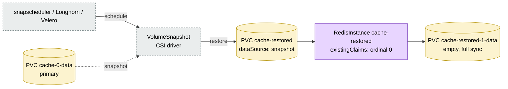

**What a snapshot holds.** A snapshot of one volume is atomic, so to Redis
it looks like a crash at that moment:

| `persistence` | A snapshot holds |
|---|---|
| `aof` (default) | every write but the last ~1 s (`appendfsync everysec`); Redis loads the AOF as after a crash |
| `rdb` | the dataset of the last RDB save, minutes old |
| `none` | no data |

**Which volume.** Take the PVC of the primary (`status.currentPrimary`), or
of a Ready replica: a replica that is in a full sync has only part of the
dataset. The generated PVCs carry the label
`redis.operator.com/instance=<name>`, so a schedule can take all of them:

```yaml
apiVersion: snapscheduler.backube/v1
kind: SnapshotSchedule
metadata: {name: cache-nightly, namespace: app}
spec:
  schedule: "0 3 * * *"
  retention: {maxCount: 7}
  claimSelector:
    matchLabels: {redis.operator.com/instance: cache}
  snapshotTemplate:
    snapshotClassName: csi-snapclass
```

**Restore.** Make a PVC from the snapshot and give it to ordinal 0 of a new
`RedisInstance`:

```yaml
apiVersion: v1
kind: PersistentVolumeClaim
metadata: {name: cache-restored, namespace: app}
spec:
  dataSource: {apiGroup: snapshot.storage.k8s.io, kind: VolumeSnapshot, name: cache-nightly-cache-0-data-202610310300}
  accessModes: [ReadWriteOnce]
  resources: {requests: {storage: 5Gi}}   # at least the restoreSize of the snapshot
---
apiVersion: redis.operator.com/v1
kind: RedisInstance
metadata: {name: cache-restored, namespace: app}
spec:
  instances: 3
  storage:
    volumeClaimTemplate: {size: 5Gi}
    existingClaims:
      - {instanceOrdinal: 0, claimName: cache-restored}
```

Ordinal 0 starts as the primary on the restored data; with only an RDB on
the volume and `persistence: aof`, the Instance Manager turns the AOF on
after the start (see [Configuration](#configuration-and-persistence-step-35)).
The operator approves it, since the new replicas are empty (see
[Safe start](#a-restarted-primary-waits-for-approval)), and they do a full
sync from it. The epoch on the volume belongs to the old instance, so the
Instance Manager ignores it (see [Epoch](#epoch)).

Limits:

- The restored PVC stays external: the operator never deletes it and
  `recreate` never moves it. Delete it yourself after the `RedisInstance`.
- Only the data comes back. The new instance has new internal passwords
  and certificates, and needs its own `RedisUser`s; an ACL file of
  `spec.acl.externalSecretRef` can be the same Secret.
- Volumes are snapshotted one by one, so snapshots of several instances,
  or later of the shards of a `RedisCluster`, may differ by seconds,
  unless the driver supports `VolumeGroupSnapshot`.
- A snapshot from a newer Redis does not load in an older image.

## Switchover

A switchover moves the primary to a replica while both are healthy, with no
lost writes. Use it before maintenance of the primary's node. The
[rolling update](#rolling-update) uses it to replace the primary, and
failover (step 4) will build on it.

```sh
kubectl annotate redisinstance cache redis.operator.com/promote=cache-1
kubectl get redisinstance cache -o jsonpath='{.status.currentPrimary}'   # cache-1 once done
```

The operator handles every value once (see [Requests](#requests)); the
outcome is in the condition `Switchover` and in the Events.

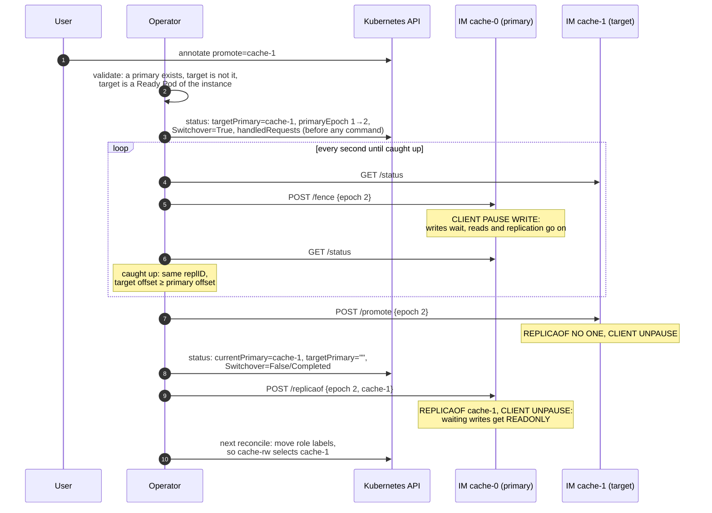

Why the steps are in this order:

- **Fence first.** Replication is asynchronous, so the replica is always a
  little behind. While the primary is fenced its offset stops growing, so
  "the target has the same offset" means "the target has every write".
- **Writes wait instead of failing.** Clients see a pause, usually well under
  a second, not errors. After the demotion the waiting writes get
  `READONLY`, so none of them land on the old primary.
- **The epoch is stored before the first command.** No Instance Manager ever
  sees an epoch the status does not hold, and the status update fails on a
  stale `resourceVersion`, so two operator leaders cannot both start a
  switchover.
- **Every step can be repeated.** After a crash of the operator, the next
  reconcile continues from `status.targetPrimary`. A target that already
  reports `role:master` was promoted by an earlier pass, so the operator only
  finishes.

The operator rejects the request (Event `SwitchoverRejected`, recorded as
handled, nothing else changed) when the instance has no primary yet, the target is
already the primary, is not a Pod of this instance, or is not Ready.

If the target does not catch up within a minute (e.g. its link to the primary
is down), the switchover fails: the operator lifts the fence, so the primary
takes writes again, sets `Switchover=False` with reason `Failed` and emits a
`Warning` Event `SwitchoverFailed`.

Known limits:

- A restart of the old primary during a switchover loses the fence, which
  lives in the `redis-server` process. Safe start of a primary comes with
  failover (step 4).
- The fence lasts at most an hour if the operator never follows up; the
  timeouts are fixed in code.
- `cache-rw` follows the role label, which the next reconcile moves. Until
  then it points at the old primary, which answers `READONLY`.

## Failover

A failover promotes a replica when the primary has failed. Unlike a
switchover, it cannot wait for the replica to catch up: the writes the old
primary did not replicate yet are lost.

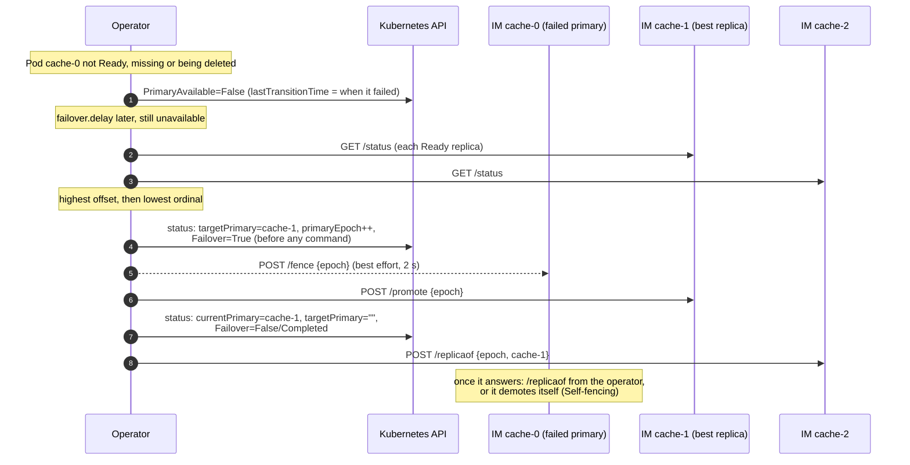

- **When:** the primary Pod is not Ready, does not exist or is being deleted
  for `spec.failover.delay` (default `30s`). The condition `PrimaryAvailable`
  turns `False` at once; its `lastTransitionTime` is when the primary
  failed, so a restart of the operator does not restart the delay. A primary
  that comes back in time keeps its role.
- **Which replica:** only Ready ones, which have finished their first sync;
  of those the one with the highest replication offset, which holds the most
  writes; a tie goes to the lowest ordinal.
- **Without a Ready replica** (e.g. `instances: 1`) nothing happens; the
  operator looks again every 5 seconds.
- **The old primary** is fenced if it still answers. When it cannot be
  reached it has fenced itself after `delay/2` (see
  [Self-fencing](#self-fencing)), so it took no writes when the replica was
  promoted. Once back, it becomes a replica of the new primary.
- **Every step can be repeated,** as in a switchover: the epoch and the
  target are written before the first command, and a crash of the operator
  continues from `status.targetPrimary`. A failover takes over from a
  switchover in progress (its condition turns `False` with reason
  `Interrupted`).
- Events: `FailoverStarted` (Warning) and `FailoverCompleted`. The condition
  `Ready` is `False` with reason `PrimaryUnavailable`, then `Failover`.

What makes a primary unavailable, and so leads to a failover once it lasts
for `failover.delay`:

| Cause | What the operator sees | Failover |
|---|---|---|
| The node of the primary fails | after ~40 s (`node-monitor-grace-period`) the Pod is no longer Ready | after ~40 s + `delay` |
| A network partition between the node and the control plane | the same; the old primary also fences itself (see [Self-fencing](#self-fencing)) | yes |
| Redis hangs or is overloaded: PING misses the 1 s probe timeout | `/readyz` fails | once it lasts `delay` |
| The Pod is deleted or evicted and does not come back (image, volume) | no Pod, or a Pod that is not Ready | once it lasts `delay` |
| `redis-server` crashes on every start | the Pod never becomes Ready | yes |
| One restart of the container | not Ready for a few seconds | no, it is back in time |
| Loading a large dataset after a restart (PING answers `LOADING`) | not Ready until the load ends | **yes, if loading takes longer than `delay`** |

**Choosing `delay`:** it must be longer than the time the primary needs to
load its dataset from the volume, or every restart of the primary ends in a
failover. Redis loads roughly a few hundred MB per second from an AOF or an
RDB, so a dataset of tens of GB needs a `delay` of minutes. A shorter
`delay` moves the primary sooner, with the risk of failovers for restarts
that would have healed; the self-fencing of the old primary comes after
`delay/2` either way.

**How many writes a failover can lose.** Replication is asynchronous: the
primary acknowledges a write before any replica has it, so the writes of its
last moments may be missing on the replica promoted. Without more, that is
the replication lag, usually milliseconds; but a primary cut off from its
replicas while clients still reach it keeps taking writes that no replica
gets, until it fences itself after `delay/2` (see [Self-fencing](#self-fencing)).

```yaml
spec:
  replication:
    minReplicasToWrite: 1   # default 0: never refuse a write
    minReplicasMaxLag: 10   # seconds, default 10
```

With `minReplicasToWrite: N` the primary refuses writes (`NOREPLICAS`)
unless N replicas are connected and lag at most `minReplicasMaxLag`
seconds, so a primary cut off from its replicas stops taking writes by
itself, and a failover loses at most about `minReplicasMaxLag` seconds of
them. The price: writes also stop while too few replicas run, e.g. during a
rollout that restarts one, or when replicas fail. It must stay below
`spec.instances`; with `instances: 3`, `1` keeps writing with one replica
down. Both apply live with `CONFIG SET`; `parameters` rejects `min-replicas-*`.

Not covered by a failover: an operator that cannot reach a Ready primary (a
network problem of the operator alone must not move the primary); Redis that
answers PING but refuses writes, e.g. `MISCONF` on a full disk; the volume of
a running primary failing (step 4.4); planned changes, which use a
switchover.

## Nodes and maintenance

**Placement.** The instances keep to different nodes (pod anti-affinity on
`redis.operator.com/instance`, per `kubernetes.io/hostname`), so a node that
fails takes at most one of them and a replica is left for a failover.

```yaml
spec:
  affinity:
    podAntiAffinityType: required   # default; preferred places an instance anyway
```

With `required`, an instance without a free node stays `Pending`: three
instances need three nodes that take Pods. `preferred` is for small
clusters. With local volumes an instance stays on the node of its volume
after the first placement.

**Maintenance of a node** (`kubectl drain`, an upgrade of the node pool):

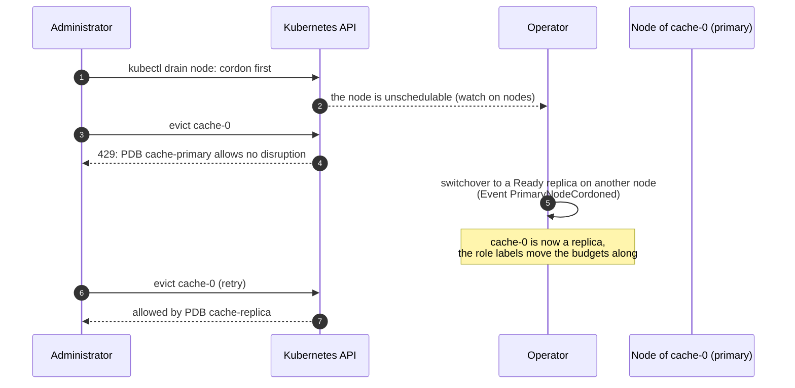

- **PodDisruptionBudgets** hold only voluntary disruptions, which go through
  the Eviction API (drain, cluster autoscaler, node upgrades). A crash of a
  node or a `kubectl delete pod` is what failover is for.
- Both budgets are `minAvailable` counts, kept up to date with
  `spec.instances`: `maxUnavailable` needs the owner of the Pods to have a
  scale subresource, which a `RedisInstance` has not, and then allows no
  disruption at all.
- A Pod that is not Ready never blocks a drain
  (`unhealthyPodEvictionPolicy: AlwaysAllow`).
- When a Pod changes its role, the operator also touches the budget of the
  old role (annotation `redis.operator.com/recount`): Kubernetes recounts
  only the budget a Pod now matches, and the stale count of the old one
  would let a drain take the new primary.
- **With `instances: 1` there are no budgets:** there is no replica to switch
  over to, so a budget would block a drain for good. The drain takes the
  primary, with an outage until it is back.
- Without a Ready replica on a node that takes Pods, the operator does not
  switch over and the drain waits.

**A node that fails** (power, kernel, network):

1. After about 40 s the node is `NotReady` and its Pods are no longer Ready.
   A primary among them is replaced by a [failover](#failover) after
   `failover.delay`.
2. The Pods stay on the node, later as `Terminating`, until it comes back:
   Kubernetes cannot tell a dead node from one cut off from the network, and
   mounting its volumes elsewhere could let two Pods write to one volume.
3. **Once you know the node is down for good,** taint it:
   `kubectl taint node <node> node.kubernetes.io/out-of-service=nodeshutdown:NoExecute`.
   Kubernetes then deletes its Pods and detaches their volumes (non-graceful
   node shutdown), and the operator creates them again: with network storage
   on another node, with the same PVC.
4. **Local volumes** (e.g. local-path, local PVs) cannot move: a new Pod on
   such a volume stays `Pending`. With

   ```yaml
   spec:
     storage:
       recreateOnNodeLoss: true
   ```

   a replica whose generated volume is local to a node that is gone, or
   tainted `out-of-service`, moves to a new generated volume and syncs from
   the primary (Event `ReplicaVolumeFailing`). The primary never moves this
   way: the failover makes it a replica first. External volumes are never
   moved. Off by default, as a node that comes back would have its data again.

## Rolling update

Every Pod carries the annotation `redis.operator.com/spec-hash`: a hash of
the PodSpec the operator built it from. When a change of the `RedisInstance`
(`image`, `resources`, `redis.startup`, `acl.defaultUser`) or a new operator image
gives another hash, the Pod is outdated and the operator replaces it.

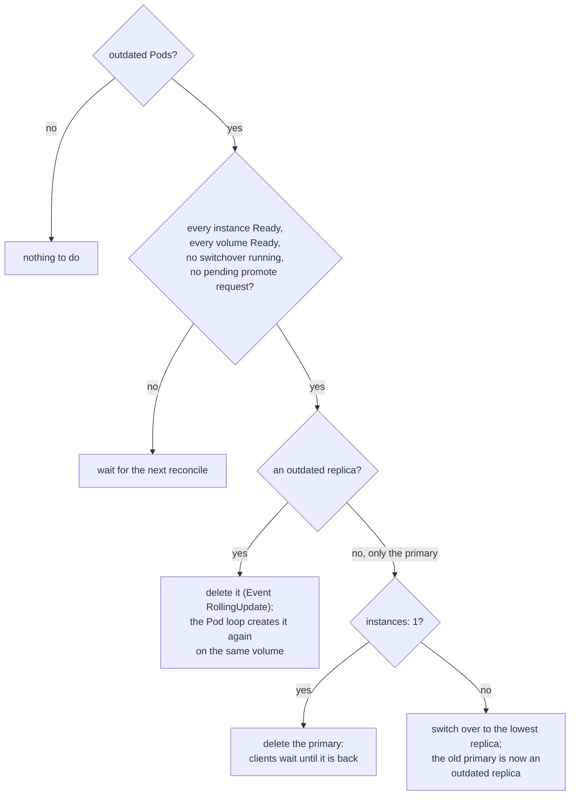

- **One Pod at a time.** The operator acts only while every instance has
  been Ready for 10 seconds, and a Pod being deleted does not count as Ready
  (nor in `status.readyInstances`). A replica is Ready only after its first
  sync, so the next Pod goes only when the new one replicates again; the 10
  seconds, like `minReadySeconds` of a StatefulSet, let a replica that has
  just synced settle, as it may still miss a probe.
- **Never on a volume in trouble.** A Pod whose volume is not `Ready` (e.g.
  its PVC is `Terminating` or `Lost`) is never outdated: without a usable
  volume there is no desired Pod to compare with, and replacing it would
  leave the instance without a Pod. While any volume is not `Ready` the
  whole rolling update waits, so a second instance never goes down next to
  one that is about to lose its volume.
- **Why a hash and not a comparison of the Pods.** The API server fills in
  defaults (`dnsPolicy`, `terminationMessagePath`, ...), so the live PodSpec
  never equals the built one. The hash is computed from what the operator
  built and compared with what it stored. The role label is not part of the
  PodSpec, so a switchover restarts nothing.
- **The primary goes last,** through a planned switchover with no lost
  writes (see Switchover). With `instances: 1` there is no replica to take
  over, so the operator restarts the primary and clients see an outage.
- **The switchover is validated like a requested one** (see Switchover); if
  it would be rejected, e.g. no primary is recorded yet, the rolling update
  waits.
- **A failed switchover** does not repeat at once: the rolling update waits
  5 minutes before it fences the primary again.
- **A switchover the user asked for goes first:** the rolling update waits
  while a `promote` request is pending. A handled one that stays, e.g. in
  git, does not block it.

Known limits:

- **An operator upgrade restarts every Redis Pod.** The `bootstrap`
  initContainer runs the operator image, which copies the Instance Manager
  into the Pod, so it is part of the hash. A new operator version makes
  every Pod of every `RedisInstance` in the cluster outdated at once. Each
  instance still replaces one Pod at a time, but all instances roll in
  parallel: one switchover per instance (a short write pause and reconnects
  for its clients) and a burst of resyncs over the whole cluster. There is no
  way yet to delay or spread it (planned: a cluster-wide limit and a
  maintenance window), nor to keep `redis-server` running while
  the Instance Manager is replaced (planned: in-place upgrade).
- A replacement waits for Ready, which means the first sync is done, not
  for a zero replication lag. Only the primary waits for zero lag, through
  the switchover.
- The rolling update stalls, without an Event, while an instance is not
  Ready (e.g. its volume is not `Ready`, see Volumes).

### With GitOps (Argo CD, Flux)

Keep the `RedisInstance` in git; the Pods, Services and PVCs are the
operator's and never belong there. A change of `spec.image` in git is the
intended way to start a rolling update. Until the steps below are done:

- **`promote` and `recreate` may live in git.** The operator handles each
  value once and never removes the annotation, so self-heal has nothing to
  put back (see [Requests](#requests)). To repeat a request, commit a new
  value, e.g. `cache-2@2`. A restore without the status runs it once more.
- **Any resource tracking of Argo CD works.** Label tracking reads
  `app.kubernetes.io/instance`, which the operator never sets on its objects,
  so Argo CD does not take them for its own or prune them.
- **Add a health check**, so Argo CD shows a rolling update or a switchover
  as `Progressing` instead of `Healthy` (see [Ready condition](#ready-condition)).

## Ready condition

The condition `Ready` sums up the instance. When several things are wrong,
the first in this order is the reason:

| `status` | `reason` | When | Passes on its own |
|---|---|---|---|
| `False` | `StorageNotReady` | the condition `StorageReady` is not `True` | no: see [Volumes](#volumes) |
| `False` | `TLSNotReady` | the certificate of the user cannot be served, see the condition `TLSReady` | no: fix the certificate |
| `False` | `ParametersNotApplied` | Redis refused an option, see the condition `ParametersApplied` | no: fix `spec.redis` |
| `False` | `PrimaryUnavailable` | the primary is not Ready; a failover follows after `failover.delay` | yes |
| `False` | `Failover` | a replica takes over from the failed primary | yes |
| `False` | `Switchover` | a switchover runs or a `promote` request is pending | yes |
| `False` | `RollingUpdate` | some Pods run an outdated spec | yes |
| `False` | `InstancesNotReady` | fewer Ready instances than `spec.instances` | usually: Pods start, replicas sync |
| `True` | `Ready` | none of the above | |

Its `observedGeneration` is the `metadata.generation` it was computed for.
Right after a change of the spec the condition still holds the old answer,
so a tool must ignore it until both match.

```sh
kubectl get redisinstance
# NAME    READY   REASON          PRIMARY   AGE
# cache   False   RollingUpdate   cache-0   3d
kubectl wait redisinstance cache --for=condition=Ready --timeout=10m
```

Health check for Argo CD, in `argocd-cm` (or `configs.cm` of its Helm chart):

```yaml
resource.customizations.health.redis.operator.com_RedisInstance: |
  hs = {status = "Progressing", message = "Waiting for the operator"}
  if obj.status ~= nil and obj.status.conditions ~= nil then
    for _, c in ipairs(obj.status.conditions) do
      if c.type == "Ready" and c.observedGeneration == obj.metadata.generation then
        hs.message = c.message
        if c.status == "True" then
          hs.status = "Healthy"
        elseif c.reason == "StorageNotReady" or c.reason == "TLSNotReady" or c.reason == "ParametersNotApplied" then
          hs.status = "Degraded"
        end
      end
    end
  end
  return hs
```

## Monitoring

Two sources of metrics, for the Prometheus Operator (e.g.
kube-prometheus-stack), and two Grafana dashboards that draw them:

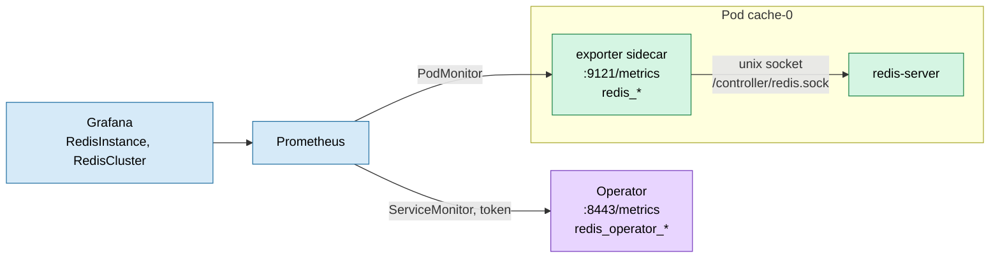

```sh
kustomize build config/monitoring | kubectl apply --server-side -f -
```

`config/monitoring` is `config/default` plus a ServiceMonitor of the
operator, a PodMonitor of the exporters, a ClusterRoleBinding that lets
Prometheus read the metrics of the operator, and the dashboards as a
ConfigMap for the Grafana sidecar (label `grafana_dashboard: "1"`). Edit
the label `release` and the ServiceAccount of Prometheus to match yours.

**The status as metrics.** The operator turns the status of every
`RedisInstance` and `RedisCluster` into metrics when Prometheus scrapes,
read from its cache, so a deleted object leaves no series behind:

| Metric | Labels | Value |
|---|---|---|
| `redis_operator_instance_pod_role` | `namespace`, `redis_instance`, `pod` | 0 replica, 1 primary, 2 becoming the primary (`targetPrimary`) |
| `redis_operator_instance_primary_epoch` | `namespace`, `redis_instance` | `status.primaryEpoch` |
| `redis_operator_instance_instances`, `_ready_instances` | `namespace`, `redis_instance` | `spec.instances`, `status.readyInstances` |
| `redis_operator_instance_volume` | `…`, `ordinal`, `state` | 1 for the state of every volume |
| `redis_operator_condition` | `namespace`, `kind`, `name`, `type`, `reason` | 1 True, 0 False |
| `redis_operator_cluster_shard_slots` | `namespace`, `redis_cluster`, `shard` | slots of the master |
| `redis_operator_cluster_shard_primary` | `…`, `shard`, `pod` | 1 for the master of every shard |
| `redis_operator_cluster_slots_to_move` | `namespace`, `redis_cluster` | `status.slotMigration.slotsToMove`, 0 when balanced |
| `redis_operator_cluster_slot_block_shard` | `…`, `block` | the shard that serves most of a block of 256 slots, -1 for none |
| `redis_operator_events_total` (counter) | `namespace`, `kind`, `name`, `type`, `reason` | Events the operator emitted |
| `redis_operator_slots_moved_total` (counter) | `namespace`, `redis_cluster`, `from_shard`, `to_shard` | slots moved |
| `redis_operator_reconcile_total` (counter) | `kind`, `namespace`, `name`, `result` | reconciles of every object: `success`, `requeue_after`, `requeue`, `error` |
| `redis_operator_reconcile_seconds_total` (counter) | `kind`, `namespace`, `name` | time spent reconciling it |
| `redis_operator_api_requests_total` (counter) | `kind`, `namespace`, `name`, `verb`, `resource`, `source` | calls of the client by the reconciles of an object: `source` `cache` for reads the informers answer, `api` for writes |
| `redis_operator_im_requests_total` (counter) | `namespace`, `redis_instance`, `pod`, `path`, `code` | calls to the Instance Managers; `code` the HTTP status or `error` |
| `redis_operator_im_request_duration_seconds` (histogram) | `path` | how long they took |

The ServiceMonitor sets `honorLabels`, so `namespace` and `pod` name the
Redis Pods, not the operator. The labels are `redis_instance` and
`redis_cluster`, not `instance`, which Prometheus keeps for the address of
a target; the PodMonitor gives the metrics of the exporters the same
labels, and `role` from the label of the Pod, so the two sources join.

**Redis itself** comes from a sidecar:

```yaml
spec:
  monitoring:
    enabled: true                                  # default false; a change rolls the Pods
    image: oliver006/redis_exporter:v1.94.0        # default
```

[redis_exporter](https://github.com/oliver006/redis_exporter) reads Redis
over the unix socket of the Pod, so it needs no TLS, as `_operator`, with
the password from the internal Secret. `/controller` is read-only to it,
as it also holds the binary of the Instance Manager. It serves port
`metrics` (9121): commands, memory, keys, clients, replication offsets.
With `spec.networkPolicy.allowFrom`, the policy lets anyone in on 9121, as
Prometheus may run in any namespace and the exporter only reports numbers.
A `RedisCluster` passes `monitoring` to its shards.

**Dashboards** (`config/monitoring/dashboards`, folder `databases`):

- *Redis Operator / RedisInstance*: *What happened, to the millisecond* (below), the role of every Pod as a timeline,
  so a switchover, a failover or a rolling update shows as the primary
  moving from row to row; Pod Ready; why Ready is False, over time; *Health*
  (conditions that are good when True: green, a problem red) and *Operations*
  (Switchover and Failover: orange while one runs, grey when idle, red when
  it failed), every reason a row and a bar of how long it lasted; commands per second,
  keys, clients, memory and the state of the volumes; an annotation where
  the epoch grew. A shard is a `RedisInstance`, so it works for one too.
- Both: *Replication*, a node graph with a node per Pod (green the primary,
  blue a replica, under it the machine it runs on, its commands per second)
  and an arrow per replica with the bytes per second it replicates (the
  primary reports its replicas by IP, which `kube_pod_info` names; only the
  pairs and roles of now, as a rate looks minutes back over a switchover;
  hover an arrow for its number), the
  throughput of every replica and its lag in bytes (the offset of the
  primary minus the one the replica acknowledged, once a second, so up to a
  second of writes is normal; the highest in each minute, from one INFO of
  the primary: offsets of different Pods are scraped at different moments).
  Graph and both graphs keep at every moment only the pairs the primary
  reports then, so a pair ends at the switchover instead of a window later;
  and the full and partial resyncs;
  *Disk*, the used space of every PVC (kubelet), over time, the AOF size and
  the age of the last RDB save.
  The volumes, a row per instance with its state as text: Ready green,
  Terminating orange, Missing or Lost red, Detached grey; a state of a
  few seconds may fall between two scrapes, the table of operations has
  every volume replaced. The log lines of the operator show the error
  of a failed reconcile, mostly a conflict: the status was written by an
  older version of the object, and the reconcile runs again at once.
- *Redis Operator / RedisCluster*: slots per shard as bars and over time, slots moved from shard to shard,
  slots to move, the health of the cluster, `Migrating` (orange while slots
  move, grey when balanced, red when blocked), a slot map of 64 rows of 256
  slots coloured by shard, the role of every node, and commands and keys
  per shard.
- Both: *Inside Redis*, what the exporter reports from Redis itself: the
  errors it answered by kind (`READONLY` after a switchover, `NOREPLICAS`,
  `WRONGPASS`, `NOPERM`, `MOVED`/`ASK` while slots move, `CLUSTERDOWN`; the
  commands of the operator count too), the link of every replica to its
  master (a replica may be Ready while it is down), the cache hit ratio,
  evicted and expired keys, the p99 latency by command (without the commands
  of the operator and the exporter), the slow log, fragmentation, how long
  the last fork stopped Redis, RDB saves and AOF rewrites, rejected
  connections and blocked clients; for a cluster also `cluster_state`, the
  slots in `pfail` or `fail` and the nodes known, as every node sees them.
  *Keys by type and size*: at every scrape the exporter runs
  `/controller/keys.lua` (`REDIS_EXPORTER_SCRIPT`), which samples 200 random
  keys (`RANDOMKEY`, `TYPE`, `MEMORY USAGE`) and counts them by type and
  memory (`<1KB`, `1-10KB`, `10-100KB`, `100KB-1MB`, `>1MB`), as
  `redis_script_values{key="hash <1KB"}`. It is a share of the keys, not a
  count: a rare type or a few big keys may not show (`redis-cli --bigkeys`
  finds those). The script runs on replicas too (`no-writes`) and in a
  cluster (`allow-cross-slot-keys`); the `bootstrap` initContainer writes it
  next to the Instance Manager.
  *Load and pressure*, where a node runs out of something: how busy the main
  thread is (Redis runs commands on one thread, so 100 % is the ceiling of a
  shard), CPU throttled by the limit, commands per second of every master
  and, for a cluster, the busiest master against the average (a hot shard),
  memory of every master of `maxmemory` and of the container of its limit
  (forks and buffers come on top of `maxmemory`), network, the output buffers
  to replicas and clients against the replica soft limit, how many seconds
  of writes the replication backlog holds (a replica cut off for longer
  needs a full resync), changes of the master, stalls (the last fork and
  `LATENCY LATEST`, with `latency-monitor-threshold` set in
  `spec.redis.parameters`) against `cluster-node-timeout`, and restarts. A
  Job with `load` in its name in the namespace shows as a yellow range, e.g.
  `memtier_benchmark` of `playground-load.yaml`.

**Alerts** (`config/monitoring/prometheusrule.yaml`, label `release` for the
`ruleSelector` of Prometheus). Every dashboard has a timeline *Alerts* of the
ones that fire for its object, and red markers where they fired:

| Alert | When |
|---|---|
| `RedisPrimaryUnavailable` (critical) | `PrimaryAvailable=False` for 30 s |
| `RedisInstanceNotReady` | `Ready=False` for 10 min, with the reason |
| `RedisReplicaLinkDown` | a replica has lost its master for 1 min |
| `RedisFullResyncs` | more than 2 full resyncs of a Pod in 10 min: the backlog is too small |
| `RedisMemoryNearMaxmemory`, `RedisOOMErrors` | above 90 % of `maxmemory` for 2 min; writes refused with OOM |
| `RedisContainerMemoryNearLimit` (critical) | above 90 % of the memory limit of the container for 1 min |
| `RedisRejectedConnections` | connections over `maxclients` |
| `RedisVolumeNearlyFull` | a `-data` PVC of a namespace with instances above 85 % |
| `RedisStall` | a `LATENCY LATEST` spike above 1 s |
| `RedisClusterSlotsUncovered`, `RedisClusterStateFail` (critical) | slots without a master; a node sees `cluster_state:fail` |
| `RedisClusterMigrationBlocked` | `Migrating=Blocked` (`BUSYKEY`) |
| `RedisClusterReshardingSlow` | slots to move for 30 min |
| `RedisClusterHotShard` | the busiest master does 1.5× the average for 5 min |
| `RedisClusterMastersOnOneMachine` | two masters on one machine for 10 min; *Masters per machine* on the dashboard |
| `RedisOperatorDown` (critical), `RedisOperatorReconcileErrors`, `RedisInstanceManagerUnreachable` | the operator, its reconciles, its calls to the Instance Managers |
- *Redis Operator / Operator*: a node graph of the operator now, with an
  arrow to every RedisInstance, RedisCluster and RedisUser (its calls to the
  Kubernetes API per minute) and to the Instance Managers of every instance
  (HTTP calls per minute), a node showing the reconciles per minute; the
  controllers of controller-runtime (reconciles by result, duration, errors,
  workers, webhook), their workqueues (depth, adds, retries, time in the
  queue, the longest running reconcile), a table of every object (reconciles,
  errors, average time, reads and writes), the calls to the API in time by
  verb, kind and object, and what client-go really sends; the calls to the
  Instance Managers by path and instance, failures and latency; the Events
  and, from Loki, *Every decision*: a row per decision with its kind,
  object and details (from → to, epoch, how long, the Pod, the cluster
  command, the error), blue when something starts, green when done, orange
  an Event, red an error. The per object numbers
  come from the operator: every controller runs behind `Instrument`, which
  counts its reconciles and puts the object in the context, where the client
  of the reconcilers (`CountingClient`) finds it.

**To the millisecond, with Loki.** A switchover is over in about 100 ms,
far below what Prometheus samples (scraping every 10 ms would be a hundred
requests a second per target). The logs have it: with Loki (e.g.
loki-stack with promtail), both dashboards have a panel *What happened, to
the millisecond* with the log lines of the operator about the object and,
for a `RedisInstance`, of its Pods (Redis, the Instance Manager, the
exporter), in order, and markers on every graph from the log of the
operator, a switch and a colour per kind: **Switchover** blue, **Failover**
red, **Rolling update** purple, **Other events** orange; for a cluster
**Resharding** purple, **Failover of a shard** red and **Slots move**
shaded orange. A switchover reads like this:

```text
22:26:55.093 operator  Started switchover
22:26:55.105 cache-2 redis  * MASTER MODE enabled (user request from 'id=5 addr=/controller/redis.sock…')
22:26:55.122 operator  Event occurred SwitchoverCompleted
22:26:55.128 cache-0 redis  * REPLICAOF cache-2.cache-hl.redis-play.svc:6379 enabled
22:26:55.135 cache-0 redis  * Successful partial resynchronization with master.
22:26:55.165 operator  Updated Pod role label
```

**Every operation as a row.** When a switchover, a failover, a rolling
update, a safe start of a restarted primary or a move of a replica to a new
volume ends, however it ends, the
operator logs one line with all of it:

```text
INFO  Finished failover  {…, "kind": "failover", "outcome": "completed", "from": "cache-2", "to": "cache-0", "epoch": 11,
                          "startMs": 1793746254093, "endMs": 1793746256098, "durationMs": 2005, "downMs": 34211}
```

| `kind` | `outcome` |
|---|---|
| `switchover` | `completed`; `rejected` (the request named no Ready replica of the instance, with `reason`); `failed` (the target did not catch up in a minute); `interrupted` (a failover took over) |
| `failover` | `completed` |
| `safe start` | `approved` (the restarted primary keeps its dataset, with `keys`); `failover` (a replica takes over, with `reason`) |
| `rolling update` | `completed`, once the last Pod has settled |
| `recreate` | `completed`, once the replica is Ready on its new volume, after its full sync; `rejected` (e.g. the primary, with `reason`) |
| `volume replaced` | `completed`, the same, after a PVC of a replica was deleted or lost its volume or node (`reason`) |
| `configuration` | `applied` (Redis took a change of `spec.redis`, `to` the Pods; or the refused options are gone); `rejected` (Redis refused an option, `reason` its error) |
| `certificate` | `issued` or `updated`: the operator wrote the TLS Secret of Redis, which the Instance Managers reload without a restart |
| `scale up`, `scale down` | `completed` once every instance is Ready, or none above the count has a volume; `interrupted` when `instances` changed again |
| `self-fence` | `lifted` (the API server is back) or `demoted` (another Pod became the primary): how long the primary took no writes. The Instance Manager logs it, in the Pod, in the same shape |

`durationMs` is from the start to the end, measured in the operator, as
conditions keep whole seconds (after a restart of the operator, from the
condition, so in whole seconds); a rejected request takes none. `downMs`,
of a failover or a safe start, is since the primary became unavailable,
`failover.delay` included. A switchover of a shard (`CLUSTER FAILOVER`)
logs the same. The section *Operations* of both dashboards reads these lines from Loki: how many
completed, how many were rejected or failed, the slowest switchover and
failover and the longest outage of a primary, a table with a row per
operation (when, what, outcome, of which instance, from, to, epoch, how
long, why: for a switchover or failover what started it, e.g. asked for,
a rolling update, a cordoned node, a failing volume, a Pod not Ready), and a point per operation on a log scale. The kind of a row is
a link: it opens the dashboard of that instance on the seconds of the
operation, 3 s before to 5 s after, where *What happened, to the
millisecond* shows every log line of it, of the operator and of the Pods.

Without Loki these panels stay empty and the rest works.

**States shorter than a scrape, in Prometheus.** Both monitors scrape every 5 s, and a
switchover is over in a second, so `targetPrimary` rarely shows in the
gauges. The counters keep it: every Event (`SwitchoverCompleted`,
`FailoverStarted`, `RollingUpdate`, …; a `RedisCluster` emits
`ReshardingMoving`, `ReshardingWaiting`, `ReshardingBlocked` and
`ReshardingBalanced` when `Migrating` changes) and every moved slot is counted,
for alerts and rates, however fast they went; the dashboards show the moved
slots as bars. A counter appears with its first increment, which
`increase()` misses, so the dashboards count `X - (X offset W or X * 0)`.
The series of a deleted object stay until the operator restarts.

The dashboards aggregate by the labels they show (`max by (pod)`, …): a
restart of the operator changes the label `instance` of its series, and a
switchover the label `role` of the exporter, which would draw a row twice.
A timeline ends a bar 20 s after its series stops, instead of drawing the
last value of an old reason or a deleted Pod up to now. The timelines take their colours from value mappings, not
thresholds: with merged values Grafana turns numbers into threshold labels
(`-∞+`) and drops the mappings. A reason that is gone shows as -1, drawn
transparent: Grafana draws the last value of a series that stopped up to
now, which a gap threshold does not end. To watch a switchover or a resharding
again, pick its time range: the timelines replay it from the history of
Prometheus.

Limits:

- The exporter logs in as `_operator`, which may do anything; it shares
  the Pod, its user and its Secrets with the Instance Manager anyway.
- The metrics endpoint of the operator serves a self-signed certificate,
  so the ServiceMonitor skips its verification; see `config/prometheus`
  for one from cert-manager.

## Reconcile loop

One pass of `RedisInstanceReconciler.Reconcile`. The operator re-runs it on
every change of the `RedisInstance` or an owned object, and requeues after
5 s while replication is not set up, every second during a switchover, and
after the remaining delay when a rolling update waits after a failed
switchover.
The primary is the Pod in `status.currentPrimary` (`cache-0` for a new
instance).

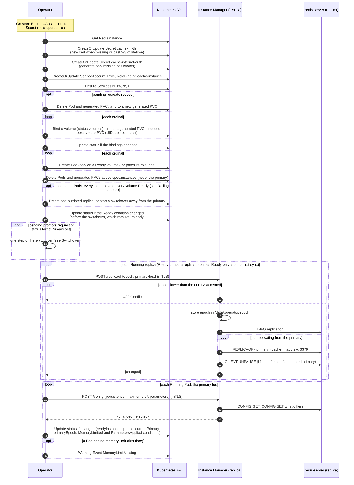

## RedisCluster

A `RedisCluster` runs Redis Cluster: the 16384 hash slots are split equally
between `spec.shards` masters, each with `instancesPerShard - 1` replicas.
Every shard is a `RedisInstance` `<name>-<n>` of its own, owned by the
cluster; it reuses Pods, volumes, TLS, users, configuration and rolling
updates of a `RedisInstance`, but Redis Cluster, not the operator, elects
the masters. The examples use the cluster `store` with `shards: 3` and
`instancesPerShard: 2`.

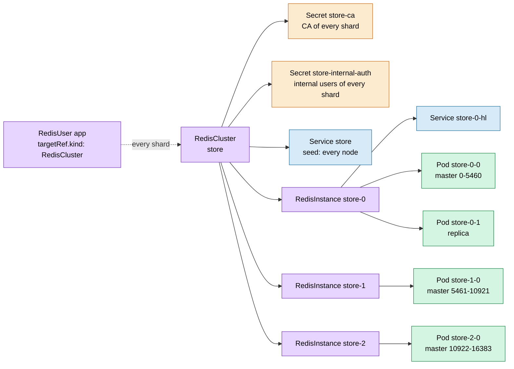

A shard differs from a `RedisInstance` of its own:

| | `RedisInstance` | shard of a `RedisCluster` |
|---|---|---|
| Spec | yours | copied from the `RedisCluster`; edits are overwritten |
| Services | `-hl`, `-rw`, `-ro`, `-r` | `-hl` only; clients go through the seed Service `store` |
| CA of the TLS of Redis | `<name>-ca` | `store-ca`, one per cluster; certificates also name the seed Service |
| Internal users | `<name>-internal-auth` | `store-internal-auth`, one per cluster, see [Changing the number of shards](#changing-the-number-of-shards) |
| Primary | chosen by the operator (safe start, failover) | the node that serves slots, as the Instance Manager reports it |
| Failover | the operator, after `failover.delay` | Redis Cluster, after `cluster-node-timeout` (15 s) |
| Pods | | `--cluster`, port `16379` (cluster bus), label `redis.operator.com/cluster=store` |

The operator never takes an existing `RedisInstance` named like a shard
for one: it would turn its data into a node of the cluster. The reconcile
of the `RedisCluster` fails with an error that names it, until you rename
or delete that `RedisInstance`.

### Connecting

Clients need cluster support (`redis-cli -c`, Lettuce, go-redis
`ClusterClient`, redis-py `RedisCluster`). They read the slot map from any
node through the seed Service and then connect to every node by its name:
`MOVED` and `CLUSTER SLOTS` give Pod DNS names
(`cluster-preferred-endpoint-type hostname`), which the certificates cover.

```sh
kubectl get secret store-ca -o jsonpath='{.data.ca\.crt}' | base64 -d > ca.crt
redis-cli -c --tls --cacert ca.crt -h store.<namespace>.svc --user <user> --pass <password>
```

There is no read-only Service: a client reads from replicas with `READONLY`
on its connections to them (Lettuce `ReadFrom.REPLICA_PREFERRED`, go-redis
`ReadOnly: true`, redis-py `read_from_replicas=True`).

Use a client with connect and command timeouts and retries. During a
rolling update a new connection may hang for a moment on a Pod that is
going away, and a node that has just restarted may answer `MOVED` with `?`
for a node whose name it has not learned yet. Neither stops the cluster:
it stays `ok` and never answers `CLUSTERDOWN`.

### Building the cluster

The `RedisCluster` controller asks the Instance Managers of the nodes for
their cluster state (`GET /status`) and runs one stage per pass, once every
Pod that runs answers:

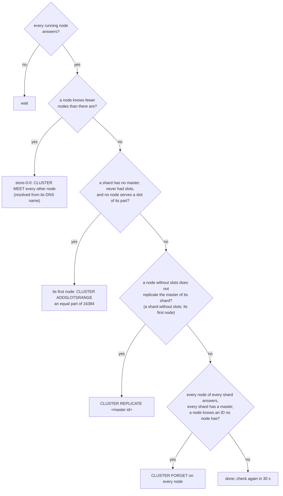

Every command is idempotent. `status.shards` keeps the slots each shard
had: a shard that lost them, e.g. every one of its volumes, does not get
them again on its own, as that would serve an empty dataset. That needs a
person.

A shard added later finds its part of the slots served by the other
shards, so it takes no slots here: its first node is an empty master that
the other nodes of the shard replicate, and the slots come to it by
[moving](#changing-the-number-of-shards).

**Every Pod restarted at once** (e.g. a restart of the nodes) gives every
node a new IP, while `nodes.conf` of each knows the others by the old ones:
the cluster bus reaches nobody and the cluster stays `fail`. The Instance
Manager reports the nodes it flags `fail` or `fail?`; when one of them is a
node that runs, the first node meets every other one again by its DNS name,
and Redis gives the ID it knows the new address, which gossip spreads. A
replica takes a new address of its master into the replication only from
the master itself, so the Instance Manager also reports a replica that
replicates from an address its master no longer has (`staleMaster`), and it
gets `CLUSTER REPLICATE` of the same master again. On the homelab the
cluster was `ok` and `Ready` with every replica in sync about 70 s after all
6 Pods were deleted.

`cluster-allow-replica-migration no` keeps every replica in its shard, so
in the `RedisInstance` that owns its Pod.

### Moving a master

Redis Cluster fails over on its own when a master is down longer than
`cluster-node-timeout`; the operator only follows. A Pod that comes back
sooner, with `nodes.conf` on its volume, is the master again and no
failover happens. Every shard checks the role of its nodes at least every
30 s and records the master in `status.currentPrimary`; the role label and
the PodDisruptionBudgets follow it.

The operator moves a master itself with `CLUSTER FAILOVER` on a replica,
which waits until the replica has every write and then lets the masters
elect it:

- a switchover you ask for, with the annotation `redis.operator.com/promote`
  on the shard, see [Requests](#requests);
- a rolling update, after every replica of the shard is updated;
- a scale-down of `instancesPerShard` that removes the master;
- the volume of the master that is being deleted or lost.

`status.targetPrimary` and the condition `Switchover` of the shard hold it
until the replica is the master, or for a minute: then `Switchover=False/Failed`
and a rolling update waits 5 minutes before it tries again. **One shard at a
time:** the masters give one vote per epoch, and none again for the same
shard for twice `cluster-node-timeout`, so failovers of two shards at once
lose votes and take half a minute or more each.

None of these starts while slots move between shards: the shard waits
until `status.slotMigration` of the cluster is gone, see
[Changing the number of shards](#changing-the-number-of-shards).

### Volumes and scaling

A replica whose volume is replaced (deleted or lost PVC, the
`redis.operator.com/recreate` request) starts empty with a new node ID. The
cluster meets it and makes it a replica of its shard, which syncs it; then
every node forgets the old ID. The volume of a master is never replaced
before the master moves, see [Volumes](#volumes).

`instancesPerShard` may change. New nodes join as replicas. On a
scale-down the master moves to a remaining replica first, then the Pods
above the new count go and the other nodes forget them. For `shards`, see
the next section.

### Changing the number of shards

`spec.shards` may change, down to 3. The operator then moves slots, with
their keys, until every shard serves its equal part of the 16384 and the
shards above the new count none:

```sh
kubectl patch rediscluster store --type merge -p '{"spec":{"shards":4}}'
kubectl get rediscluster store -o jsonpath='{.status.conditions[?(@.type=="Migrating")].message}'
# Moving slot 5460 from store-0-0 to store-3-0; 3812 slots to move
```

A slot moves the classic way of Redis 7.2, the way `redis-cli --cluster
reshard` does it: `CLUSTER SETSLOT IMPORTING` on the target,
`MIGRATING` on the source, `MIGRATE` of the keys of the slot, 100 at a time,
until none is left, then `SETSLOT NODE` on the target and then on the
source. Meanwhile clients get `ASK` for a key that has moved already, and
`TRYAGAIN` for a command on several keys of which only some have; a cluster
client follows the first and retries the second. The cluster stays `ok`.

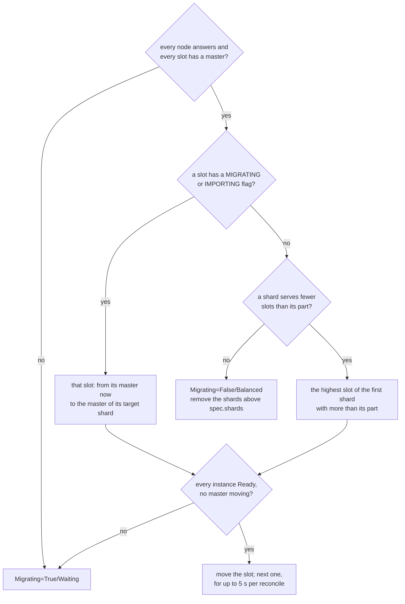

The decisions, and why:

1. **Minimal move.** A shard with more than its part gives its highest
   slots to a shard with fewer, like `redis-cli --cluster rebalance`, so no
   slot moves twice: 3 → 4 moves 4096 slots, the part of the new shard, and
   every old shard keeps the rest of its own. The parts are those of
   `slotRange`, but the slots of a shard are no longer one range after a
   move: `store-0` may serve `0-4095` and `store-3` `4096-5460,9557-10921,15018-16383`.
2. **One internal Secret for the cluster.** `MIGRATE` logs in to the target
   with `AUTH2 _operator <password>`, so the source must know the password
   of the target. Every shard mounts `store-internal-auth`, which the
   `RedisCluster` creates before the shards, like the one CA `store-ca`:
   `MIGRATE` goes over TLS with `tls-cluster yes`, to the Pod DNS name of
   the target. The policy of a shard lets the nodes of the cluster in on
   `6379` too, see [Users and network policies](#users-and-network-policies):
   without it `MIGRATE` would hang until its timeout.
3. **Gates.** A slot starts only while every instance of every shard is
   Ready and no shard has `status.targetPrimary`: a move to a master that is
   going away is wasted, and a Pod that restarts takes `MIGRATE` down with
   it. The gate is checked before every slot, not once per reconcile. The
   shards in turn start no `CLUSTER FAILOVER` of their own (rolling update,
   promote, scale-down, volume) while `status.slotMigration` is set, also
   while `Blocked`: a failover of the source loses its `MIGRATING` flag. Its
   rolling update waits, its promote waits and runs once the slots are in
   place. A failover of Redis Cluster itself, of a master that is down,
   still happens; see resuming below.
4. **`BUSYKEY` stops.** A key of the slot that the target has already, e.g.
   written there with `ASKING` by a client, makes `MIGRATE` fail with
   `BUSYKEY`. The operator does not use `REPLACE`, which could overwrite the
   newer value: it stops with `Migrating=False/Blocked`, the slot, both
   nodes and the key. Delete the key on the node whose copy is wrong (on the
   target with `ASKING` first), and the move goes on.
5. **No change of `shards` while slots move.** A rule of the CRD rejects a
   change of `spec.shards` while `status.slotMigration` is set: the target
   parts would change under a slot on the way. Change it again once
   `Migrating` is `Balanced`.
6. **Shrinking is automatic.** With fewer `shards`, the shards from the new
   count on give away every slot, with its keys. Once every slot has a
   master of a remaining shard and no slot has a flag, the operator deletes
   their `RedisInstance`s, with the Pods and the PVCs, and then the other
   nodes forget them. In that order: a node forgotten while it still runs
   comes back by gossip, and one deleted while it still serves a slot takes
   the keys with it.
7. **Status.** `Ready=False/Resharding` while slots move; the condition
   `Migrating` says what happens: `True/Moving` with the slot and how many
   are left, `True/Waiting` with what it waits for, `False/Blocked`, or
   `False/Balanced` when done. `status.slotMigration.slotsToMove` counts the
   slots left. The health check of Argo CD in
   [Ready condition](#ready-condition), as
   `redis.operator.com_RedisCluster`, shows `Resharding` as `Progressing`.
8. **One slot at a time** in the whole cluster: at most one slot has a
   flag at any moment, so a failover or a restart has at most one slot to
   finish. One reconcile moves slots for up to 5 s, one call of the
   Instance Manager runs `MIGRATE` for up to 5 s, and the reconcile a
   second after it goes on, so the status, with the slots of every shard,
   follows every few seconds. That is about 50 slots a second without keys: 3 → 4 takes about
   two minutes, plus the time to send the keys.

**Resuming.** The operator keeps no state of a move: the flags are in
`nodes.conf` of the nodes and in `CLUSTER NODES` (`[5460->-<id>]`,
`[5460-<-<id>]`), and the Instance Manager reports them. Every reconcile
first finishes a slot that has a flag, from the master that serves it now
to the master of the shard it goes to, and every step does nothing when it
is done already. A restart of the operator, a reconcile cut by its 5 s, or
a failover of the source or the target, which lose the flags of the old
master, all go on from where the nodes are. A flag that names a node gone
for good stops all moves; clear it with `CLUSTER SETSLOT <slot> STABLE`.

### Users and network policies

A `RedisUser` with `targetRef: {kind: RedisCluster, name: store}` is a user
of every shard; it is `Ready` once every node of every shard has it, and
the [validation webhook](#validation-webhook) checks its username against
every shard.

`spec.networkPolicy.allowFrom` of the cluster goes to every shard. The
policy of a shard also lets in the nodes of the whole cluster on the
cluster bus, and on the port of Redis for `MIGRATE`:

```yaml
    - ports: [{port: 16379}, {port: 6379}]
      from: [{podSelector: {matchLabels: {redis.operator.com/cluster: store}}}]
```

Without `allowFrom`, add that rule to a policy of your own, next to the ones
of a [RedisInstance](#network-policies).

### Status

```sh
kubectl get rediscluster store
# NAME    SHARDS   STATE   READY   REASON   AGE
# store   3        ok      True    Ready    5m
```

| Field | Content |
|---|---|
| `status.clusterState` | `cluster_state` of a master: `ok` or `fail` |
| `status.shards[]` | per shard: its master and its slots, also of a shard on its way out |
| `status.slotMigration` | while slots move: `slotsToMove` |
| `SlotsCovered` | `True/Covered`, or `False/Uncovered` with how many slots have no master |
| `Migrating` | `True/Moving`, `True/Waiting`, `False/Blocked` or `False/Balanced` |
| `Ready` | `True/Ready`; `False` with `SlotsUncovered`, `ClusterFail`, `Resharding` or `ShardsNotReady` |

Limits:

- A cordoned node does not move a master of a shard away; the
  PodDisruptionBudget holds the drain until Redis Cluster or a switchover
  moves it.
- Redis Cluster has one database; Redis ignores `spec.redis.startup.databases`.
