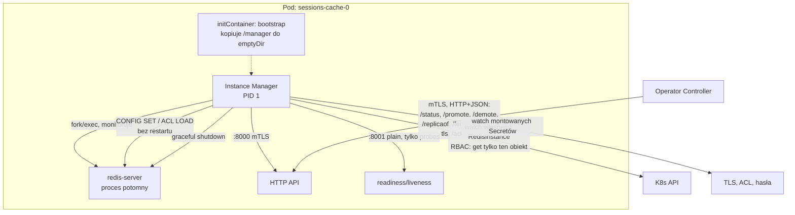
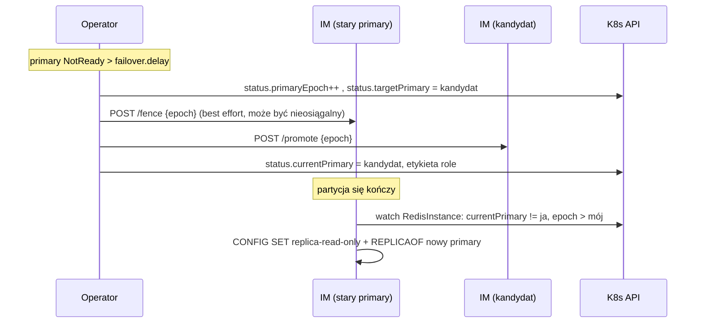
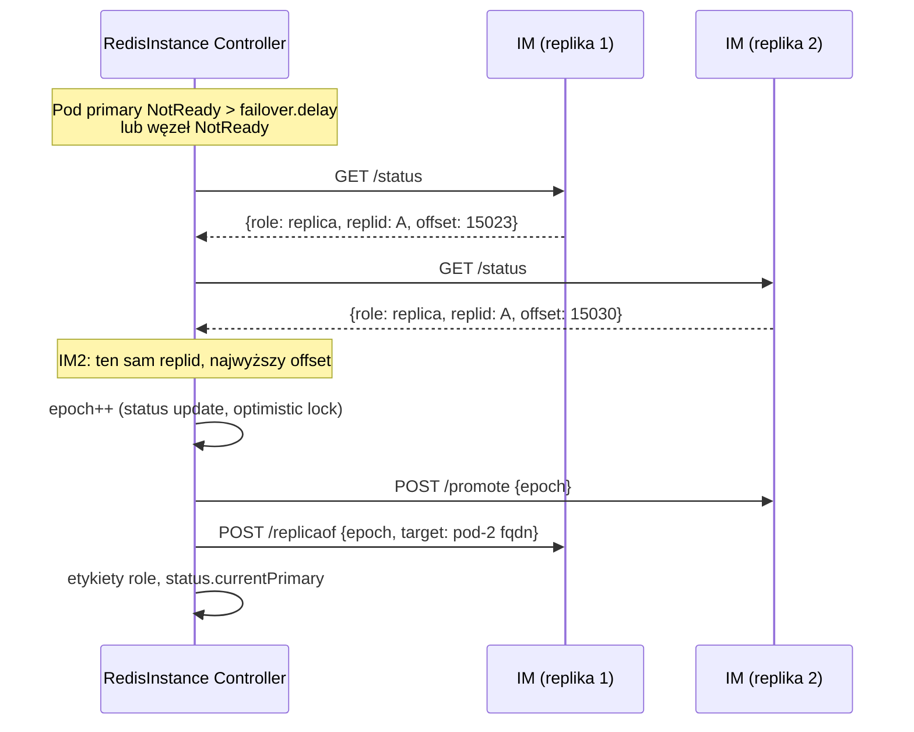
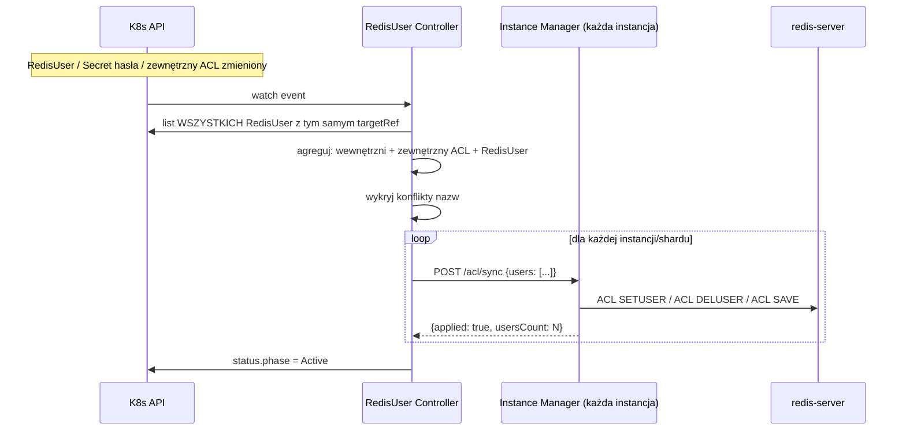
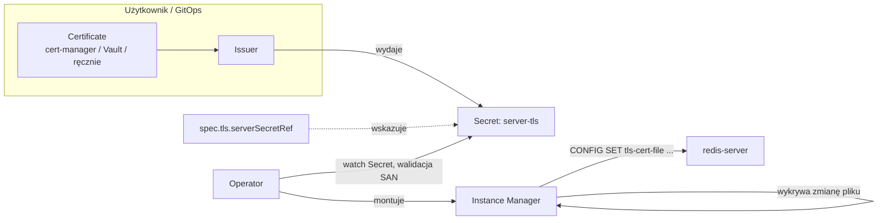
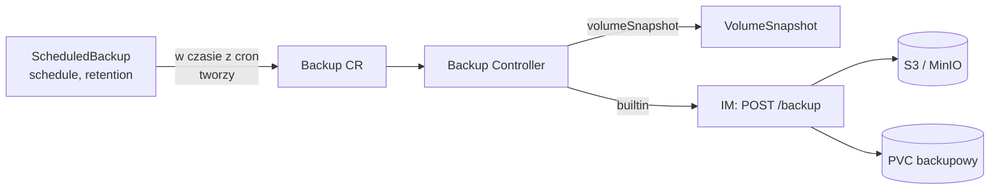
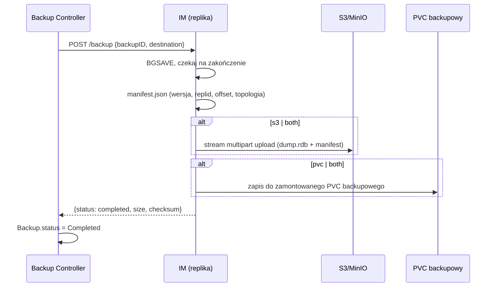

# Redis Operator — plan master

Jedyny obowiązujący dokument architektoniczny. Zastępuje wcześniejsze pliki (`redis-operator-plan.md`, `redis-operator-cnpg-style.md`, `redis-operator-final-model.md`). Zawiera tylko decyzje w aktualnej wersji. Decyzje odrzucone są opisane w sekcji 14, razem z uzasadnieniem.

**API group:** `redis.operator.com/v1`. Prefiks adnotacji i etykiet operatora: `redis.operator.com/`.

---

## 1. Filozofia — wzorzec CloudNativePG + Strimzi

Operator działa na zasadzie **deklaratywnego "zamawiania"**: użytkownik opisuje, czego chce (instancja, klaster, użytkownik, backup), a operator wykonuje wszystkie niskopoziomowe operacje. Użytkownik nie dotyka bezpośrednio Poda, PVC ani komend administracyjnych Redisa.

| Wzorzec | Zapożyczony z | Zastosowanie u nas |
|---|---|---|
| Pody zarządzane bezpośrednio (nie StatefulSet) | CloudNativePG | Pełna kontrola nad cyklem życia każdej instancji z osobna |
| Instance Manager (binarka jako PID 1 w kontenerze) | CloudNativePG | Lokalne decyzje: promocja, fencing, reload TLS/ACL, graceful shutdown |
| Binarka IM kopiowana initContainerem | CloudNativePG | Działa z upstreamowym obrazem `redis`/`valkey`, bez własnego obrazu bazy |
| `TargetRef` — satelickie CRD referencujące właściciela danych | Strimzi (`KafkaUser`→`Kafka`) | `RedisUser`, `Backup`, `ScheduledBackup` wskazują na `RedisInstance`/`RedisCluster` |
| Bring-your-own dla TLS, userów/ACL i PVC | CloudNativePG | Operator konsumuje gotowe zasoby, a gdy ich nie podano, generuje własne |
| `-rw`/`-ro`/`-r` nazewnictwo Service | CloudNativePG | Czytelny, przewidywalny dostęp do primary i replik |
| Kubernetes API (etcd) jako jedyne źródło prawdy o topologii | CloudNativePG | Brak zewnętrznego mechanizmu konsensusu (Sentinel) — patrz sekcja 14 |

### Wspierane silniki i wersje

Minimum to **Redis 7.2 / Valkey 7.2**. Uzasadnienie:
- `cluster-announce-hostname` i `cluster-preferred-endpoint-type` (od 7.0) są potrzebne do stabilnego DNS w `RedisCluster`.
- `CLUSTER SHARDS` jest dostępne od 7.0.
- 7.2 to ostatni Redis na licencji BSD. Od 7.4 Redis jest na RSAL/SSPL, a od 8.0 na RSAL/SSPL/AGPL. Valkey (BSD, fork 7.2) jest traktowany jako pełnoprawny silnik docelowy.

Silnik wybiera użytkownik przez `spec.image`. Instance Manager wykrywa wersję i silnik przez `INFO server` i raportuje je w statusie.

---

## 2. CRD — pełny model

```mermaid
graph TB
    RI[RedisInstance<br/>primary + N replik]
    RC[RedisCluster<br/>M shardów]
    RU[RedisUser]
    BK[Backup]
    SBK[ScheduledBackup]

    RU -->|targetRef| RI
    RU -->|targetRef| RC
    BK -->|targetRef| RI
    BK -->|targetRef| RC
    SBK -->|targetRef, tworzy| BK

    PVC1[(Zewnętrzny PVC)]
    PVC2[(PVC generowany przez operator)]
    TLS1[Zewnętrzny Secret TLS<br/>np. cert-manager]
    ACL1[Zewnętrzny Secret ACL<br/>np. Vault/ESO]

    RI -.existingClaims.-> PVC1
    RI -.volumeClaimTemplate.-> PVC2
    RI -.tls.serverSecretRef.-> TLS1
    RI -.acl.externalSecretRef.-> ACL1
```

| CRD | Właściciel danych? | Kluczowe pola |
|---|---|---|
| `RedisInstance` | Tak | `instances`, `storage`, `tls`, `acl`, `networkPolicy`, `replication`, `bootstrap` |
| `RedisCluster` | Tak | `shards`, `instancesPerShard`, `instanceTemplate` |
| `RedisUser` | Nie (autoryzacja) | `targetRef`, `username`, `authentication`, `acl.rules` |
| `Backup` | Nie | `targetRef`, `method: volumeSnapshot \| builtin`, `builtin.destination` |
| `ScheduledBackup` | Nie | `targetRef`, `schedule`, `backupTemplate`, `retention` |

Restore nie jest osobnym CRD. Robi się go przez `spec.bootstrap` nowego `RedisInstance`/`RedisCluster` (sekcja 10), tak jak w CNPG.

### Wspólny wzorzec `TargetRef`

```go
type TargetRef struct {
    // +kubebuilder:validation:Enum=RedisInstance;RedisCluster
    Kind string `json:"kind"`
    Name string `json:"name"`
}
```

Jeden typ Go i jedna funkcja `resolveTarget(ctx, ref) (client.Object, error)`, używana zarówno przez webhook, jak i przez kontrolery (sekcja 12).

---

## 3. RedisInstance — silnik bazowy (primary + repliki)

### Pody zarządzane bezpośrednio, nie StatefulSet

Każda instancja ma jawną, przewidywalną nazwę (`<name>-0`, `<name>-1`, ...). Tworzy ją i usuwa jawnie Reconciler. Ordinal to **tożsamość**, a nie rola. Rola (`primary`/`replica`) jest zapisana w `status.currentPrimary` i w etykiecie `redis.operator.com/role`.

Każdy Pod ma ustawione `spec.hostname: <name>-<ordinal>` i `spec.subdomain: <name>-hl`, dzięki czemu dostaje stabilny DNS:

```
<name>-<ordinal>.<name>-hl.<namespace>.svc.cluster.local
```

**Replikacja zawsze używa nazw DNS, nigdy Pod IP.** Pod IP zmienia się przy każdym restarcie Poda, więc `REPLICAOF <PodIP>` zrywa replikację po restarcie primary. Redis dostaje `replica-announce-ip <fqdn>`, żeby w `INFO replication` pokazywał nazwy DNS.

### Kształt spec

```yaml
apiVersion: redis.operator.com/v1
kind: RedisInstance
metadata:
  name: sessions-cache
spec:
  instances: 3
  image: valkey/valkey:8.0
  storage:
    volumeClaimTemplate:
      size: 5Gi
      storageClassName: fast-ssd
    existingClaims: []            # sekcja 6
  replication:
    minReplicasToWrite: 1         # 0 = wyłączone; sekcja 3.3
    minReplicasMaxLag: 10
  failover:
    delay: 30s                    # ile primary może być NotReady przed failoverem
  affinity:
    podAntiAffinityType: required # required | preferred
  resources:                      # corev1.ResourceRequirements; sekcja 3.9
    requests: {memory: 2Gi, cpu: 500m}
    limits:   {memory: 2Gi}
  tls: {}                         # sekcja 7
  acl: {}                         # sekcja 8
  networkPolicy: {}               # sekcja 9
  bootstrap: {}                   # sekcja 10 (restore)
  redis:
    persistence: aof              # aof | rdb | none
    maxmemoryPolicy: noeviction   # sekcja 3.9
    maxmemoryRatio: 75            # % limitu pamięci → maxmemory; sekcja 3.9
    modules: []                   # sekcja 3.7
```

### Instance Manager — serce wzorca



**Dystrybucja binarki.** Obraz operatora zawiera binarkę `manager`. InitContainer (obraz operatora) kopiuje ją do współdzielonego `emptyDir`, a kontener `redis` (obraz użytkownika, np. `redis:7.2`) ma nadpisany `command: ["/controller/manager", "instance", "run"]`. Dzięki temu nie trzeba budować własnego obrazu Redisa, a użytkownik może podać dowolny zgodny obraz Redis/Valkey.

**Transport: HTTP + JSON, nie gRPC.** Łatwiej go debugować (`curl`), nie wymaga toolchainu `protoc`/`buf`, a CNPG robi tak samo. Komunikacja jest ukryta za interfejsem, żeby transport dało się wymienić:

```go
type InstanceManagerClient interface {
    Status(ctx context.Context) (InstanceStatus, error)
    Promote(ctx context.Context, epoch int64) error
    Demote(ctx context.Context, epoch int64, primaryHost string) error
    ReplicaOf(ctx context.Context, epoch int64, primaryHost string) error
    Fence(ctx context.Context, epoch int64) error
    ReloadTLS(ctx context.Context) error
    SyncACL(ctx context.Context, users []ACLUser) error
}
```

Dlaczego Instance Manager, a nie operator łączący się bezpośrednio z Redisem:
1. **Lokalne decyzje bez roundtripu** — reload certu/ACL i fencing dzieją się w Podzie, natychmiast.
2. **Bezpieczny start** — IM decyduje, w jakiej roli uruchomić `redis-server` (sekcja 3.3), zanim proces przyjmie pierwsze połączenie.
3. **Graceful shutdown** — przy SIGTERM na primary IM najpierw robi switchover (jeśli jest zdrowa replika), a dopiero potem zatrzymuje `redis-server`. Na replice po prostu zamyka proces.
4. **Bogaty status** — offset replikacji, lag, `master_replid`, `cluster_state`, epoch.
5. **Idempotencja** — `POST /replicaof` najpierw sprawdza `INFO replication` i nic nie robi, jeśli replika już jest podpięta do właściwego primary z `master_link_status:up`. Obecne `setReplicaOf` w każdym reconcile (bez sprawdzenia stanu) zostanie usunięte.

### 3.1 Bezpieczeństwo API Instance Managera

API IM pozwala promować, degradować i zmieniać ACL, więc bez uwierzytelnienia każdy Pod w klastrze mógłby przejąć bazę. Dlatego:

- Operator utrzymuje **wewnętrzne PKI dla IM** (CA per operator, Secret w namespace operatora; certyfikat serwerowy per `RedisInstance`). To PKI jest **zawsze** generowane przez operator i jest niezależne od TLS Redisa z sekcji 7.
- Port `:8000` (API) wymaga mTLS: IM akceptuje tylko certyfikat klienta z CN operatora.
- Port `:8001` (probes) wystawia tylko `/healthz` i `/readyz`, bez żadnych mutacji.
  - `/healthz` (liveness) sprawdza tylko IM, nie Redisa: ładowanie dużego datasetu nie może restartować Poda.
  - `/readyz` (readiness): `PING` (odrzuca `LOADING`), a na replice dodatkowo zakończony pierwszy pełny sync (`master_link_status:up` i `master_sync_in_progress:0`). Spełniony warunek IM zapamiętuje do swojego restartu: przy awarii primary repliki zostają w `-ro` i serwują lekko nieaktualne dane, zamiast wypaść wszystkie naraz. Primary nie jest zapamiętywany, więc zdegradowany primary musi najpierw zsynchronizować się jako replika.
- Operator zawsze tworzy wbudowaną NetworkPolicy pozwalającą na ruch do `:8000` tylko z Podów operatora. Jest ona niezależna od `spec.networkPolicy.mode`, bo to element bezpieczeństwa operatora, a nie aplikacji.

### 3.2 Użytkownicy wewnętrzni

Operator generuje Secret `<name>-internal-auth` z dwoma zarezerwowanymi użytkownikami Redisa:

| User | Uprawnienia | Użycie |
|---|---|---|
| `_operator` | `+@all ~* &*` | IM → lokalny `redis-server` (admin, ACL, CONFIG) |
| `_replication` | `+psync +replconf +ping` | `masteruser`/`masterauth` replik |

Nazwy z prefiksem `_` są zarezerwowane. `RedisUser` i zewnętrzny ACL nie mogą ich używać (walidacja CEL + IM).

Użytkownik `default` jest domyślnie **wyłączony** (`user default off`). Można go jawnie włączyć przez `spec.acl.defaultUser: enabled` (np. dla środowiska deweloperskiego).

### 3.3 Split-brain, fencing i ochrona przed pustym primary

To trzy najważniejsze mechanizmy poprawności. Muszą powstać **przed** automatycznym failoverem.

#### Epoch (generacja primary)

`status.primaryEpoch` (int64) rośnie przy każdej zmianie primary. Każda mutacja w IM (`/promote`, `/demote`, `/replicaof`, `/fence`) niesie epoch:
- IM zapisuje ostatni widziany epoch na PVC (`/data/.operator/epoch`).
- IM **odrzuca** polecenie z epoch mniejszym niż zapisany (HTTP 409). To chroni przed opóźnionym poleceniem ze starego lidera operatora (np. po zmianie leadera w leader election).

#### Fencing starego primary



- **Aktywny fencing:** `POST /fence` przełącza Redis w tryb odrzucający zapisy (`CLIENT PAUSE WRITE` bez timeoutu) i rozłącza klientów.
- **Samo-fencing:** IM watchuje własny `RedisInstance`. Jeśli `status.currentPrimary` wskazuje inny Pod, a `status.primaryEpoch` jest wyższy niż lokalny, IM sam degraduje swój Redis do repliki.
- **Utrata kontaktu z API serwerem:** jeśli IM na primary nie może odczytać swojego `RedisInstance` dłużej niż `failover.delay`, sam się fencuje. Taniej jest chwilowo odrzucić zapisy niż ryzykować dwa primary.
- **Selector `-rw`** opiera się na etykiecie `role=primary`. Operator zdejmuje ją ze starego Poda przed nadaniem nowemu, więc ruch Service nigdy nie trafia do dwóch primary jednocześnie.
- **Granica utraty danych:** replikacja Redisa jest asynchroniczna. `spec.replication.minReplicasToWrite` → `min-replicas-to-write`/`min-replicas-max-lag` sprawia, że izolowany primary sam przestaje przyjmować zapisy. Domyślnie `0`, bo przy `instances: 1` blokowałoby to wszystkie zapisy. Dokumentacja musi to jasno opisać.

#### Bezpieczny start — ochrona przed pustym primary

Klasyczny problem Redisa: primary restartuje się z pustym datasetem (brak persystencji albo uszkodzony RDB), repliki robią pełny resync i **kasują swoje dane**.

Reguła IM przy starcie Poda:
1. IM odczytuje `RedisInstance` z API.
2. Jeśli `status.currentPrimary != ja` → start `redis-server` od razu z `replicaof <currentPrimary-fqdn>`.
3. Jeśli `status.currentPrimary == ja` → start z `replicaof no one`, ale **w trybie fenced** (zapisy wstrzymane). IM raportuje `offset`, `master_replid` i rozmiar datasetu. Operator porównuje to z replikami:
   - dane spójne (ten sam `replid`, offset ≥ offsetów replik) → operator zdejmuje fence;
   - dane puste lub starsze niż na którejś replice → operator robi **failover na najlepszą replikę** (epoch++), a ten Pod startuje jako replika.
4. Persystencja jest domyślnie włączona (`appendonly yes`, `appendfsync everysec` + RDB). Wyłączyć ją można tylko jawnie przez `spec.redis.persistence: none`. Wtedy punkt 3 zawsze kończy się failoverem, jeśli jest dostępna replika.

### 3.4 Failover — wybór kandydata



Kryteria wyboru: ten sam `master_replid` co ostatnio znany primary, najwyższy `master_repl_offset`, `master_link_status` niedawno `up`. Remis rozstrzyga niższy ordinal (determinizm).

**Planowany switchover** przez `kubectl annotate redisinstance sessions-cache redis.operator.com/promote=sessions-cache-2` (krok 3.2, opis dla użytkownika w `docs/architecture.md`). Przebieg: walidacja → `status.targetPrimary` + `primaryEpoch++` (zapis statusu przed pierwszym poleceniem do IM) → fence primary → czekanie, aż kandydat dogoni offset (ten sam `replID`, offset ≥) → promote → `status.currentPrimary` → demote starego przez `/replicaof`. Każdy krok da się powtórzyć: po crashu operator kontynuuje od `status.targetPrimary`, a cel, który jest już `master`, oznacza udany promote. Kandydat, który nie dogoni w ciągu minuty, kończy switchover jako `Failed` i zdejmuje fence. Awaryjny failover nie czeka na zerowy lag (odpowiedź na dawną otwartą decyzję #2).

### 3.5 Odporność na awarie węzłów i drain

- **PodDisruptionBudget** generowany automatycznie:
  - PDB dla replik: `maxUnavailable: 1`.
  - PDB dla primary: `minAvailable: 1`. Drain węzła z primary jest blokowany, dopóki operator nie zrobi switchoveru. Operator wykrywa cordon na węźle primary i sam inicjuje switchover.
- **Anti-affinity** po `redis.operator.com/instance`, domyślnie `required` (instancje na różnych węzłach), z opcją `preferred` dla małych klastrów.
- **Węzeł NotReady:** Pod na martwym węźle wisi w `Terminating`/`Unknown`, bo nie ma kontrolera, który by go przeniósł. Operator:
  1. traktuje go jako niedostępny po `failover.delay` → failover, jeśli to primary;
  2. nie usuwa siłowo Poda, dopóki węzeł może wrócić (ryzyko podwójnego montowania RWO);
  3. jeśli węzeł ma taint `node.kubernetes.io/out-of-service` (Kubernetes non-graceful node shutdown), operator usuwa Pod i odtwarza instancję na innym węźle. Zależnie od storage będzie to ten sam PVC (storage sieciowy) albo nowy (storage lokalny, opcja `spec.storage.recreateOnNodeLoss: true`, tylko dla PVC generowanych).

### Awarie woluminów (krok 4)

Rozszerzenie modelu z sekcji 6 o automatyczną reakcję. Zasada: **wygenerowany wolumin repliki jest jednorazowy** (operator naprawia sam), **zewnętrzny należy do użytkownika** (tylko raport i `recreate` na żądanie), **wolumin primary nigdy nie jest odtwarzany pusty** (primary zawsze przenosimy na replikę).

| Wolumin | Stan | Reakcja w kroku 4 |
|---|---|---|
| primary | `Terminating`, Pod działa | **automatyczny switchover** na najlepszą replikę (fence + zero lag, bez utraty danych); usunięcia PVC (`deletionTimestamp`) nie da się cofnąć, więc nie ma na co czekać. Po switchoverze stary ordinal jest repliką i dalej jak niżej. |
| primary | `Missing`/`Lost` albo Pod niedostępny > `failover.delay` | **failover**: promote repliki z tym samym `replid` i najwyższym offsetem, bez fence i bez czekania na lag (możliwa utrata ostatnich zapisów). Stary ordinal wraca jako replika na nowym PVC. |
| replika, generowany | `Terminating`, Pod działa | operator sam usuwa Pod (po jednej replice naraz, nigdy gdy trwa switchover/failover), żeby od razu przejść na nowy wolumin; dane tej repliki i tak przepadną przy zatrzymaniu Poda. Koszt: chwilowo jedna replika mniej w `-ro`. |
| replika, generowany | `Lost` | automatycznie jak `recreate`: usunięcie Poda i PVC, nowy PVC, pełny sync. |
| replika, generowany | `Missing` (Pod zniknął) | już w kroku 3.3: nowy pusty PVC. |
| replika, zewnętrzny | `Missing`/`Lost`/`Terminating` | bez automatu: raport (`StorageReady=False`, Event), naprawa przez `recreate`. |

Usuwa to lukę z kroku 3.3: primary bez woluminu i bez Poda nie zostaje już bez primary, bo awaria jego woluminu sama uruchamia failover.

### 3.6 Update istniejących Podów

Zmiana `spec.image` lub konfiguracji, która wymaga restartu, uruchamia rolling update: najpierw repliki (po jednej, czekając na `master_link_status:up` i nadrobienie lagu), na końcu switchover primary na zaktualizowaną replikę i restart starego primary. Zmiany, które da się zastosować przez `CONFIG SET`, idą bez restartu.

**Jak (krok 3.4):** Pod nosi adnotację `redis.operator.com/spec-hash` (hash PodSpec, z którego powstał). Inny hash niż Poda zbudowanego z bieżącego spec = Pod nieaktualny. Porównanie hasha, a nie PodSpec, bo API server dopisuje wartości domyślne. Operator działa tylko, gdy wszystkie instancje są Ready (Pod w trakcie usuwania się nie liczy), wszystkie woluminy są `Ready`, nie trwa switchover i nie ma adnotacji `promote`. Pod bez woluminu `Ready` nigdy nie jest nieaktualny (bez woluminu nie ma z czym porównać, a wymiana zostawiłaby instancję bez Poda). Switchover rolloutu przechodzi tę samą walidację co ręczny (np. brak zapisanego primary → czekanie). Wtedy: usuwa jedną nieaktualną replikę (pętla Podów tworzy ją od nowa na tym samym PVC), a gdy nieaktualny został tylko primary, robi switchover na najniższą replikę. `instances: 1` → restart primary (przerwa dla klientów). Po nieudanym switchoverze czeka 5 minut. Czekanie na Ready oznacza zakończony pierwszy sync, nie zerowy lag; zerowy lag ma tylko primary, przez switchover.

**GitOps (krok 3.4c–e).** Rolling update nie gryzie się z Argo CD/Flux: w gicie jest `RedisInstance`, Podami zarządza operator, a zmiana `spec.image` w gicie to zamierzona ścieżka. Gryzą się trzy rzeczy, które trzeba poprawić:
- **3.4c — condition `Ready` i health check** (zrobione). Bez niej Argo pokazuje `Healthy` w środku rolling update. `Ready=True`, gdy wszystkie instancje Ready, żaden Pod nie jest nieaktualny, nie trwa switchover i `StorageReady=True`; inaczej `False` z powodem `RollingUpdate`/`Switchover`/`InstancesNotReady`/`StorageNotReady`. W docs gotowy health check Lua dla Argo (`False` z `StorageNotReady` → `Degraded`, reszta → `Progressing`).
- **3.4d — idempotentne `promote` i `recreate`** (zrobione). Dziś operator zdejmuje adnotację po obsłużeniu; narzędzie, które naprawia dryf (`selfHeal`), dodaje ją z powrotem i żądanie wykonuje się znowu (dla `recreate`: nowy pusty wolumin i pełny resync w pętli). Kierunek: operator nie zdejmuje adnotacji, zapisuje obsłużoną wartość w statusie i reaguje tylko na nową wartość; powtórzenie tego samego żądania przez dopisany token (`recreate=cache-2@2026-10-24`), jak `kubectl rollout restart`. Rolling update czeka wtedy tylko na nieobsłużone `promote`.
- **3.4e — własna etykieta instancji** (zrobione). Pody i Services miały `app.kubernetes.io/instance=<nazwa RedisInstance>`, a Argo CD w trybie label tracking (domyślnym przed 3.0) uznaje po niej zasoby za swoje (OutOfSync, ryzyko prune). Zmiana na `redis.operator.com/instance`; bez migracji, bo operator nie ma jeszcze wdrożeń.

**Upgrade operatora (decyzja #5, sekcja 13).** Hash obejmuje initContainer `bootstrap` z obrazem operatora, więc nowa wersja operatora czyni nieaktualnymi wszystkie Pody wszystkich instancji w klastrze naraz. Decyzja: na razie restart przez rolling update, kontrola tempa (3.4f) i upgrade w miejscu razem w kroku 11; docelowo upgrade IM bez restartu Redisa (sekcja 3.10, krok 11).
- **3.4f — tempo rolling update** (odłożone 2026-10-24 do kroku 11: dotyczy dopiero klastra z wieloma instancjami i częstymi upgrade'ami operatora, a operator nie ma jeszcze wdrożeń). Limit równolegle aktualizowanych `RedisInstance` w klastrze (flaga operatora, np. `--max-concurrent-rollouts`, domyślnie 1; instancja „w trakcie” = ma nieaktualne Pody, licznik w pamięci lidera odbudowywany z listy instancji) i okno serwisowe w `spec` (np. `spec.updatePolicy.maintenanceWindow`), poza którym rolling wywołany **wyłącznie** zmianą operatora czeka; zmiana `spec` użytkownika idzie od razu. Condition `Ready=False` z powodem `RolloutPending` pokazuje, że Pody czekają.

**`/replicaof` także do replik, które nie są Ready.** Replika jest Ready dopiero po pierwszym syncu (sekcja 3.1), więc replika z nieaktualnym celem replikacji (np. wystartowała ze starym `replicaof` w `redis.conf` tuż przed switchoverem) nigdy nie zrobi syncu i nigdy nie będzie Ready. Dlatego operator wysyła `/replicaof` do każdej repliki w fazie Running, nie tylko Ready (krok 3.1); błąd IM w trakcie startu Poda oznacza tylko ponowienie reconcile.

### 3.7 Moduły Redisa

```yaml
spec:
  redis:
    modules:
      - name: crdt
        image: registry.example.com/redis-crdt-module:0.1.0   # obraz z plikiem .so
        path: /modules/crdt.so
        args: ["--site-id", "a"]
```

- Operator dodaje initContainer z obrazu modułu, który kopiuje `.so` do współdzielonego `emptyDir` (`/modules`), tak jak binarkę IM. Obraz silnika zostaje upstreamowy.
- IM uruchamia `redis-server` z `--loadmodule <path> <args...>` i raportuje załadowane moduły (`MODULE LIST`) w statusie.
- Zmiana listy modułów wymaga restartu `redis-server`, więc idzie przez rolling update (sekcja 3.6).
- To ogólny mechanizm (przydaje się też np. dla modułów JSON i wyszukiwania), a jednocześnie punkt integracji dla przyszłego modułu active-active (sekcja 18).

Silnik jest w IM ukryty za interfejsem `Engine` (start, konfiguracja, `INFO`, replikacja). Dzięki temu da się później podpiąć obok niego dodatkowy proces (np. syncer active-active) bez przepisywania IM.

### 3.8 RBAC i tożsamości

Kopiujemy sprawdzone wzorce zamiast projektować własne: tożsamość per instancja z CloudNativePG, ograniczanie zasięgu operatora ze Strimzi. Są trzy tożsamości, każda z minimalnymi uprawnieniami.

#### Operator

- Uprawnienia wyłącznie z markerów `+kubebuilder:rbac` → `make manifests` → `config/rbac/role.yaml`. Nowy typ zasobu = nowy marker, nigdy ręczna edycja YAML.
- **Domyślnie cały klaster** (ClusterRole + ClusterRoleBinding), jak CNPG.
- **Tryb ograniczony do namespace'ów** (wzorzec Strimzi): zmienna `WATCH_NAMESPACES=a,b` → cache managera obserwuje tylko te namespace'y (`cache.Options.DefaultNamespaces`), a instalacja wiąże **ten sam ClusterRole** przez **RoleBinding** w każdym obserwowanym namespace zamiast ClusterRoleBinding. Uprawnienia są wtedy fizycznie ograniczone przez RBAC, a nie tylko przez konfigurację operatora. Wtedy też Secrety całego klastra nie są czytelne dla operatora.
- Operator **nie** dostaje `escalate`/`bind`. Tworzy Role dla IM tylko z uprawnieniami, które sam posiada (ochrona przed eskalacją w K8s wymusza to automatycznie).

#### Instance Manager (wzorzec CNPG)

Operator tworzy **per `RedisInstance`** trzy obiekty z ownerReference (znikają razem z instancją):

| Obiekt | Nazwa | Zawartość |
|---|---|---|
| ServiceAccount | `<name>` | używany przez Pody instancji (`serviceAccountName`) |
| Role | `<name>` | `redis.operator.com/redisinstances`: `get`, `list`, `watch`, `resourceNames: [<name>]` |
| | | `secrets`: `get`, `resourceNames: [...]` tylko dla Secretów czytanych przez API (np. poświadczenia S3 backupu, sekcja 10) |
| RoleBinding | `<name>` | Role `<name>` → SA `<name>` |

- **IM tylko czyta.** Status `RedisInstance` pisze wyłącznie operator (jeden lider, sekcja 3.3). To świadomie ciaśniej niż w CNPG, gdzie instance manager aktualizuje status klastra.
- IM obserwuje swój obiekt z `fieldSelector=metadata.name=<name>`, bo `resourceNames` przy `list`/`watch` działa tylko z takim selektorem.
- Secrety montowane jako wolumen (TLS, ACL, `<name>-internal-auth`) **nie** wymagają RBAC, montuje je kubelet. Przez API IM czyta tylko to, czego nie da się zamontować do działającego Poda.
- `spec.serviceAccountTemplate.metadata` (wzorzec CNPG): użytkownik może dodać adnotacje do SA, np. `eks.amazonaws.com/role-arn` (IRSA) albo `iam.gke.io/gcp-service-account` (Workload Identity). Backup do S3/GCS działa wtedy bez statycznych kluczy w Secrecie.
- Do czasu, aż IM potrzebuje API (krok 2), Pody mają `automountServiceAccountToken: false`: w kontenerze z Redisem nie leży żaden token.

#### Użytkownicy klastra

- Role wygenerowane przez kubebuilder (`*_admin_role`, `*_editor_role`, `*_viewer_role`) dostają etykiety agregacji `rbac.authorization.k8s.io/aggregate-to-admin|edit|view: "true"` (jak opcja `rbac.aggregateClusterRoles` w Helm chart CNPG). Właściciel namespace'u z wbudowaną rolą `edit` może wtedy tworzyć `RedisInstance` bez dodatkowych uprawnień od admina klastra.
- Viewer **nie** widzi Secretów `<name>-internal-auth`: wbudowana rola `view` celowo nie obejmuje Secretów.

### 3.9 Pamięć i zasoby

Redis trzyma cały dataset w RAM, więc limit kontenera i `maxmemory` muszą do siebie pasować. Bez `maxmemory` Redis rośnie aż do limitu i dostaje OOMKill zamiast kontrolowanej odmowy zapisu albo eviction. Bez `resources` Pod ma QoS BestEffort i kubelet usuwa go jako pierwszy przy braku pamięci na węźle.

- **`spec.resources`** (`corev1.ResourceRequirements`) trafia 1:1 do kontenera `redis` (wzorzec CNPG). Dokumentacja zaleca requests = limits dla pamięci (QoS Guaranteed).
- **`maxmemory` liczone z limitu** (wzorzec Strimzi, który tak samo ustawia `-Xmx` JVM): `maxmemory = limit pamięci × maxmemoryRatio / 100`. IM czyta limit z cgroup v2 (`/sys/fs/cgroup/memory.max`, jak skrypt `dynamic_resources.sh` w Strimzi), bez dostępu do API K8s. Nie Downward API: `resourceFieldRef: limits.memory` bez limitu zwraca pamięć węzła i IM nie odróżni tego od prawdziwego limitu, a cgroup daje wtedy `max`. Cgroup widzi też limit domyślny z LimitRange.
- **`maxmemoryRatio`** domyślnie `75`. Zapas jest na copy-on-write przy fork (BGSAVE, przepisywanie AOF), bufory replikacji i klientów oraz fragmentację. Przy `persistence: none` fork nie występuje, więc można dać więcej. CEL: 10–95.
- **Brak limitu pamięci:** `maxmemory 0` (bez limitu) plus ostrzeżenie w statusie (Condition) i Event. Nie blokujemy, bo przydaje się w środowisku deweloperskim.
- **`maxmemoryPolicy`** domyślnie `noeviction`, bo operator traktuje Redisa jako magazyn danych i nie kasuje kluczy po cichu. Dla cache'a użytkownik wybiera `allkeys-lru`/`allkeys-lfu`. CEL: enum polityk Redisa.
- **Zmiany:** w kroku 1.5 IM zapisuje `maxmemory` i `maxmemory-policy` do `redis.conf` przy starcie Poda. Stosowanie `maxmemoryPolicy` i `maxmemoryRatio` w locie przez `CONFIG SET` dochodzi w kroku 3, razem z `spec.redis.parameters`. Zmiana `resources` wymaga nowego Poda, więc idzie przez rolling update (sekcja 3.6). In-place resize Podów (K8s ≥ 1.33) to możliwe rozszerzenie później.
- **Krok 3.5:** ogólne `spec.redis.parameters` i `spec.redis.persistence`, opisane w sekcji 3.11.

### 3.10 Upgrade Instance Managera w miejscu (krok 11)

Nowa wersja operatora podmienia binarkę IM w działającym Podzie bez restartu `redis-server` (wzorzec CNPG, `ENABLE_INSTANCE_MANAGER_INPLACE_UPDATES`).

**Dlaczego to robimy:**
- **Upgrade operatora nie powinien dotykać danych.** To zmiana warstwy sterującej (control plane), a dziś restartuje płaszczyznę danych każdej bazy w klastrze. Użytkownik bazy nie zmienił nic, a jego klienci tracą połączenia.
- **Koszt restartu Redisa rośnie z danymi.** Restart repliki to ładowanie RDB/AOF z dysku (przy dziesiątkach GB minuty) i resync; restart primary to switchover: pauza zapisów, reconnect, zerwane połączenia blokujące (`BLPOP`, `XREAD BLOCK`), subskrypcje pub/sub, client-side caching (tracking). W RedisCluster (krok 10) każda wymiana primary shardu to failover slotów i fala `MOVED` u klientów.
- **Restarty zniechęcają do aktualizacji operatora.** Przy N instancjach każdy release, także łatka bezpieczeństwa (CVE w Go lub zależnościach), to N switchoverów. Zespoły odkładają wtedy upgrade, a stary operator to ryzyko. Upgrade bez wpływu na bazy usuwa ten hamulec.
- **Skala.** Kontrola tempa (3.4f) rozkłada restarty w czasie, ale ich nie usuwa: przy setkach instancji rollout całego klastra trwa godziny po każdym releasie.

**Dlaczego dopiero na końcu:**
- Nowy IM musi przejąć cały stan starego. Każdy krok wcześniej dokłada stan do przejęcia (TLS i reload certów — 5, ACL — 6, backup w toku — 7, moduły). Zrobione wcześniej, przejęcie trzeba by poprawiać przy każdym kroku; na końcu robimy je raz, na kompletnym IM.
- Wymaga stabilnego kontraktu API IM (`/update`, `/status` niezmienne między wersjami), który ustala się dopiero, gdy API przestaje rosnąć.
- Do tego czasu restart (bez kontroli tempa) jest bezpieczny: switchover nie gubi zapisów. Krok 11 to optymalizacja dostępności, nie poprawność.

**Jak:**
1. `spec-hash` bez initContainera `bootstrap`; wersja IM w `/status` i w `status` instancji (spec Poda pokazuje wtedy stary obraz initContainera).
2. `PUT /update` (mTLS, tylko certyfikat operatora): binarka + sha256 zgodny z binarką operatora; zapis `/controller/manager.new`, fsync, stara jako `manager.prev`, atomowy `rename`.
3. `syscall.Exec` nowej binarki z flagą `--adopt=<pid redis-server>`: ten sam PID 1, `redis-server` zostaje dzieckiem. Nowy IM nie startuje Redisa, czeka na niego przez `Wait4`, przejmuje SIGTERM i sprzątanie zombie, podnosi od nowa :8000/:8001.
4. Stan w pamięci na dysk przed krokiem 11: latch readiness (`/data/.operator/synced`), żeby replika nie wypadła z Services po `exec`. Epoch jest już na dysku, fence żyje w Redisie.
5. Rollback: nowy IM, który nie zgłosi się zdrowo w N sekund, wraca do `manager.prev` (`exec`); restart kontenera po crashu uruchamia `manager.prev`, jeśli `manager` nie przeszedł startu. Operator aktualizuje po jednym Podzie i zatrzymuje się po pierwszej porażce (Event, condition).
6. Flaga operatora, na start domyślnie wyłączona (jak w CNPG); domyślnie włączona po ustabilizowaniu.

**Ryzyka:** `/update` z definicji uruchamia przysłany kod, więc wyciek CA operatora (`redis-operator-ca`) oznacza wykonanie kodu w każdym Podzie Redisa (dziś „tylko” fence/promote/replicaof) — opisać w docs, sprawdzać sha256. Version skew: nowy operator musi umieć wysłać `/update` do starego IM. Krótka dziura w probach między `exec` a `listen`. Pomaga tylko przy upgradzie operatora: zmiana `spec.image`, `resources` czy modułów dalej idzie przez rolling update.

Test e2e: dwa obrazy operatora (v1 → v2); `redis-server` ma ten sam PID i `uptime_in_seconds` przed i po, brak switchovera, epoch bez zmian, wersja IM w statusie = v2; zepsuta binarka v2 → rollback do v1 bez restartu Redisa.

### 3.11 Konfiguracja Redisa: `parameters` i `persistence` (krok 3.5)

```yaml
spec:
  redis:
    persistence: aof            # aof (domyślnie) | rdb | none
    startup:                    # tylko przy starcie: zmiana = rolling update
      databases: 16
      ioThreads: 1
    maxmemoryPolicy: noeviction
    maxmemoryRatio: 75
    parameters:                 # dowolne opcje redis.conf poza zarządzanymi przez operator
      hz: "20"
      notify-keyspace-events: Ex
```

**Wszystko przez `CONFIG SET`, nic przez `redis.conf`.** IM zapisuje w `redis.conf` tylko to, co musi być przy starcie (użytkownicy, replikacja, `appendonly` według dysku, patrz niżej). Resztę ustawia `CONFIG SET` po starcie `redis-server`, zanim Pod zgłosi Ready, a potem przy każdej zmianie spec (operator → `POST /config` do każdego Poda w fazie Running, idempotentnie przez `CONFIG GET`). Powód: literówka w `redis.conf` (`Bad directive`) zatrzymuje `redis-server` i daje crashloop przy pierwszym restarcie, a błąd `CONFIG SET` to tylko wpis w condition `ParametersApplied=False` (Ready → `ParametersNotApplied`, w Argo `Degraded`), Redis działa dalej. Zmiana `maxmemoryPolicy`, `maxmemoryRatio`, `persistence` i `parameters` nie restartuje Podów (dziś `maxmemory*` to flagi w PodSpec, czyli rolling update).

**Walidacja (CEL):** nazwy jak opcje `redis.conf`, najwyżej 64 wpisy, wartości jednoliniowe do 1024 znaków (nowa linia mogłaby dopisać opcję), odrzucone opcje zarządzane przez operator: porty, gniazda, `dir`/pliki danych, replikacja, użytkownicy i hasła, `maxmemory*` (osobne pola), `appendonly`/`save` (pole `persistence`), `tls-*` (krok 5), `cluster-*` (krok 10), `include`, `rename-command`, `loadmodule`, `enable-*-command`/`enable-protected-configs` (uruchamianie kodu).

**Opcje wymagające restartu** (Redis 7.2 odpowiada na `CONFIG SET` błędem `can't set immutable config`, sprawdzone na `redis:7.2`): `databases`, `io-threads`, `io-threads-do-reads`, `tcp-backlog`, `always-show-logo`, `disable-thp`, `set-proc-title`, `syslog-enabled`, `syslog-ident`, `syslog-facility`, `supervised`, `daemonize`, `unixsocket`, `unixsocketperm`, `pidfile`, `logfile`, `aclfile`, `appendfilename`, `appenddirname`, `cluster-enabled`, `cluster-config-file`, `enable-debug-command`, `enable-protected-configs`, `enable-module-command`. `dir` i `dbfilename` to opcje chronione (`can't set protected config`). Wszystkie pozostałe testowane (`port`, `bind`, `save`, `appendonly`, `appendfsync`, `hz`, `maxclients`, `oom-score-adj`, `activedefrag`, `lazyfree-*`, `latency-tracking`, `notify-keyspace-events`, `tls-port`…) zmieniają się w locie. **`startup` — osobna sekcja na opcje wymagające restartu** (`databases`, `ioThreads`). Nazwa i opis pola mówią wprost, że zmiana wymienia Pody (rolling update ze switchoverem primary). Typowane pola z `Minimum`/`Maximum` zamiast mapy: literówka w wartości opcji startowej dałaby `redis-server`, który nie wstaje (crashloop), a typ odrzuca ją już w API. Wartości domyślne = domyślne Redisa (16, 1). IM dostaje je jako flagi (część PodSpec, więc zmiana zmienia `spec-hash`) i wpisuje do `redis.conf`. `parameters` odrzuca `databases` i `io-threads*` z odesłaniem do `startup`. Pozostałe niezmienne opcje (np. `tcp-backlog`, `disable-thp`) nie mają pól; w `parameters` kończą się `ParametersApplied=False`. Nowe pole w `startup` dopiero, gdy ktoś go potrzebuje.

**`persistence`:**

| Wartość | Redis | Utrata przy crashu |
|---|---|---|
| `aof` (domyślnie) | `appendonly yes`, `appendfsync everysec` (zmienialne w `parameters`), plus snapshoty RDB (`save 3600 1 300 100 60 10000`) | do ~1 s zapisów |
| `rdb` | `appendonly no`, snapshoty RDB | zapisy od ostatniego snapshotu (minuty) |
| `none` | `appendonly no`, `save ""` | wszystko; dla cache'a |

**Przejścia między trybami — pułapki sprawdzone na `redis:7.2`:**
1. Start z `appendonly yes` na danych tylko w RDB (brak `appendonlydir`) daje **pusty dataset**: Redis ładuje wyłącznie AOF. Dotyczy np. restore z RDB do instancji `aof` i zmiany `rdb` → `aof`.
2. Wyłączony AOF, którego pliki zostały na dysku: następny start z `appendonly yes` ładuje stary AOF i **gubi zapisy** zrobione po wyłączeniu.

Reguła IM, która omija obie:
- **Start:** `appendonly yes` w `redis.conf` wtedy i tylko wtedy, gdy na dysku jest `appendonlydir/*.manifest`. Redis ładuje więc zawsze najpełniejsze dane, które ma.
- **Po starcie, przed Ready:** dojście do spec przez `CONFIG SET`. Włączenie AOF: `CONFIG SET appendonly yes` (Redis sam przepisuje AOF z pamięci). Wyłączenie: `CONFIG SET appendonly no` → `SAVE` (RDB ma wszystko) → usunięcie `appendonlydir`. Sprawdzone: oba kierunki przeżywają crash bez utraty danych.

Ograniczenie: `none` nie kasuje istniejącego `dump.rdb`, więc restart może załadować stare dane; bezpieczny start primary (krok 4) i tak woli wtedy replikę.

**Podkroki:** 3.5a API (`parameters`, `persistence`, `startup`, CEL) · 3.5b IM `POST /config` (idempotentne `CONFIG GET`/`SET`, przejścia AOF, błędy per opcja) · 3.5c operator: `/config` do Podów Running, condition `ParametersApplied`, `maxmemory*` bez flag w PodSpec · 3.5d IM przy starcie: `startup` i `appendonly` (według dysku) w `redis.conf`, dojście do spec przed Ready.

---

## 4. Services — dostęp do danych

### RedisInstance

| Service | Typ | Selector | Użycie |
|---|---|---|---|
| `<name>-rw` | ClusterIP | `role=primary` | Zapisy i odczyty z primary |
| `<name>-ro` | ClusterIP | `role=replica` | Odczyty **tylko** z replik |
| `<name>-r` | ClusterIP | wszystkie instancje | Odczyty z dowolnej instancji (w tym primary) |
| `<name>-hl` | Headless (`publishNotReadyAddresses: true`) | wszystkie instancje | Stabilny DNS per Pod, replikacja, IM |

Gwarancja braku zapisów na `-ro`/`-r` jest wymuszona na dwóch poziomach:
1. Redis: `replica-read-only yes` na replikach (wymuszone przez IM, użytkownik nie może tego nadpisać). Zapis kończy się błędem `READONLY You can't write against a read only replica.`
2. Opcjonalnie ACL: `RedisUser` może mieć `spec.acl.replicaRules`. Wtedy użytkownik na replikach dostaje np. tylko `+@read`. Przydaje się dla aplikacji, które mają fizycznie nie móc pisać nawet po failoverze. **Uwaga:** reguły replik trzeba przepisać po każdej zmianie ról, więc wykonuje to IM przy `/promote`/`/demote`.

Uwaga dla użytkowników: `-r` zawiera primary, więc zapis przez `-r` może się czasem udać, a czasem nie. Dokumentacja musi to jasno opisać. Do zapisów służy tylko `-rw`.

Przy `instances: 1` Service `-ro` nie ma endpointów. Tworzymy go mimo to, żeby nazwy były przewidywalne.

### RedisCluster (etap późniejszy)

| Service | Typ | Użycie |
|---|---|---|
| `<name>` | ClusterIP, wszystkie node'y | Seed dla klientów cluster-aware (topologię odkrywają przez `CLUSTER SHARDS`) |
| `<name>-hl` | Headless | Stabilny DNS per node, cluster bus (port 16379) |

- `cluster-announce-hostname <fqdn>` + `cluster-preferred-endpoint-type hostname` sprawiają, że klienci dostają w przekierowaniach `MOVED`/`ASK` nazwy DNS zamiast IP.
- Odczyty z replik: klient wysyła `READONLY` na połączeniu do repliki (standard Redis Cluster). Operator nie może tego wymusić na poziomie Service, bo routing robi klient, a nie Service.
- Dostęp spoza klastra K8s jest trudny (każdy node musi być osiągalny osobno). Odkładamy to: opcja `LoadBalancer` per node dopiero, gdy będzie potrzebna.

---

## 5. RedisUser — autoryzacja jako osobny manifest

Wzorzec identyczny do `KafkaUser` w Strimzi. Jeden duży plik ACL w Secrecie ma wady: konflikty w Git, brak granularnego RBAC, brak `kubectl get` per user. Osobny CR to rozwiązuje. Jest to jedno z trzech źródeł użytkowników (sekcja 8).

```yaml
apiVersion: redis.operator.com/v1
kind: RedisUser
metadata:
  name: checkout-service
spec:
  targetRef:
    kind: RedisCluster
    name: orders-cluster
  username: checkout-service
  authentication:
    passwordSecretRef:            # zewnętrzny Secret (np. z Vault/ESO)
      name: checkout-service-redis-password
      key: password
    # ALBO: generate: true -> operator tworzy Secret <name>-redis-user
  acl:
    rules:
      - "~orders:*"
      - "~checkout:session:*"
      - "+@read"
      - "+@write"
      - "-@admin"
      - "-@dangerous"
    replicaRules:                 # opcjonalne, sekcja 4
      - "~orders:*"
      - "+@read"
status:
  phase: Active
  syncedAt: "2026-08-19T10:00:00Z"
  conditions: []
```



Kluczowe decyzje:
- Kontroler przelicza **cały pożądany zbiór userów** przy każdej zmianie, a nie pojedynczego usera. Eliminuje to race condition przy równoległych zmianach.
- Do IM trafiają **hashe haseł** (`#<sha256>`), nigdy plaintext.
- Finalizer na `RedisUser` gwarantuje `ACL DELUSER` przed usunięciem CR z etcd.
- Rotacja hasła: watch na `passwordSecretRef` jest traktowany jak zmiana samego `RedisUser`. W czasie rotacji można mieć dwa hasła jednocześnie (`>old >new`), jeśli Secret zawiera klucz `previousPassword`.
- `RedisCluster`: sync idzie do **wszystkich node'ów wszystkich shardów** (ACL nie propaguje się między node'ami).
- Nowa instancja (skalowanie, odtworzenie po failoverze) dostaje pełny ACL od IM przy starcie, zanim zacznie przyjmować ruch (readiness dopiero po `/acl/sync`).

---

## 6. Storage — PVC generowany lub zewnętrzny

```yaml
spec:
  storage:
    volumeClaimTemplate:          # operator generuje PVC
      size: 5Gi
      storageClassName: fast-ssd
    existingClaims:               # część instancji na zewnętrznych PVC; niezmienne po utworzeniu
      - instanceOrdinal: 0
        claimName: sessions-cache-restored-from-snapshot
      - instanceOrdinal: 3        # zarezerwowany na skalowanie w górę do 4 instancji
        claimName: sessions-cache-spare
```

**Zasada: wolumeny wybiera się przy tworzeniu, potem zarządza nimi wyłącznie operator.** `spec.storage.existingClaims` to dane wejściowe, a faktyczne przypisanie ordinal → PVC trzyma `status.volumes`. Zmienić je można tylko operacją przez operator (adnotacja `recreate`, niżej), nigdy edycją spec. Ordinal nie ma stałej roli (switchover przenosi primary), więc ograniczenie „zewnętrzny tylko dla primary” nie miałoby sensu.

### Walidacja w spec (CEL)

- `existingClaims` jest niezmienne po utworzeniu: `has(self.existingClaims) == has(oldSelf.existingClaims) && (!has(self.existingClaims) || self.existingClaims == oldSelf.existingClaims)` na `StorageSpec` (nie da się też dodać listy później).
- Unikalne ordinale (`listType=map`, `listMapKey=instanceOrdinal`).
- **Brak** reguły `instanceOrdinal < instances`: wpis dla ordinala ≥ `instances` to wolumin zarezerwowany na skalowanie w górę; ta reguła blokowałaby skalowanie w dół przy niezmiennej liście.
- `volumeClaimTemplate` wymagane, chyba że wpisy dla ordinali `< instances` pokrywają wszystkie instancje: `has(self.storage.volumeClaimTemplate) || (has(self.storage.existingClaims) && self.storage.existingClaims.filter(c, c.instanceOrdinal < self.instances).size() == self.instances)`. Skalowanie w górę bez wolnego woluminu i bez template jest odrzucane na `kubectl apply`/`kubectl scale`.

### Pamięć operatora: `status.volumes`

```yaml
status:
  volumes:
    - {ordinal: 0, claimName: sessions-cache-restored-from-snapshot, uid: 7f3a…, external: true,  state: Ready}
    - {ordinal: 1, claimName: sessions-cache-1-data,                 uid: 91bc…, external: false, state: Ready}
    - {ordinal: 2, claimName: sessions-cache-2-data,                 uid: c0de…, external: false, state: Missing,
       message: "PVC was deleted; a new one is generated because instance 2 is a replica"}
```

- **Przypisanie powstaje raz**, przy pierwszym podpięciu ordinala: wpis z `existingClaims`, jeśli jest, w przeciwnym razie PVC `<name>-<ordinal>-data` z `volumeClaimTemplate`. Od tej chwili operator patrzy tylko na `status.volumes`.
- **`uid` PVC** jest zapisywany przy pierwszym podpięciu. PVC o tej samej nazwie, ale z innym UID (ktoś usunął i utworzył od nowa, np. z innego snapshotu) to **inny wolumin**: traktowany jak brakujący, nigdy montowany po cichu.
- **`state` jest obserwowany, nie historyczny.** Operator wylicza go w każdym reconcile z bieżącego stanu PVC; trwale zapamiętane są tylko `claimName`, `uid` i `external`. Historia (co i kiedy odtworzono) jest w Events.

| `state` | Kiedy | Skutek |
|---|---|---|
| `Ready` | PVC istnieje, UID zgodny, nie jest usuwany, faza ≠ `Lost` | normalna praca |
| `Terminating` | PVC ma `deletionTimestamp`, ale Pod go jeszcze trzyma (`pvc-protection`) | Warning Event; Pod działa dalej, po jego zniknięciu → `Missing` |
| `Missing` | PVC nie istnieje albo ma inny UID | patrz „Usunięty lub podmieniony PVC” |
| `Lost` | faza PVC `Lost` (PV zniknął) | jak `Missing` |

Condition `StorageReady` agreguje: `True`, gdy każdy wpis jest `Ready`; inaczej `False` z listą ordinali w `message`.

### Cykl życia

| Zdarzenie | Generowany PVC | Zewnętrzny PVC |
|---|---|---|
| Usunięcie `RedisInstance` | usunięty (ownerReference, GC) | zostaje |
| Skalowanie w dół | usunięty razem z wpisem w `status.volumes` (dane repliki są do odtworzenia) | odpięty, zostaje; wpis w `status.volumes` też zostaje |
| Skalowanie w górę | ordinal z wpisem w `status.volumes` → ten sam PVC; bez wpisu → `existingClaims`, a w ostateczności nowy PVC z template | ponownie podpięty ten sam PVC (z kontrolą UID) |

- Operator oznacza własne PVC etykietą `redis.operator.com/managed-pvc: "true"`. Przed jakimkolwiek `Delete` sprawdza **zarówno** etykietę, jak i ownerReference.
- Skalowanie w dół nigdy nie usuwa primary (krok 3.1, Event `ScaleDownBlocked`).
- Kto chce zachować dane po usunięciu CR, robi przedtem Backup (sekcja 10) albo używa `existingClaims`.

### Usunięty lub podmieniony PVC (`Missing`/`Lost`)

Dopóki Pod działa, `pvc-protection` trzyma PVC w `Terminating`. Decyzja zapada, gdy Poda już nie ma:

| Ordinal | Generowany PVC | Zewnętrzny PVC |
|---|---|---|
| **replika** | operator tworzy nowy pusty PVC, zapisuje nowy UID, Event `VolumeRecreated`; replika robi pełny sync | `StorageReady=False`, Pod nie powstaje; naprawa: `recreate` |
| **primary** | **nigdy automatycznie**: pusty primary skasowałby dane replik przy `FULLRESYNC`. `StorageReady=False`, Pod nie powstaje; wyjście: switchover na zdrową replikę (krok 3.2), potem ordinal jest repliką. Od kroku 4 robi to failover. | jak obok |

### Operacja `recreate` — jedyna zmiana przypisania

`kubectl annotate redisinstance sessions-cache redis.operator.com/recreate=sessions-cache-2`:
- tylko dla repliki (primary → `Event RecreateRejected`, żądanie zapisane jako obsłużone, jak przy promote);
- usuwa Pod; generowany PVC usuwa, zewnętrzny tylko odpina (zostaje nietknięty);
- przestawia wpis w `status.volumes` na nowy generowany PVC (wymaga `volumeClaimTemplate`), Event `InstanceRecreated`; przypisanie i obsłużone żądanie w jednym zapisie statusu.

Od kroku 3.4d adnotacja nie jest zdejmowana: obsłużona wartość trafia do `status.handledRequests`, ta sama wartość drugi raz nic nie robi, `<pod>@<token>` powtarza żądanie, usunięcie adnotacji kasuje wpis (odporność na GitOps, sekcja 3.6).

Ta sama ścieżka obsłuży uszkodzony wolumin (np. lokalny dysk na martwym węźle) i, od kroku 4, `recreateOnNodeLoss`.

### Ograniczenia

- **Status nie przeżywa każdego przywracania.** Odtworzenie `RedisInstance` z gita albo Velero zaczyna z pustym statusem. Operator odbudowuje przypisania ze spec i deterministycznych nazw, więc wynik jest ten sam, z jednym wyjątkiem: ordinal przestawiony wcześniej przez `recreate` wraca do zewnętrznego PVC ze spec. UID zostaje zapisany od nowa (pierwsze podpięcie), więc podmieniony PVC nie zostanie wtedy wykryty.
- **Obce dane podane już przy tworzeniu przechodzą.** Operator nie wie, czy zewnętrzny PVC należał do tej bazy; to świadoma decyzja użytkownika (typowo restore). Replika i tak zrobi pełny sync i nadpisze **dane na tym woluminie** (zniszczy je, jeśli PVC przez pomyłkę należał do innego klastra). Obcy primary złapie dopiero bezpieczny start z kroku 4 (porównanie `replid`/offsetu z replikami). Plik `/data/.operator/epoch` z obcego woluminu może mieć wyższą wartość niż `status.primaryEpoch`, co blokuje polecenia do tej instancji (409). Opcjonalny stempel tożsamości na woluminie (`/data/.operator/identity` z UID `RedisInstance`) rozwiązałby oba przypadki; dodamy, jeśli zajdzie potrzeba.
- **Jeden PVC w dwóch `RedisInstance`** wykrywa dopiero adnotacja `redis.operator.com/attached-to: <ns>/<name>/<ordinal>` (zdejmowana finalizerem przy odpięciu) — po kroku 3.3.
- **Zewnętrzny PVC środkowego ordinala bez template** nie da się odtworzyć: `recreate` wymaga `volumeClaimTemplate`.

---

## 7. TLS / mTLS — zewnętrzne certyfikaty albo wewnętrzna PKI

Dwa niezależne obszary:
1. **TLS Redisa** (klienci ↔ Redis, replikacja, cluster bus) — konfigurowalny, opisany tutaj.
2. **mTLS operator ↔ IM** — zawsze wewnętrzna PKI operatora (sekcja 3.1).

```yaml
spec:
  tls:
    enabled: true
    serverSecretRef:              # kubernetes.io/tls: tls.crt, tls.key (+ opcjonalnie ca.crt)
      name: sessions-cache-server-tls
    clientCASecretRef:            # CA, którym weryfikujemy certy klientów
      name: backend-clients-ca
      key: ca.crt
    clientAuth: optional          # none | optional | required  -> tls-auth-clients
    replication: true             # tls-replication yes
```



- **Zewnętrzne certy (bring-your-own):** operator nie integruje się z API cert-managera. Konsumuje gotowy Secret, a jego treścią i odnawianiem zarządza użytkownik. Nie ma więc zależności od wersji cert-managera ani potrzeby RBAC do `cert-manager.io`.
- **Walidacja przez operator:** certyfikat serwerowy musi mieć w SAN nazwy Service (`-rw`, `-ro`, `-r`) i wildcard `*.<name>-hl.<ns>.svc` (replikacja weryfikuje hostname). Jeśli SAN nie pasuje, operator ustawia condition `TLSReady=False` z listą brakujących nazw i nie wdraża certu.
- **Brak `serverSecretRef`** → operator generuje wewnętrzną PKI (self-signed CA per `RedisInstance`, Secret `<name>-ca` i `<name>-server-tls`) i sam ją rotuje przed wygaśnięciem.
- **Rotacja:** IM wykrywa zmianę zamontowanych plików (inotify + fallback polling, bo zamontowane Secrety podmieniają symlink `..data`) i wykonuje `CONFIG SET tls-cert-file/tls-key-file/tls-ca-cert-file`. Redis ładuje nowe certy przy `CONFIG SET` dla nowych połączeń, a istniejące połączenia zostają. Nie ma rolling restartu. To odpowiada na dawną otwartą decyzję #1: `CONFIG SET`, nie SIGHUP.

---

## 8. Użytkownicy i ACL — trzy źródła

Pożądany zbiór użytkowników na każdej instancji to suma trzech źródeł:

| Źródło | Zarządzane przez | Format | Priorytet przy konflikcie nazw |
|---|---|---|---|
| Wewnętrzni (`_operator`, `_replication`) | Operator | — | Zarezerwowane, nie da się nadpisać |
| `spec.acl.externalSecretRef` | Użytkownik / Vault / ESO | Plik ACL Redisa (`users.acl`) | Konflikt → błąd |
| `RedisUser` CR | Użytkownik (per aplikacja) | CRD | Konflikt → błąd |

```yaml
spec:
  acl:
    defaultUser: disabled         # disabled | enabled
    externalSecretRef:
      name: sessions-cache-acl    # klucz users.acl, np. "user reporting on #<hash> ~* +@read"
      key: users.acl
    unmanagedUsers: remove        # remove | keep
```

- **Zewnętrzny ACL** służy organizacjom, które trzymają użytkowników w Vault lub innym systemie IAM i generują plik ACL. IM parsuje go, odrzuca linie z nazwami zarezerwowanymi i plaintext hasłami (tylko `#<hash>`; opcja `allowPlaintextPasswords: true` dla wygody dev) i scala z pozostałymi źródłami.
- **Konflikt nazw** (ten sam `username` w zewnętrznym ACL i w `RedisUser`, albo w dwóch `RedisUser`): żaden z konfliktujących userów nie jest zmieniany, a oba źródła dostają condition `Conflict` z nazwą drugiego. Bezpieczniej jest nie zgadywać, które źródło ma rację.
- **`unmanagedUsers: remove`** (domyślnie): IM usuwa userów, którzy nie pochodzą z żadnego źródła, czyli np. dodanych ręcznie przez `ACL SETUSER`. To wykrywanie driftu. `keep` pozwala na migrację istniejącej bazy.
- Hasła `RedisUser` zawsze pochodzą z Secretu: zewnętrznego (`passwordSecretRef`) albo wygenerowanego (`generate: true`).

---

## 9. NetworkPolicy — none / reference / managed

```yaml
spec:
  networkPolicy:
    mode: managed   # none | reference | managed
    managed:
      allowFrom:
        - namespaceSelector: {matchLabels: {team: backend}}
```

- `managed` — operator generuje NetworkPolicy: ruch do `6379` z `allowFrom`, replikacja między instancjami, cluster bus.
- `reference` — użytkownik tworzy własną NetworkPolicy. Operator gwarantuje stabilne, udokumentowane etykiety: `app.kubernetes.io/name: redis`, `redis.operator.com/instance`, `redis.operator.com/role: primary|replica` (bez `app.kubernetes.io/instance`, krok 3.4e).
- `none` — brak izolacji aplikacyjnej (świadomy wybór).

Niezależnie od trybu operator zawsze tworzy politykę dla portu IM `:8000` (tylko Pody operatora), zob. sekcja 3.1.

---

## 10. Backup i restore

Dwie metody. Wybór zależy od możliwości storage:

| Metoda | Kiedy | Jak | Restore |
|---|---|---|---|
| `volumeSnapshot` | CSI driver wspiera `VolumeSnapshot` | Snapshot PVC repliki | Nowy PVC z `dataSource: VolumeSnapshot` |
| `builtin` | CSI nie wspiera snapshotów, potrzebna kopia off-site albo inny storage | RDB przez IM → S3/MinIO lub PVC | IM pobiera RDB przed startem `redis-server` |

### Model CRD — wzorzec CNPG



- `ScheduledBackup` **nie używa CronJobów**. Jego kontroler liczy następny termin z wyrażenia cron (`RequeueAfter`) i tworzy `Backup` CR z `backupTemplate`. Jedno źródło statusu: każdy backup to obiekt `Backup` widoczny w `kubectl get backups`.
- `Backup` Controller wykonuje backup i zarządza jego statusem (`Pending → Running → Completed | Failed`).
- **Retencja** (`retention: {keepLast: 7, maxAge: 30d}`) jest egzekwowana przez kontroler `ScheduledBackup`. Usunięcie `Backup` CR usuwa artefakt (finalizer), chyba że `deletionPolicy: Retain`.

```yaml
apiVersion: redis.operator.com/v1
kind: ScheduledBackup
metadata:
  name: sessions-nightly
spec:
  targetRef: {kind: RedisInstance, name: sessions-cache}
  schedule: "0 3 * * *"
  retention: {keepLast: 7}
  backupTemplate:
    method: volumeSnapshot        # volumeSnapshot | builtin
    target: prefer-replica        # prefer-replica | primary
    volumeSnapshot:
      className: csi-snapclass
    # builtin:
    #   destination: s3           # s3 | pvc | both
    #   s3: {endpoint, bucket, credentialsSecretRef}
    #   pvc: {claimName, subPath}
```

### Metoda `volumeSnapshot` (CSI)

Snapshot CSI jest crash-consistent, a nie aplikacyjnie spójny. Żeby był spójny:
1. Operator wybiera replikę (`prefer-replica`) z `master_link_status:up`.
2. `POST /backup/prepare` → IM robi `BGSAVE`, czeka na zakończenie (`rdb_bgsave_in_progress:0`, `rdb_last_bgsave_status:ok`) i blokuje kolejne przepisania AOF na czas snapshotu.
3. Operator tworzy `VolumeSnapshot` PVC tej repliki.
4. `POST /backup/finish` → IM odblokowuje.

Restore tworzy nowy `RedisInstance` z `spec.bootstrap.volumeSnapshot`. Operator tworzy PVC z `dataSource` wskazującym snapshot (to jest PVC generowany, więc należy do operatora). Opcjonalnie użytkownik może sam utworzyć PVC ze snapshotu i podać go w `existingClaims` (wtedy PVC jest zewnętrzny i zostaje po usunięciu).

Walidacja: jeśli nie istnieje `VolumeSnapshotClass` dla drivera storage PVC, `Backup` kończy się `Failed` z jasnym komunikatem, a webhook ostrzega już przy tworzeniu (sekcja 12).

### Metoda `builtin`



- Upload robi **IM**, a nie osobny Job, bo plik RDB jest lokalnie na PVC Poda. Unikamy dzięki temu przesyłania go przez sieć do innego Poda. Secretów nie da się zamontować do działającego Poda, więc IM pobiera poświadczenia S3 przez API K8s (RBAC: `get` na wskazanym Secrecie, nadawany przez operator per `RedisInstance`).
- Destination `pvc` wymaga, żeby PVC backupowy był `ReadWriteMany` albo zamontowany do Poda repliki. Zmiana montowania = restart Poda, więc zalecane jest RWX.
- Restore: `spec.bootstrap.backup: {name: <Backup>}`. Przed pierwszym startem `redis-server` IM pobiera RDB do `/data`, weryfikuje checksum i startuje z niego.
- Backup nigdy nie nadpisuje działającej bazy. Restore zawsze tworzy **nowy** zasób.

### RedisCluster

Backup per shard z repliki każdego shardu. Pełna spójność point-in-time między shardami wymagałaby `CLIENT PAUSE WRITE` na wszystkich primary jednocześnie, na czas `BGSAVE` fork. Ta decyzja pozostaje otwarta (sekcja 13).

---

## 11. RedisCluster (po ustabilizowaniu RedisInstance)

Reużywa całego silnika `RedisInstance`: IM, fencing, storage, TLS, ACL. Nowe elementy:
- tworzenie klastra: `CLUSTER MEET` po DNS, przydział slotów, repliki przez `CLUSTER REPLICATE`;
- skalowanie shardów: migracja slotów (`CLUSTER SETSLOT ... MIGRATING/IMPORTING` + `MIGRATE`), wykonywana krokowo z zapisem postępu w statusie, żeby dało się ją wznowić po restarcie operatora;
- failover: natywny mechanizm klastra (gossip + głosowanie primary). Operator nie decyduje o failoverze, tylko obserwuje (`CLUSTER SHARDS`), aktualizuje etykiety/status i odtwarza utracone repliki. Tu operator **nie** jest źródłem decyzji, bo Redis Cluster ma własne kworum.

Do doprecyzowania przy kroku 10:
- **Rozmieszczenie Podów.** Anti-affinity per shard (etykieta `redis.operator.com/shard`), nie per instancja: primary i jego repliki muszą stać na różnych węzłach (lub strefach). Pody różnych shardów mogą dzielić węzeł. Bez tego awaria jednego węzła zabiera cały shard i `cluster_state:fail`.
- **Zmniejszanie liczby shardów.** Kolejność: (1) wyprowadzić wszystkie sloty z usuwanego shardu (migracja jak przy skalowaniu w górę), (2) `CLUSTER FORGET <id>` na **każdym** pozostałym node'zie w oknie 60 s (inaczej gossip przywraca wpis), (3) dopiero potem usunąć Pody i PVC. Każdy etap zapisany w statusie, żeby wznowić po restarcie. Skalowanie w dół z niepustym shardem blokowane walidacją/statusem, nie przez kasowanie danych.
- **Bezpieczny start w trybie klastra.** `nodes.conf` (`cluster-config-file`) leży na PVC obok danych, więc restart zachowuje node ID i przydział slotów. Node z pustym PVC (nowy lub utracony wolumen) dostaje nowe ID: operator robi `CLUSTER FORGET` starego ID i dołącza nowy jako replikę (`CLUSTER MEET` + `CLUSTER REPLICATE`), nigdy jako primary z pustymi slotami. Analogia do ochrony przed pustym primary z sekcji 3.3.
- **Kształt statusu.** `status.clusterState` (`ok`/`fail` z `CLUSTER INFO`), `status.shards[]`: `{name, primary, replicas[], slots: "0-5460", nodeID}`, plus `status.slotMigration` (źródło, cel, zakres, postęp) dla wznawialnej migracji. Warunki: `Ready`, `SlotsCovered` (wszystkie 16384 przypisane), `Migrating`.
- **Wpływ na `RedisInstance` już teraz.** IM nie może zakładać jednego primary na całą instancję: rola i stan replikacji pochodzą z Redisa (`INFO replication`, w klastrze `CLUSTER SHARDS`), a cel replikacji przychodzi z zewnątrz (dziś `status.currentPrimary`, w klastrze primary danego shardu).

---

## 12. Walidacja — CEL najpierw, webhooki tylko tam, gdzie muszą

### Dlaczego CEL, a nie webhook, jako domyślna walidacja

Reguły walidacji zapisane w CRD (`+kubebuilder:validation:XValidation`, CEL) są wykonywane przez API server:
- **Brak dodatkowego komponentu w ścieżce krytycznej.** Webhook to osobny Deployment. Gdy nie działa, `failurePolicy: Fail` blokuje wszystkie zmiany CR (także awaryjne), a `Ignore` przepuszcza niezwalidowane obiekty. CEL nie ma tego problemu.
- **Brak certyfikatu dla webhooka.** Webhook wymaga TLS (cert-manager albo samodzielne zarządzanie CA + `caBundle`), co przeczy decyzji "bez zależności od cert-managera".
- **Reguły przejść (`oldSelf`)** pozwalają deklaratywnie wyrazić niezmienność pól (np. `storage.volumeClaimTemplate.storageClassName`, `username` w `RedisUser`).
- **Testowanie:** reguły CEL są sprawdzane przez envtest bez uruchamiania serwera webhooka.
- **Wcześnie, nie na końcu:** walidacja w CRD kształtuje API. Dodana późno, zmienia zachowanie dla obiektów, które już istnieją w klastrze. Dlatego CEL wchodzi w kroku 0 i rośnie razem z każdym nowym polem.

Przykłady reguł CEL:
- `existingClaims` niezmienne po utworzeniu, unikalne ordinale (sekcja 6);
- `volumeClaimTemplate` wymagane, gdy `existingClaims` nie pokrywa wszystkich ordinali `< instances`;
- `username` nie zaczyna się od `_`;
- `authentication`: dokładnie jedno z `passwordSecretRef` / `generate`;
- `minReplicasToWrite < instances`.

### Kiedy jednak webhook

Tylko dla walidacji **między obiektami**, której CEL nie potrafi (CEL widzi jeden obiekt):
- `TargetRef` wskazuje istniejący obiekt właściwego rodzaju;
- `RedisUser.username` unikalny w obrębie jednego `targetRef`;
- `Backup` z `method: volumeSnapshot` ma pasujący `VolumeSnapshotClass`.

Webhook jest **wyłącznie warstwą UX** (szybki, czytelny błąd przy `kubectl apply`). Kontrolery i tak sprawdzają te same warunki i ustawiają conditions, bo walidacja webhooka to sprawdzenie w jednym momencie (obiekt docelowy może zniknąć chwilę później). Dlatego webhook ma `failurePolicy: Ignore` i jest opcjonalny w instalacji. Ta sama funkcja `resolveTarget` jest używana w webhooku i w kontrolerach.

---

## 13. Otwarte decyzje

1. **Spójność point-in-time backupu RedisCluster** — `CLIENT PAUSE WRITE` na wszystkich shardach vs akceptacja niespójności rzędu sekund.
2. **Samo-fencing przy utracie API servera** — czy domyślnie włączone. Chroni przed split-brain, ale awaria control plane zatrzymuje zapisy we wszystkich bazach. CNPG ma to jako opcję.
3. **Zakres wsparcia Redis ≥ 7.4 / 8.x** — technicznie działa, ale licencja RSAL/SSPL/AGPL może blokować część użytkowników. Czy testujemy w CI tylko Valkey + Redis 7.2?
4. **Dostęp do RedisCluster spoza K8s przez jeden adres** *(do uzupełnienia na koniec, przy kroku 10)*. Wewnątrz klastra wystarcza Service `<name>` jako seed. Z zewnątrz zwykły LB (L4) nie działa: klient dostaje w `MOVED`/`ASK` adresy node'ów i musi łączyć się z nimi bezpośrednio. Kierunek: opcjonalne `spec.proxy` (Deployment Envoy `redis_proxy` + Service `<name>-proxy` typu LoadBalancer). Klient widzi pojedynczego Redisa, a proxy routuje po slocie. Ograniczenia do opisania w dokumentacji: komendy wieloklawiszowe tylko w obrębie slotu (`{hashtag}`), pub/sub, `MULTI`, `SCAN` po całym klastrze, komendy blokujące. Alternatywy odrzucone: LB per node (N adresów), jeden LB z routingiem SNI (reguła per node, wymaga TLS).
5. ~~**Upgrade operatora a restart Podów Redisa.**~~ Obraz operatora jest w initContainer `bootstrap` (kopiuje binarkę IM), więc wchodzi do `spec-hash`. Każdy upgrade operatora (np. sync w Argo CD) uruchamia rolling update wszystkich `RedisInstance` w klastrze jednocześnie: w każdej po jednym Podzie naraz, ale wszystkie instancje równolegle. Skutki: switchover w każdej instancji (krótka pauza zapisów, reconnect klientów), fala resynców (sieć, dysk) w całym klastrze, brak wpływu na moment (okno serwisowe). Dziś bez możliwości opóźnienia czy rozłożenia. Opcje:
   - (a) **Zostawić** — najprościej, IM zawsze w wersji operatora; skutki opisane w docs (stan obecny).
   - (b) **Obraz operatora poza hashem, stary IM zostaje** do następnego restartu Poda — operator musi wtedy rozmawiać z kilkoma wersjami API IM (version skew, wersjonowanie API IM, testy zgodności).
   - (c) **Upgrade IM w miejscu** (wzorzec CNPG): operator wysyła nową binarkę do IM, IM robi `exec` sam siebie, `redis-server` (dziecko) działa dalej — bez restartu Redisa; najwięcej pracy (PID 1, przekazanie procesu dziecka, rollback).
   - (d) **Sterowanie tempem** jako dodatek do (a): limit równoległych rollingów w klastrze i/lub adnotacja/`spec` okna serwisowego, które odkłada rolling wywołany samą zmianą operatora.

   **Rozstrzygnięte (2026-10-24):** teraz (a); (d) jako 3.4f odłożone do kroku 11 (brak wdrożeń, więc brak klastrów z wieloma instancjami); docelowo (c) w kroku 11 (sekcja 3.10, z uzasadnieniem). (b) odrzucone: version skew bez końca, bo stary IM mógłby zostać w Podzie na zawsze.

---

## 14. Decyzje odrzucone (z uzasadnieniem)

### RedisSentinel — usunięty z modelu

1. **Dwa źródła decyzji o failoverze.** Operator już ma pełny obraz sytuacji: stan Podów i węzłów z API K8s plus offset replikacji z IM. Sentinel podejmuje decyzję niezależnie i **sam** przepina repliki (`REPLICAOF` na `+switch-master`). Operator uzgadniający stan pożądany i Sentinel zmieniający topologię za jego plecami będą ze sobą walczyć. Zamiana na tryb "Sentinel decyduje, operator wykonuje" wymagałaby dwóch ścieżek failoveru do utrzymania i przetestowania.
2. **Konsensus już istnieje.** Kworum Sentinela ma rozwiązać problem "kto decyduje" przy partycjach. W Kubernetesie ten problem rozwiązuje etcd: `status.currentPrimary` + `primaryEpoch` z optymistycznym lockowaniem, a tylko jeden lider operatora (leader election) pisze status. Sentinel dubluje etcd, i to słabiej (nie ma epoch zapisanego trwale obok danych).
3. **Fencing i epoch nie pasują do Sentinela.** Mechanizmy z sekcji 3.3 (epoch w IM, samo-fencing przez watch CR, bezpieczny start) zakładają, że topologię zapisuje jedno źródło. Sentinel nie zna epoch operatora.
4. **Koszt operacyjny w K8s.** Dodatkowe 3 Pody na bazę, `sentinel announce-ip`/`announce-hostnames` przy zmiennych IP i dodatkowy ACL/TLS dla Sentinela.
5. **Discovery klientów zastępuje Service `-rw`**, który zawsze wskazuje aktualny primary i nie wymaga klienta rozumiejącego protokół Sentinel.
6. **Precedens:** CNPG nie ma żadnego odpowiednika Sentinela (np. Patroni/etcd) i to podejście sprawdza się produkcyjnie.

**Świadomy kompromis:** gdy operator nie działa, nie ma automatycznego failoveru. Łagodzenie: operator w HA (2+ repliki, leader election), a IM dalej obsługuje lokalny fencing i bezpieczny start bez operatora. Jeśli pojawią się klienci **wymagający** protokołu Sentinel, rozważymy tylko read-only endpoint zgodny z `SENTINEL get-master-addr-by-name`, zasilany z `status.currentPrimary`, **bez prawa do decyzji**.

### StatefulSet — zastąpiony zarządzaniem Podami bezpośrednio
Brak kontroli nad tym, który Pod jest restartowany jako pierwszy (rolling update musi kończyć się na primary), sztywne `volumeClaimTemplates` (brak `existingClaims` per ordinal), brak możliwości odtworzenia pojedynczej instancji na nowym PVC.

### Własny obraz Docker (redis-server + IM)
Zastąpiony kopiowaniem binarki initContainerem (sekcja 3), żeby wspierać dowolny obraz Redis/Valkey bez przebudowy.

### CronJob dla ScheduledBackup
Zastąpiony kontrolerem tworzącym `Backup` CR (sekcja 10). Jedno źródło statusu, brak osobnych Podów tylko po to, żeby utworzyć obiekt.

---

## 15. Struktura repo (docelowa)

```
redis-operator/
├── cmd/
│   └── main.go                       # jedna binarka: `manager controller` | `manager instance run` | `manager bootstrap`
├── api/v1/
│   ├── redisinstance_types.go
│   ├── rediscluster_types.go
│   ├── redisuser_types.go
│   ├── backup_types.go
│   ├── scheduledbackup_types.go
│   └── common_types.go               # TargetRef, TLSSpec, ACLSpec, StorageSpec
├── internal/
│   ├── controller/
│   │   ├── redisinstance_controller.go
│   │   ├── rediscluster_controller.go
│   │   ├── redisuser_controller.go
│   │   ├── backup_controller.go
│   │   └── scheduledbackup_controller.go
│   ├── resources/                    # buildery: Pod, PVC, Service, PDB, NetworkPolicy (czyste funkcje, unit testy)
│   ├── instancemanager/
│   │   ├── httpapi/                  # /status, /promote, /demote, /replicaof, /fence, /reload-tls, /acl/sync, /backup
│   │   ├── redisproc/                # fork/exec + monitorowanie redis-server
│   │   ├── startup/                  # bezpieczny start, epoch
│   │   ├── acl/                      # scalanie źródeł, parser users.acl
│   │   └── shutdown/
│   ├── imclient/                     # InstanceManagerClient (mTLS HTTP)
│   ├── pki/                          # wewnętrzne CA: IM mTLS + domyślny TLS Redisa
│   ├── backup/
│   │   ├── target.go
│   │   ├── s3_target.go
│   │   └── pvc_target.go
│   └── webhook/
│       └── targetref_resolver.go
├── config/crd/, config/rbac/, config/samples/
└── test/e2e/
```

---

## 16. Status implementacji (na dziś)

### Zbudowane i zweryfikowane (envtest + e2e w Kind)
- **Krok 0:** API group `redis.operator.com`; `spec.storage.volumeClaimTemplate` + `existingClaims` z walidacją CEL; Pody z `hostname`/`subdomain` i DNS przez Service `-hl`; Services `-rw`/`-ro`/`-r` po etykiecie `redis.operator.com/role`; PVC generowane z ownerReference (zewnętrzne nigdy nie są usuwane); replikacja po DNS, `REPLICAOF` tylko przy realnej zmianie.
- **Krok 1.1–1.2:** Instance Manager jako PID 1 (initContainer kopiuje binarkę do `emptyDir`, jedna binarka z podkomendami), SIGTERM → czyste zatrzymanie `redis-server`; probes `/healthz`/`/readyz` na `:8001`; `automountServiceAccountToken: false`; role `*_admin|editor|viewer` z etykietami `aggregate-to-*` (test e2e przez `kubectl auth can-i`).
- **Krok 1.3:** wewnętrzna PKI (`internal/pki`, ECDSA P-256): CA w Secret `redis-operator-ca` w namespace operatora, Secret `<name>-im-tls` per instancja z odnowieniem po 2/3 ważności i przy zmianie CA; API IM na `:8000` po mTLS (tylko `ClientAuth` z CN `redis-operator`, certy czytane przy każdym handshake'u); `GET /status` z `INFO replication`; `internal/imclient` (świeży cert klienta per handshake); reconciler czyta stan replik przez `/status`.
- **Krok 1.4:** Secret `<name>-internal-auth` (hasła `crypto/rand.Text()`, generowane raz, nigdy nie podmieniane); IM zapisuje `redis.conf` z `user default off`, `_operator` i `_replication` (`+psync +replconf +ping`) oraz `masteruser`/`masterauth`; probes, `/status` i `REPLICAOF` operatora logują się jako `_operator`; `spec.acl.defaultUser: disabled|enabled` (flaga `--default-user` IM).

- **Krok 1.5:** `spec.resources` 1:1 do kontenera `redis`; `spec.redis.maxmemoryPolicy` (enum, domyślnie `noeviction`) i `maxmemoryRatio` (10–95, domyślnie 75); IM czyta limit z cgroup v2 (`memory.max`) i zapisuje `maxmemory`/`maxmemory-policy` w `redis.conf`; bez limitu `maxmemory 0`, condition `MemoryLimited=False` i jeden Warning Event (`events.k8s.io`).
- **Krok 2.1:** `POST /replicaof {epoch, primaryHost}` w IM (idempotentny, przez `INFO replication`); `status.primaryEpoch` (na razie zawsze 1); IM trzyma najwyższy przyjęty epoch w `/data/.operator/epoch` (atomowy zapis) i odrzuca starsze polecenia (409); operator nie łączy się już z Redisem bezpośrednio; status zapisywany tylko przy realnej zmianie (`equality.Semantic.DeepEqual`).

- **Krok 2.2:** ServiceAccount, Role (`get` tylko na własny `RedisInstance`) i RoleBinding `<name>-instance` per instancja; token jako projected volume tylko w kontenerze `redis` (`automountServiceAccountToken: false` zostaje); IM przed startem `redis-server` czyta `status.currentPrimary` (czeka, aż operator go ustawi) i replika startuje od razu z `replicaof` w `redis.conf`; `POD_NAME`/`POD_NAMESPACE` z Downward API, `--instance` jako flaga.
- **Krok 2.3:** `/readyz` na replice wymaga zakończonego pierwszego syncu (`master_link_status:up`, `master_sync_in_progress:0`), zapamiętanego do restartu IM (sekcja 3.1); test e2e: nowa replika bez możliwości syncu (wyłączony `_replication` na primary) jest Running, ale nie Ready, a zsynchronizowane repliki zostają Ready.
- **Krok 3.1:** kontroler bierze primary ze `status.currentPrimary` (pusty → ordinal 0), etykiety `role` i Services `-rw`/`-ro` idą za nim; `/replicaof` trafia do każdej repliki w fazie Running (nie tylko Ready, sekcja 3.6), błąd IM startującego Poda to tylko ponowienie (log `V(1)`); skalowanie w dół nigdy nie usuwa primary (Warning Event `ScaleDownBlocked`, trzeba najpierw zrobić switchover).
- **Krok 3.2a:** API IM `POST /fence {epoch}` (`CLIENT PAUSE <1h> WRITE`: zapisy czekają, odczyty, `INFO` i strumień replikacji działają) i `POST /promote {epoch}` (`REPLICAOF NO ONE` + `CLIENT UNPAUSE`); `/replicaof` zdejmuje pauzę po `REPLICAOF` (zdegradowany primary odpowiada `READONLY` zamiast wieszać klientów); `/status` raportuje `replID` i `offset`; wspólna obsługa epoch i błędów 409/503 (`runCommand`).
- **Krok 3.2b:** switchover przez adnotację `redis.operator.com/promote=<pod>`: walidacja (jest primary, cel ≠ primary, cel to Ready Pod instancji; inaczej Event `SwitchoverRejected`), `status.targetPrimary` + `primaryEpoch++` + condition `Switchover`, fence → zero lag → promote → `currentPrimary`, Events `SwitchoverCompleted`/`SwitchoverFailed` (timeout 1 min zdejmuje fence); adnotacja zdejmowana po obsłużeniu (od 3.4d zostaje, obsłużona wartość w `status.handledRequests`). Test e2e: switchover na `-1` i z powrotem, bez utraty danych, stary primary (Running, nie Ready) dostaje `/replicaof`.
- **Krok 3.4:** rolling update: adnotacja `redis.operator.com/spec-hash` na Podzie (hash PodSpec), nieaktualne Pody wymieniane po jednym tylko przy wszystkich instancjach Ready (Pod w trakcie usuwania nie liczy się jako Ready), repliki najpierw, primary przez switchover na najniższą replikę, przy `instances: 1` restart primary, 5 min przerwy po nieudanym switchoverze, czekanie na adnotację `promote` użytkownika, wstrzymanie przy woluminie innym niż `Ready`, walidacja switchoveru jak przy ręcznym; Events `RollingUpdate`. Testy: envtest (kolejność, jeden Pod naraz, brak usunięcia primary, czekanie na `promote` i po `Failed`, pojedyncza instancja), e2e w Kind (`redis:7.2` → `7.4`, najwyżej jedna instancja w dół, primary ostatni, `currentPrimary`/epoch, brak utraty zapisów).
- **Krok 3.4e:** etykieta instancji `redis.operator.com/instance` zamiast `app.kubernetes.io/instance`, bo Argo CD w trybie label tracking bierze obiekty z tą etykietą za swoje (OutOfSync, ryzyko prune przy nazwie aplikacji równej nazwie `RedisInstance`). Bez migracji: operator nie ma jeszcze wdrożeń. Testy: selektory Services w envtest jako literały, e2e (brak `app.kubernetes.io/instance` na Podach i Services, selektor `-rw`).
- **Krok 3.4d:** żądania (`promote`, `recreate`) idempotentne: operator nigdy nie zdejmuje adnotacji, obsłużoną wartość zapisuje w `status.handledRequests` w tym samym `Status().Update` co skutek (start switchoveru z epoch, nowe przypisanie woluminu, odrzucenie), działa tylko na nowej wartości; `<pod>@<token>` powtarza żądanie dla tego samego Poda; usunięcie adnotacji kasuje wpis; rollout i condition `Ready` czekają tylko na nieobsłużone `promote`. Testy: tabelowe `pendingRequest`/`markHandled`, envtest (odrzucenie raz, brak ponownego `recreate` przy zostawionej adnotacji, `@2`, zapomnienie po usunięciu, rollout nie czeka na obsłużone `promote`), e2e (adnotacja zostaje, Pod po `recreate` nie jest wymieniany ponownie, `handledRequests` po switchoverze).
- **Krok 3.4c:** condition `Ready` (powody w kolejności: `StorageNotReady`, `Switchover`, `RollingUpdate`, `InstancesNotReady`; `observedGeneration` = generacja, dla której policzona), zapisywana przed switchoverem (który może wrócić wcześniej); kolumny `kubectl get` (`Ready`, `Reason`, `Primary`, `Age`); health check Lua dla Argo CD w docs (`StorageNotReady` → `Degraded`, inne `False` i stara generacja → `Progressing`). Testy: tabelowy `readyCondition`, envtest (start → `Ready` → `RollingUpdate` → `StorageNotReady`), e2e (`kubectl wait --for=condition=Ready`, `RollingUpdate` w trakcie rolloutu).
- **Krok 3.3:** model woluminów z sekcji 6: `existingClaims` niezmienne po utworzeniu (CEL na `StorageSpec`, porównanie list typu map bez kolejności), wpisy ordinali ≥ `instances` jako rezerwa na skalowanie w górę; `status.volumes` (`claimName`, `uid`, `external`, `state`, `message`) zapisywany zaraz po przypisaniu, przed utworzeniem Poda; Pod powstaje tylko na woluminie `Ready`; wygenerowana nazwa nigdy nie przejmuje PVC, którego operator nie utworzył; PVC z innym UID = inny wolumin; auto-odtworzenie wygenerowanego PVC repliki bez Poda (Event `VolumeRecreated`), nigdy primary; `Detached` dla zewnętrznego PVC po skalowaniu w dół i ponowne podpięcie przy skalowaniu w górę (kontrola UID); adnotacja `redis.operator.com/recreate=<pod>` (tylko replika, wymaga template; status zapisany przed zdjęciem adnotacji); condition `StorageReady` i Warning Event `VolumeUnavailable` przy wejściu w stan inny niż `Ready`; watch na niezarządzane PVC (mapowanie po `existingClaims`/`status.volumes`) zamiast pollingu. Testy: envtest na każdy przypadek z sekcji 6 i reguły CEL, osobny scenariusz e2e w Kind (UID, niezmienność, utrata statusu, usunięty PVC repliki, podmieniony zewnętrzny PVC + `recreate`, odrzucony `recreate` primary, rezerwa i `Detached` przy skalowaniu, odzyskanie primary przez switchover, brak pustego primary).

### Świadomie tymczasowe uproszczenia
- Primary przenosi tylko planowany, ręczny switchover; brak automatycznego switchoveru i failoveru przy jakiejkolwiek awarii primary (Pod, PVC, PV, węzeł, sieć) — wszystko w kroku 4 („Zakres kroku 4” w sekcji 17).
- Primary startuje bez fence i bez porównania danych z replikami (bezpieczny start primary z sekcji 3.3, krok 4 razem z failoverem). Restart starego primary w trakcie switchoveru gubi fence (pauza żyje w procesie `redis-server`).
- Po switchoverze etykiety `role` przestawia pętla Podów w następnym reconcile: `-rw` przez chwilę wskazuje stary primary, który odpowiada wtedy `READONLY` (jest już fenced albo repliką), więc zapisy nigdy nie trafiają do dwóch primary.
- Fence trwa najwyżej godzinę (`fenceTimeout`), switchover czeka na kandydata minutę (`switchoverTimeout`); oba na stałe w kodzie.
- Fence nie rozłącza klientów: zapisy czekają, a po demote dostają `READONLY`.
- Upgrade operatora restartuje wszystkie Pody Redisa w klastrze, bez kontroli tempa (3.4f) i bez upgrade IM w miejscu (krok 11). Restore bez statusu (Velero, git) powtarza raz żądanie `promote`/`recreate` zostawione w adnotacji. Health check Argo CD tylko jako przykład w docs (nie testowany w Argo). Rolling update stoi bez Eventu, gdy któraś instancja nie jest Ready.
- Ograniczenia woluminów z sekcji 6 („Ograniczenia”): status nie przeżywa restore z gita/Velero, obce dane przy tworzeniu przechodzą, brak `attached-to`, środkowy zewnętrzny ordinal bez template nie do odtworzenia.
- Primary bez woluminu i bez Poda (PVC usunięty, Pod usunięty przed switchoverem) zostaje bez Poda: switchover wymaga działającego primary, więc wyjściem jest dopiero failover (krok 4, „Awarie woluminów” w sekcji 3.5). Do tego czasu brak też automatycznej reakcji na `Terminating`/`Lost` (operator tylko raportuje).
- Brak NetworkPolicy dla `:8000` (krok 8; mTLS już blokuje obcych). Rotacja CA tylko ręczna (usunięcie Secretu + restart operatora).
- Brak TLS Redisa, ACL użytkowników, PDB, backupu.

---

## 17. Roadmapa

```mermaid
graph TD
    S0["0. Porządki<br/>API group, spec.storage, headless + DNS,<br/>-rw/-ro/-r, etykiety role, PVC managed/external,<br/>CEL, idempotentny REPLICAOF"]
    S1["1. IM v1<br/>initContainer copy, PID 1, GET /status,<br/>automountServiceAccountToken: false, role aggregate-to-*,<br/>wewnętrzna PKI + mTLS, użytkownicy wewnętrzni,<br/>spec.resources + maxmemory z limitu"]
    S2["2. IM v2<br/>/replicaof, epoch, bezpieczny start repliki,<br/>readiness po pierwszym syncu,<br/>SA + Role + RoleBinding per instancja"]
    S3["3. Reconciler → imclient<br/>3.1 primary ze statusu, /replicaof do nie-Ready replik<br/>3.2 /fence, /promote, switchover<br/>3.3 wolumeny: niezmienne existingClaims,<br/>status.volumes + UID, recreate<br/>3.4 rolling update (spec-hash)<br/>3.4c condition Ready + health Argo<br/>3.4d idempotentne promote/recreate<br/>3.4e etykieta redis.operator.com/instance<br/>3.5 spec.redis.parameters"]
    S4["4. Failover<br/>samo-fencing, bezpieczny start primary,<br/>failover.delay, wybór kandydata,<br/>awarie woluminów, PDB, anti-affinity,<br/>węzeł NotReady, drain (zakres niżej)"]
    S5["5. TLS: zewnętrzne certy + wewnętrzna PKI + reload"]
    S6["6. ACL: RedisUser + zewnętrzny users.acl"]
    S7["7. Backup: ScheduledBackup, volumeSnapshot, builtin, restore"]
    S8["8. NetworkPolicy: managed/reference"]
    S9["9. Webhook: TargetRef (opcjonalny)"]
    S10["10. RedisCluster + serwisy klastra"]
    S11["11. Upgrade operatora bez przerw<br/>3.4f tempo rolloutu, okno serwisowe<br/>upgrade IM w miejscu (exec, sekcja 3.10)"]
    S0 --> S1 --> S2 --> S3 --> S4 --> S5 --> S6 --> S7 --> S8 --> S9 --> S10 --> S11
```



### Zakres kroku 4 (failover) — lista kontrolna

Krok 4 jest skończony dopiero, gdy **każda** awaria primary kończy się bez ręcznej interwencji i bez dwóch primary przyjmujących zapisy. Do tego czasu operator świadomie nie robi automatycznego failoveru (sekcja 16), bo bez punktów 1–3 byłby niebezpieczny.

Mechanizmy (muszą wejść razem):
1. **Samo-fencing IM** (sekcja 3.3): IM watchuje własny `RedisInstance`; `currentPrimary` ≠ ja i wyższy `primaryEpoch` → sam degraduje się do repliki; utrata kontaktu z API serverem dłużej niż `failover.delay` → sam się fencuje (otwarta decyzja #2: domyślnie włączone czy opcja).
2. **Bezpieczny start primary** (sekcja 3.3): Pod, który jest `currentPrimary`, startuje fenced; operator porównuje `replid`/offset z replikami i zdejmuje fence albo robi failover na lepszą replikę.
3. **`spec.failover.delay`**: odróżnia restart Poda (failover zbędny, primary wraca na tym samym PVC) od awarii.
4. **Wybór kandydata i failover** (sekcja 3.4): ten sam `replid`, najwyższy offset, remis → niższy ordinal; `primaryEpoch++` przed poleceniami; `/fence` starego best effort; `/promote`; `/replicaof` na pozostałych.
5. **Awarie woluminów** (sekcja 3.5, „Awarie woluminów”): automatyczny switchover przy `Terminating` primary, failover przy `Missing`/`Lost` primary, automatyczny restart/odtworzenie wygenerowanej repliki.
6. **Węzły i drain** (sekcja 3.5): PDB, anti-affinity, węzeł NotReady, `out-of-service`, `recreateOnNodeLoss`, switchover przy cordonie węzła primary.

Kryteria akceptacji (każdy jako test e2e, plus testy chaosu z akapitu niżej):

| Awaria primary | Oczekiwany wynik |
|---|---|
| Pod padł, PVC cały, wraca przed `failover.delay` | brak failoveru, primary wraca na tym samym PVC, repliki się podłączają |
| Pod niedostępny dłużej niż `failover.delay` | failover na najlepszą replikę, stary wraca jako replika |
| PVC usunięty, Pod działa (`Terminating`) | automatyczny switchover bez utraty danych, stary ordinal dostaje nowy PVC jako replika |
| PVC i Pod utracone (`Missing`) | failover, stary ordinal wraca jako replika na nowym PVC (dziś: instancja bez primary) |
| PV padł (`Lost`) | failover, odtworzenie starego ordinala jako repliki (dziś: tylko raport) |
| Partycja sieci: primary odcięty od operatora i API | stary primary sam się fencuje, nowy primary po failoverze, po powrocie stary staje się repliką; nigdy dwa primary przyjmujące zapisy |
| Primary wraca z pustym/starszym datasetem | bezpieczny start: failover na replikę zamiast `FULLRESYNC` replik z pustego primary |
| Węzeł primary NotReady / cordon | failover / switchover zgodnie z sekcją 3.5 |

Każdy krok jest realizowany pojedynczo, z unit testami builderów (`internal/resources`), testem envtest kontrolera i testem w klastrze homelab przed przejściem dalej. Testy chaosu (kill primary, partycja sieci przez NetworkPolicy, drain węzła) wchodzą od kroku 4 i są odpalane przy każdej zmianie logiki failoveru.

Multi-cluster i active-active nie są częścią tej roadmapy — patrz sekcja 18.

<br/>

<hr style="height:6px;border:none;background:#444;" />

━━━━━━━━━━━━━━━━━━━━━━━━━━━━━━━━━━━━━━━━━━━━━━━━━━━━━━━━━━━━━━━━

# POZA ZAKRESEM — OSOBNY PROJEKT (na później)

## 18. Multi-cluster i active-active

Odłożone świadomie. Nie blokuje żadnego kroku roadmapy z sekcji 17. W operatorze zostają tylko punkty zaczepienia: `spec.redis.modules` (sekcja 3.7) i interfejs `Engine` w IM.

### Dlaczego osobny projekt

Active-active (zapisy w wielu lokalizacjach jednocześnie) wymaga zmian w **silniku bazy**, nie w operatorze. W Redis Enterprise (który nie wchodzi w grę) działa to tak:
- typy CRDT w zmodyfikowanym silniku, każdy z własną regułą scalania: liczniki sumują przyrosty, zbiory i hashe są add-wins, stringi last-write-wins według zegarów wektorowych;
- proces syncer przesyłający strumień zmian między lokalizacjami;
- operator K8s tylko konfiguruje te elementy przez REST API klastra Enterprise.

OSS Redis i Valkey nie mają ani metadanych CRDT przy kluczach, ani replikacji dwukierunkowej. Żaden operator tego nie doda.

### Decyzja: moduł, nie fork

| | Moduł (Module API, C lub Rust) | Fork Valkey (C) |
|---|---|---|
| Natywne `SET`/`INCR` z CRDT | Nie, nowe komendy (`CRDT.SET`, `CRDT.INCR`, ...) | Tak |
| Utrzymanie | Działa z oficjalnymi obrazami Valkey/Redis | Stałe mergowanie upstreamu |
| Dystrybucja | `.so` ładowany przez `spec.redis.modules` | Własny obraz silnika |

Wybrany **moduł**. Koszt: aplikacje używają nowych komend dla danych replikowanych active-active. Zaleta: brak forka silnika do utrzymania.

### Podział na warstwy

| Warstwa | Gdzie | Język |
|---|---|---|
| Typy CRDT, metadane per klucz (zegary wektorowe, znaczniki usunięć), scalanie | Moduł | C lub Rust |
| Syncer: strumień zmian między lokalizacjami, śledzenie, co która lokalizacja już dostała, ponawianie | Osobny proces obok IM | Go |
| Orkiestracja: lokalizacje, poświadczenia, łączność, status | Ten operator (nowy CRD lub `spec.activeActive`) | Go |

### Multi-cluster active-passive (DR)

Prostszy wariant do zrobienia w tym samym osobnym projekcie, prawdopodobnie przed active-active:
- `spec.replica.source` wskazuje primary w innym klastrze K8s (endpoint + TLS + `_replication`);
- cały `RedisInstance` działa jako łańcuch replik tylko do odczytu;
- promocja przy awarii lokalizacji jest ręczna (adnotacja), z epoch jak w sekcji 3.3;
- wymaga łączności między klastrami (LoadBalancer/ingress TCP, ewentualnie mesh).

### Otwarte pytania (na start tego projektu)

1. Rust czy C dla modułu (Rust: bezpieczeństwo pamięci, crate `redis-module`; C: bezpośrednie API, brak warstwy FFI).
2. Które typy CRDT w pierwszej wersji (propozycja: licznik, LWW-register, OR-set).
3. Transport syncera: własny protokół na TCP/TLS czy strumień przez istniejący broker.
4. Semantyka TTL i usuwania kluczy między lokalizacjami.

